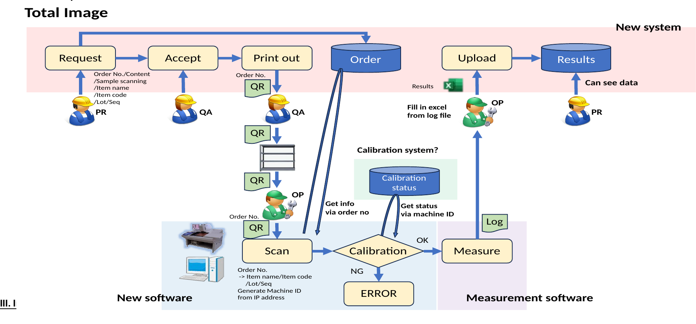
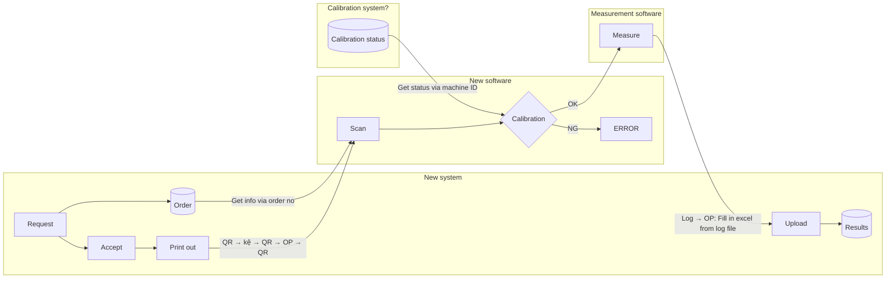
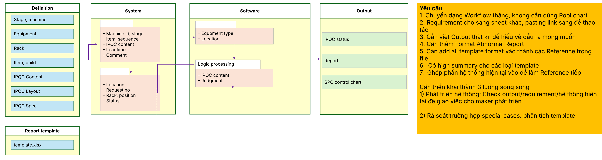
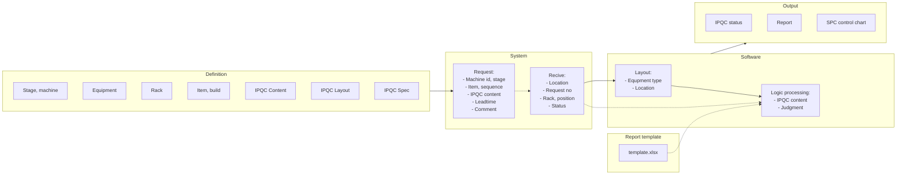
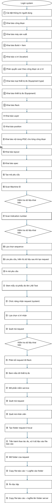

# 01. Concept — Khái niệm hệ thống LAB Test

> Nguồn: sheet `01. Concept` trong `LAB_Test_system_261013.xlsx`. Mục I–II chép nguyên văn từ ô Excel. Mục III–IV là sơ đồ vẽ bằng shape/ảnh: ảnh được render từ file gốc bằng LibreOffice, phần chữ bên dưới **chép lại từ hình và từ XML của shape**, không phải văn bản gốc; chỗ nào là diễn giải của người chuyển đổi đều được ghi rõ.

## I. Background

| Ô | Hiện tại | Ô | Vấn đề |
|---|---|---|---|
| B5 | Tiêu chuẩn IPQC khai báo trên Plus A | K5 | Không thân thiện, khó thao tác |
| B6 | QA Lab tự quản lí tiêu chuẩn dự vào tài liệu PE | K6 | Tiêu chuẩn phân tán / khó kiểm soát version |
| B7 | Tạo phiếu yêu cầu đo bằng giấy | K7 | Ghi chép thủ công, có thể xảy ra sai sót |
| B8 | QA Lab không theo dõi được yêu cầu nào sắp được đem lên phòng Lab để phân bổ nguồn lực | K8 | Khó planning nguồn lực |
| B9 | PR không follow tình trạng đo của các request | K9 | Mất thời gian để liên hệ, xác nhận |
| B10 | Kết quả đo IPQC được nhập thủ công trên WCS dực vào file kết quả đo từ QA Lab | K10 | Dễ sai sót, tốn thời gian |

## II. Output mong muốn

### PE Engineer <!-- B14 -->

1\. Khái báo các nội dung IPQC cho công đoạn phụ trách <!-- C15 -->\
2\. Khai báo số lượng mẫu hole cho 1 pcs <!-- C16 -->\
3\. Khai báo số lượng mẫu cho từng loại hàng NPI, MASS <!-- C17 -->\
4\. Khai báo loại thiết bị, khu vực đo IPQC <!-- C18 -->

### PE Leader <!-- B19 -->

1\. Theo dõi được số lượng Item name đã được khai báo IPQC theo từng công đoạn <!-- C20 -->\
2\. Theo dõi được số lượng Item code đã được khai báo IPQC theo từng công đoạn. (common/individual) <!-- C21 -->\
3\. Phân biệt được giữa Common (spec áp dụng theo Item name) và Individual (Spec áp dụng riêng cho Item code) <!-- C22 -->\
4\. Lọc, tìm kiếm, kiểm tra spec thuận tiện. <!-- C23 -->

### PE Operator <!-- B24 -->

1\. Khai báo Specification cho Item Name. Các Item Code thuộc Item Name đó sẽ tự động kế thừa Specification đã được cấu hình. <!-- C25 -->\
2\. Cho phép chỉnh sửa Specification riêng cho từng Item Code trong trường hợp Individual. <!-- C26 -->\
3\. Lọc và tìm kiếm các nội dung cần khai báo Specification. <!-- C27 -->

### PR Engineer/Leader <!-- B29 -->

1\. Theo dõi thời điểm hoàn thành đo IPQC của từng Lot để chủ động nhận hàng và chuyển sang công đoạn tiếp theo. <!-- C30 -->\
2\. Theo dõi số lượng Lot hoặc máy gặp sự cố tại từng công đoạn để báo cáo cấp trên và phối hợp xử lý, đảm bảo sản lượng xuất hàng. <!-- C31 -->\
3\. Xuất dữ liệu đo IPQC và kết hợp với thông tin 4M của Lot sản xuất để phục vụ điều tra, phân tích sự cố. <!-- C32 -->\
4\. Theo dõi số lượng Request IPQC đã tạo, đã chuyển đến LAB, đang được xử lý và đã hoàn thành. <!-- C33 -->\
5\.  Hiển thị biểu đồ kiểm soát SPC theo cấu trúc Machine ID → Item Name → Item Code. <!-- C34 -->

### PR Operator <!-- B35 -->

1\.Hiển thị trạng thái lấy mẫu của Lot và Machine ID, giúp xác định đối tượng đã được lấy mẫu kiểm tra hay chưa. <!-- C36 -->\
2\. Khi tạo Request lấy mẫu, hiển thị nội dung cần đo và số lượng mẫu cần cung cấp cho phòng LAB. <!-- C37 -->\
3\. Quét Machine ID để hiển thị thông tin liên quan và tình trạng lấy mẫu IPQC của máy. <!-- C38 -->\
4\. Quét Indication Number để hiển thị Item Name và Item Code tương ứng. <!-- C39 -->

### LAB test engineer <!-- B41 -->

1\. Khai báo và cấu hình Layout cho từng thiết bị đo. <!-- C42 -->\
2\. Khai báo Layout tương ứng với từng nội dung đo trên thiết bị, phục vụ việc xác định vị trí hoặc điểm đo. <!-- C43 -->

### LAB test leader <!-- B45 -->

1\. Theo dõi tổng số Request IPQC được tạo từ các công đoạn sản xuất. <!-- C46 -->\
2\. Theo dõi số lượng Request theo trạng thái: Received, In Progress, Completed và NG. <!-- C47 -->\
3\. Ghi nhận thời gian tiếp nhận Request và người tiếp nhận để phục vụ theo dõi, truy xuất lịch sử. <!-- C48 -->\
4\. Theo dõi được tổng số hole của tất cả các request <!-- C49 -->

## III. Image — Total Image

<!-- ảnh nhúng neo tại ô A52; file gốc image1.png (2500×1406 px) kèm bản SVG -->

Chép lại từ hình (không phải văn bản gốc). Hình có 3 vùng: **New system** (nền hồng), **New software** (nền xanh), **Measurement software** (nền tím), cùng một khối **Calibration system?** (nền xanh lá).

Chú thích chữ trên hình, theo thứ tự luồng:

| Vị trí trên hình | Chữ trên hình |
|---|---|
| Dưới **Request**, người dùng **PR** | Order No./Content /Sample scanning /Item name /Item code /Lot/Seq |
| Dưới **Accept** | QA |
| Dưới **Print out**, người dùng **QA** | Order No. — QR |
| Chuỗi bàn giao mẫu | QR → (biểu tượng kệ/rack) → QR → OP → QR "Order No." |
| Dưới **Scan** | Order No. -> Item name/Item code /Lot/Seq. Generate Machine ID from IP address |
| Mũi tên Order → Scan | Get info via order no |
| Mũi tên Calibration status → Calibration | Get status via machine ID |
| Nhánh của **Calibration** | OK → Measure; NG → ERROR |
| Giữa **Measure** và **Upload** | Log; OP "Fill in excel from log file"; biểu tượng Excel "Results" |
| Cạnh **Results**, người dùng **PR** | Can see data |

## IV. System structure

Chép lại từ hình và XML của shape. Tên các tab nhỏ (**Request**, **Recive**, **Layout**) có trong XML nhưng LibreOffice không hiển thị trên ảnh render; vị trí gán tab dưới đây là suy luận theo thứ tự shape trong XML.

Đường liền/đường nét đứt chép theo hình: Definition → System (liền); Request → Recive (nét đứt); Recive → Layout (liền); Layout → Logic processing (liền); Recive → Logic processing (nét đứt); template.xlsx → Logic processing (nét đứt); Software → Output (liền).

### Hộp "Yêu cầu" (shape màu cam cạnh sơ đồ)

Chép nguyên văn từ XML của shape. Dòng `3)` có trong XML nhưng bị khung hình che khi hiển thị trong Excel/LibreOffice.

> **Yêu cầu**\
> 1\. Chuyển dạng Workflow thẳng, không cần dùng Pool chart\
> 2\. Requirement cho sang sheet khác, pasting link sang đễ thao tác\
> 3\. Cần viết Output thật kĩ  để hiểu về đầu ra mong muốn\
> 4\. Cần thêm Format Abnormal Report\
> 5\. Cần add all template format vào thành các Reference trong file\
> 6\.  Có high summary cho các loại template\
> 7\.  Ghép phần hệ thống hiện tại vào để làm Reference tiếp
>
> Cần triển khai thành 3 luồng song song\
> 1) Phát triển hệ thống: Check output/requirement/hệ thống hiện tại để giao việc cho maker phát triển\
> 2) Rà soát trường hợp special cases: phân tích template\
> 3) Triển khai version mới 1-2 tuần/lần + document update để end user tham gia  vào quá trình phát triển và góp ý

## IV. Yêu cầu thiết kế phần mềm

> Trong file gốc, mục này cũng được đánh số "IV" (trùng với System structure). Giữ nguyên như nguồn.

### Workflow (flowchart vẽ bằng shape)

Chép lại theo thứ tự trên hình, chữ lấy từ XML của shape. Ba hình thoi "Kiểm tra dữ liệu khai báo" không ghi nhánh Có/Không trên hình.

0\. Login system\
① Cài đặt thông tin người dùng\
② Khai báo công đoạn\
③ Khai báo máy sản xuất\
④ Khai báo Build + Item\
⑤ Khai báo vị trí (location)\
⑥ Phân quyền user theo công đoạn và vị trí\
⑦ Khai báo loại thiết bị đo (Equipment type)\
⑧ Khai báo thiết bị đo (Equipment)\
⑨ Khai báo Rack\
⑩ Khai báo Layer\
⑪ Khai báo position\
⑫ Khai báo nội dung IPQC cho từng công đoạn\
⑬ Khai báo layout\
⑭ Khai báo spec\
⑮ Tạo mã yêu cầu\
⑯ Scan Machine ID\
◇ Kiểm tra dữ liệu khai báo\
⑰ Scan Indication number\
◇ Kiểm tra dữ liệu khai báo\
⑱ Lựa chọn sequence\
⑲ Lưa yêu cầu, hiển thị dữ liệu sau khi tạo request\
⑳ In mã yêu cầu\
㉑ Đem mẫu và phiếu đo lên LAB Test\
㉒ Chức năng nhận request (system)\
㉓ Lựa chọn vị trí nhận\
㉔ Quét mã request\
◇ Kiểm tra dữ liệu khai báo\
㉕ Phân bổ request tới Rack\
㉖ Đem mẫu tới thiết bị đo\
㉗ Mở phần mềm service\
㉘ Quét mã request\
㉙ Quét mã nhân viên\
㉚ Tạo folder request ở local\
㉛ Tiến hành thao tác đo, xử lí dữ liệu vào file báo cáo\
㉜ Mở folder của request\
㉝ Copy file báo cáo + Logfile vào folder\
㉞ Ấn đọc tệp\
㉟ Copy file báo cáo + logfile lên folder server

### Ảnh bảng requirement dán trong sheet Concept

Sheet Concept có một ảnh (định dạng EMF) chụp bảng "Thứ tự | Chức năng | Đối tượng sử dụng | Requirement", đặt bên phải flowchart. Ảnh dưới đây là bản render của ảnh đó. **Chưa đối chiếu** ảnh này với sheet `02. Requirement` ([02-requirements.md](02-requirements.md)); nếu có khác biệt, cần hỏi chủ tài liệu bản nào là bản hiện hành.

[Mở ảnh bảng requirement (ảnh dài, 1647×8253 px)](assets/01-concept/requirement-table-image.png)
