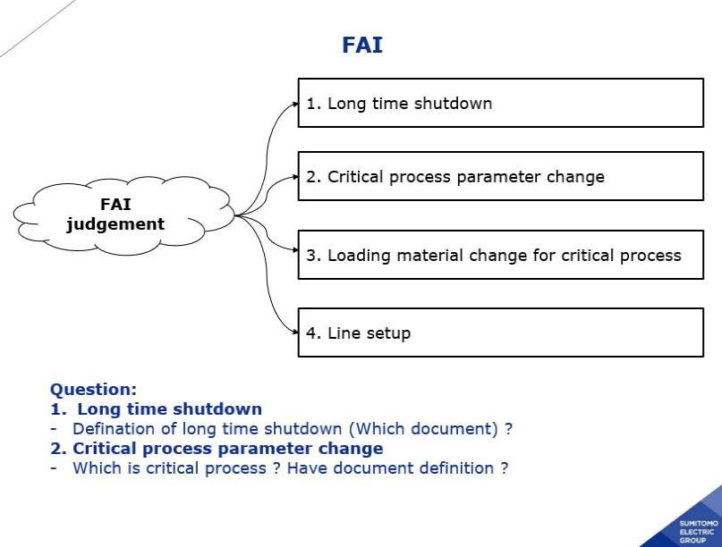
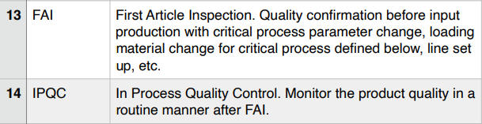

# Customer rule

> Nguồn: sheet `Customer rule` trong `LAB_Test_system_261013.xlsx`. Chuyển đổi tự động, giữ nguyên câu chữ gốc. Cột `Row` và tên cột (A, B, ...) là tọa độ ô trong Excel.

<!-- ảnh neo tại ô E2 -->

<!-- ảnh neo tại ô S3 -->
