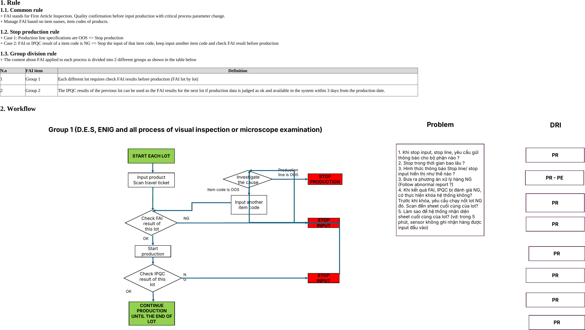
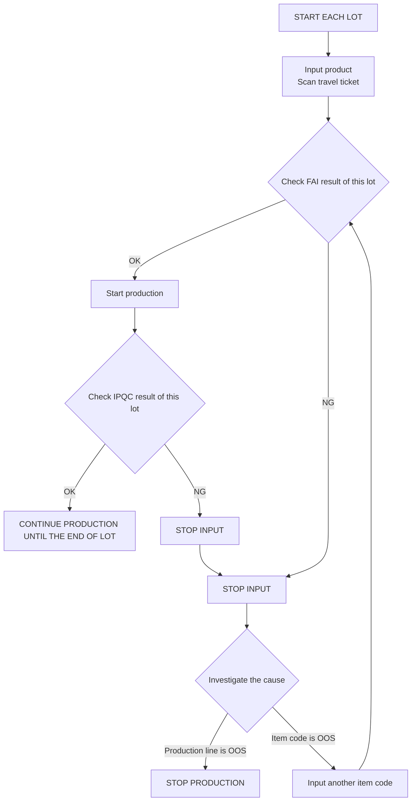

# Group 1 — FAI (First Article Inspection), nhóm 1

> Nguồn: sheet `Group 1` trong `LAB_Test_system_261013.xlsx`. Mục 1 chép nguyên văn từ ô Excel. Mục 2 là flowchart vẽ bằng shape: ảnh render từ file gốc bằng LibreOffice, phần chữ bên dưới **chép lại từ hình và XML của shape**, không phải văn bản gốc.

## 1. Rule <!-- C4 -->

### 1.1. Common rule <!-- C5 -->

\+ FAI stands for First Article Inspection. Quality confirmation before input production with critical process parameter change. <!-- C6 -->\
\+ Manage FAI based on item names, item codes of products. <!-- C7 -->

### 1.2. Stop production rule <!-- C9 -->

\+ Case 1: Production line specifications are OOS => Stop production <!-- C10 -->\
\+ Case 2: FAI or IPQC result of a item code is NG => Stop the input of that item code, keep input another item code and check FAI result before production <!-- C11 -->

### 1.3. Group division rule <!-- C13 -->

\+ The content about FAI applied to each process is divided into 2 different groups as shown in the table below <!-- C14 -->

| Row | C: N.o | D: FAI item | E: Definition |
|---|---|---|---|
| 17 | 1 | Group 1 | Each different lot requires check FAI results before production (FAI lot by lot) |
| 18 | 2 | Group 2 | The IPQC results of the previous lot can be used as the FAI results for the next lot if production data is judged as ok and available in the system within 3 days from the production date. |

## 2. Workflow <!-- C21 -->

Tiêu đề trên hình: **Group 1 (D.E.S, ENIG and all process of visual inspection or microscope examination)**

Nhánh `S2 → S1` và `S1 → Investigate the cause` chép theo đường nối trên hình: đường từ hộp STOP INPUT thứ hai nối lên hộp STOP INPUT thứ nhất, rồi đi lên hình thoi "Investigate the cause".

### Problem (hộp ghi chú trên hình)

Chép nguyên văn từ XML của shape, giữ cả số thứ tự bị lặp như trong nguồn:

1\. Khi stop input, stop line, yêu cầu gửi thông báo cho bộ phận nào ?\
2\. Stop trong thời gian bao lâu ?\
3\. Hình thức thông báo Stop line/ stop input hiển thị như thế nào ?\
3\. Đưa ra phương án xử lý hàng NG (Follow abnormal report ?)\
4\. Khi kết quả FAI, IPQC bị đánh giá NG, có thực hiện khóa hệ thống không? Trước khi khóa, yêu cầu chạy nốt lot NG đó. Scan đến sheet cuối cùng của lot?\
5\. Làm sao để hệ thống nhận diện sheet cuối cùng của lot? (vd: trong 5 phút, sensor không ghi nhận hàng được input đầu vào)

### DRI (cột bên phải hình)

Cột **DRI** có 8 hộp, từ trên xuống theo vị trí trên hình: PR, PR - PE, PR, PR, PR, PR, PR, PR. Trong file không có liên kết nào chỉ rõ hộp DRI nào ứng với bước nào của flowchart.
