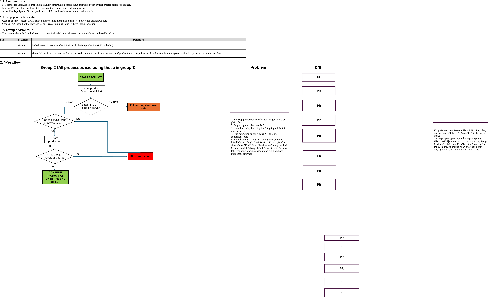
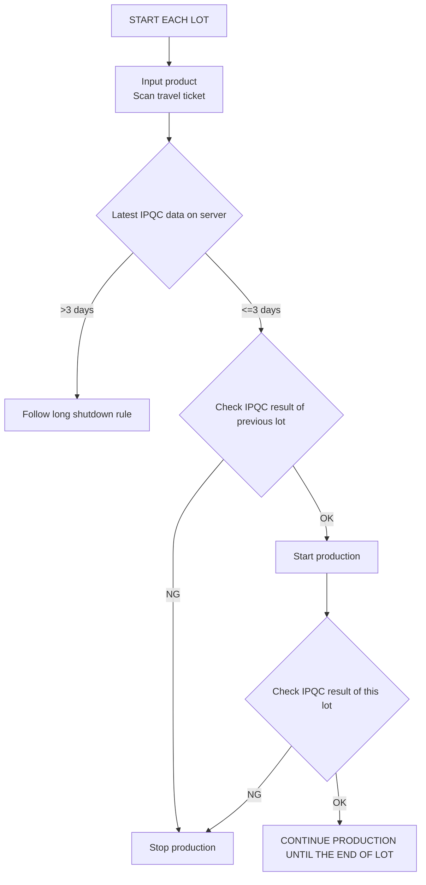

# Group 2 — FAI (First Article Inspection), nhóm 2

> Nguồn: sheet `Group 2` trong `LAB_Test_system_261013.xlsx`. Mục 1 chép nguyên văn từ ô Excel. Mục 2 là flowchart vẽ bằng shape: ảnh render từ file gốc bằng LibreOffice, phần chữ bên dưới **chép lại từ hình và XML của shape**, không phải văn bản gốc.

## 1. Rule <!-- C3 -->

### 1.1. Common rule <!-- C4 -->

\+ FAI stands for First Article Inspection. Quality confirmation before input production with critical process parameter change. <!-- C5 -->\
\+ Manage FAI based on machine status, not on item names, item codes of products. <!-- C6 -->\
\+ A machine is judged as OK for production if FAI results of that lot on the machine is OK. <!-- C7 -->

### 1.2. Stop production rule <!-- C9 -->

\+ Case 1: The most recent IPQC data on the system is more than 3 days  => Follow long shutdown rule <!-- C10 -->\
\+ Case 2: IPQC result of the previous lot or IPQC of running lot is OOS => Stop production <!-- C11 -->

### 1.3. Group division rule <!-- C13 -->

\+ The content about FAI applied to each process is divided into 2 different groups as shown in the table below <!-- C14 -->

| Row | C: N.o | D: FAI item | E: Definition |
|---|---|---|---|
| 17 | 1 | Group 1 | Each different lot requires check FAI results before production (FAI lot by lot) |
| 18 | 2 | Group 2 | The IPQC results of the previous lot can be used as the FAI results for the next lot if production data is judged as ok and available in the system within 3 days from the production date. |

## 2. Workflow <!-- C20 -->

Tiêu đề trên hình: **Group 2 (All processes excluding those in group 1)**

### Problem (hộp ghi chú trên hình)

Chép nguyên văn từ XML của shape:

1\. Khi stop production yêu cầu gửi thông báo cho bộ phận nào ?\
2\. Stop trong thời gian bao lâu ?\
3\. Hình thức thông báo Stop line/ stop input hiển thị như thế nào ?\
4\. Đưa ra phương án xử lý hàng NG (Follow abnormal report ?)\
5\. Khi kết quả FAI, IPQC bị đánh giá NG, có thực hiện khóa hệ thống không? Trước khi khóa, yêu cầu chạy nốt lot NG đó. Scan đến sheet cuối cùng của lot?\
6\. Làm sao để hệ thống nhận diện sheet cuối cùng của lot? (vd: trong 5 phút, sensor không ghi nhận hàng được input đầu vào)

### Ghi chú bên phải hình

Chép nguyên văn từ XML của shape:

> Khi phát hiện trên Server thiếu dữ liệu chạy hàng của lot sản xuất thực tế gần nhất có 2 phương án xử lý:\
> 1\. Cho phép nhập dữ liệu bổ sung song song kiểm tra dữ liệu thô trước khi xác nhận chạy hàng\
> 2\. Yêu cầu nhập đầy đủ dữ liệu lên Server, kiểm tra dữ liệu trước khi xác nhận chạy hàng. Cần quy định thời gian cho phép nhập bổ sung

### DRI (cột bên phải hình)

Cột **DRI** gồm 8 hộp "PR" ngang hàng với flowchart, cộng thêm 6 hộp "PR" nằm riêng phía dưới, xa flowchart. Trong file không có liên kết nào chỉ rõ hộp DRI nào ứng với bước nào.
