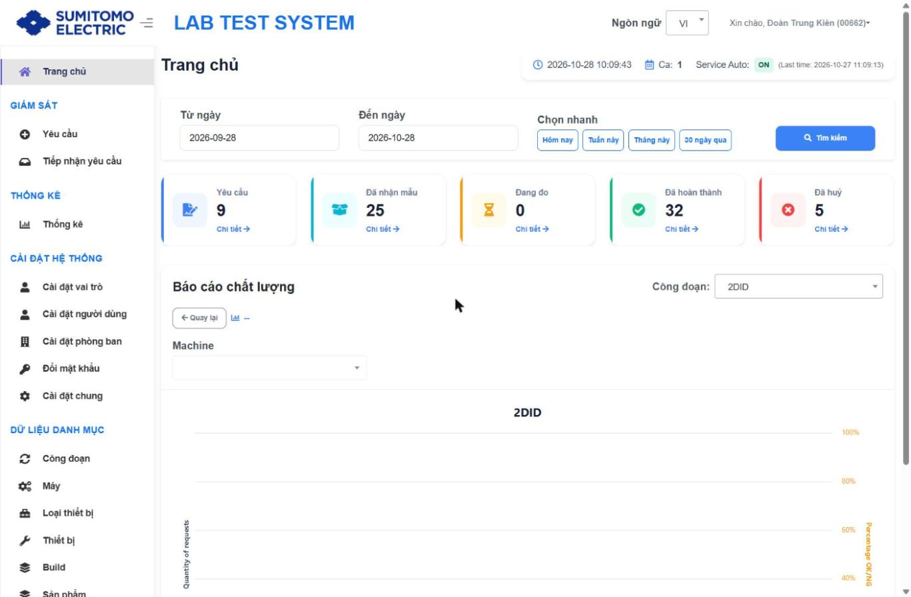
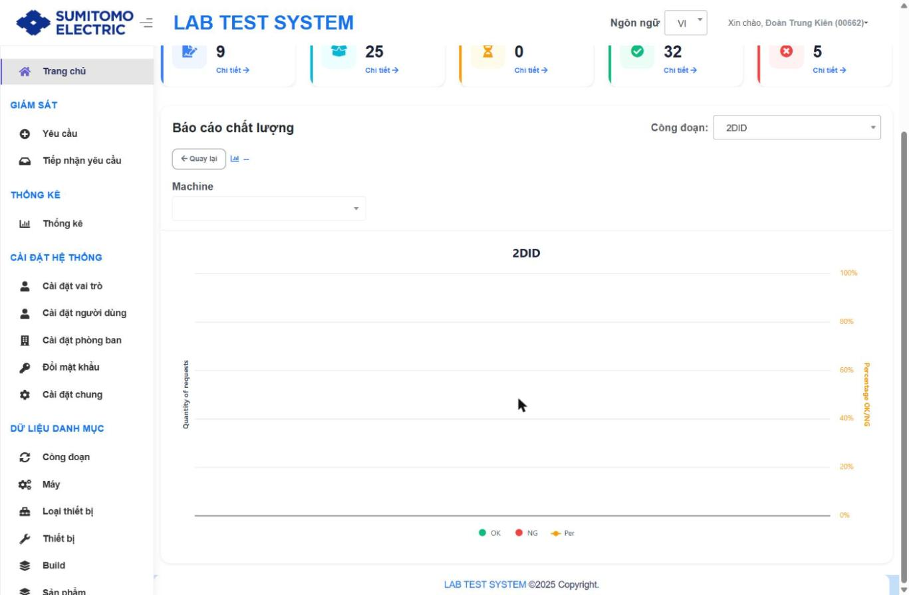

# Đăng nhập & Trang chủ

## Mục đích
Tổng quan số lượng yêu cầu theo trạng thái trong khoảng thời gian, tình trạng Service tự động, và báo cáo chất lượng OK/NG theo Công đoạn → Máy → Item.

## Đăng nhập `[Từ tài liệu cũ]`
| Bước | Thao tác | Kết quả |
|---|---|---|
| 1 | Truy cập `http://10.212.9.242:8082`, nhập tài khoản (Mã nhân viên) và mật khẩu được cấp | Vào màn Trang chủ |
| 2 | Nếu mật khẩu hết hạn / vừa bị admin reset (khi bật tuỳ chọn tại Cài đặt chung) | Hệ thống yêu cầu đổi mật khẩu `[Suy luận]` |

## Thành phần màn hình

| Khu vực | Thành phần | Ghi chú |
|---|---|---|
| Thanh trạng thái (góc phải) | Đồng hồ hệ thống, **Ca** (ca làm việc hiện tại), **Service Auto: ON/OFF** + "(Last time: yyyy-mm-dd hh:mm:ss)" | Mới. Cho biết Service tự động còn hoạt động không |
| Bộ lọc | Từ ngày, Đến ngày (mặc định 30 ngày gần nhất), Chọn nhanh: Hôm nay / Tuần này / Tháng này / 30 ngày qua; nút Tìm kiếm | |
| Thẻ KPI | Yêu cầu · Đã nhận mẫu · Đang đo · Đã hoàn thành · Đã huỷ | Mới. Mỗi thẻ có link **Chi tiết →** mở màn `/request` lọc sẵn theo trạng thái |
| Báo cáo chất lượng | Dropdown **Công đoạn**, nút **← Quay lại**, breadcrumb (icon biểu đồ), dropdown **Machine**; biểu đồ cột OK/NG (trục trái: Quantity of requests) + đường **Per** (trục phải: Percentage OK/NG) | Thay cho biểu đồ Stage/Machine cũ |

## Thao tác
| Bước | Mục đích | Thao tác | Kết quả mong đợi |
|---|---|---|---|
| 1 | Lọc theo thời gian | Chọn Từ ngày/Đến ngày hoặc nút Chọn nhanh → **Tìm kiếm** | Thẻ KPI và biểu đồ cập nhật theo khoảng ngày |
| 2 | Xem danh sách theo trạng thái | Nhấn **Chi tiết →** trên thẻ KPI | Mở màn Yêu cầu với bộ lọc Trạng thái tương ứng |
| 3 | Xem chất lượng theo công đoạn | Chọn **Công đoạn** | Biểu đồ OK/NG theo Machine của công đoạn |
| 4 | Drill-down | Nhấn cột Machine → ItemName → ItemCode → IPQC Content `[Từ tài liệu cũ, cơ chế drill-down vẫn còn: có các bộ lọc ẩn Machine/ItemName/ItemCode]` | Mức cuối hiển thị Lot No, Value, Spec |
| 5 | Quay lại mức trước | Nhấn **← Quay lại** | Về cấp drill-down trước |

## Thay đổi so với xlsx
- Thêm thanh trạng thái Ca / Service Auto.
- Thêm 5 thẻ KPI có liên kết sang màn Yêu cầu.
- Biểu đồ đổi thành "Báo cáo chất lượng" OK/NG + % (thay Stage/Machine multi-select).
- Mặc định 30 ngày; bỏ lựa chọn nhiều Stage cùng lúc (chỉ 1 Công đoạn).
