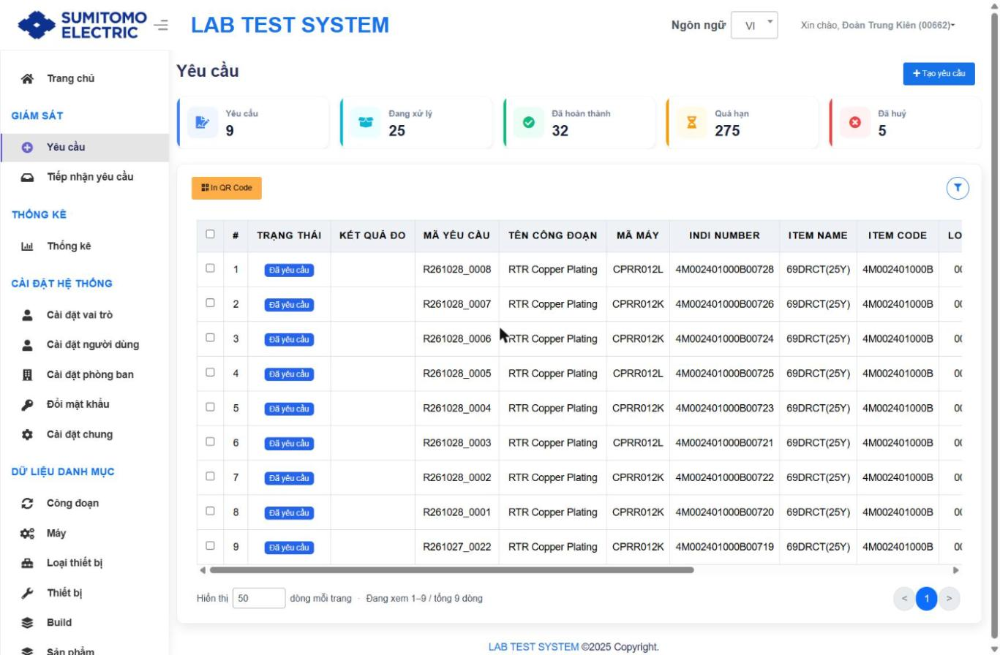
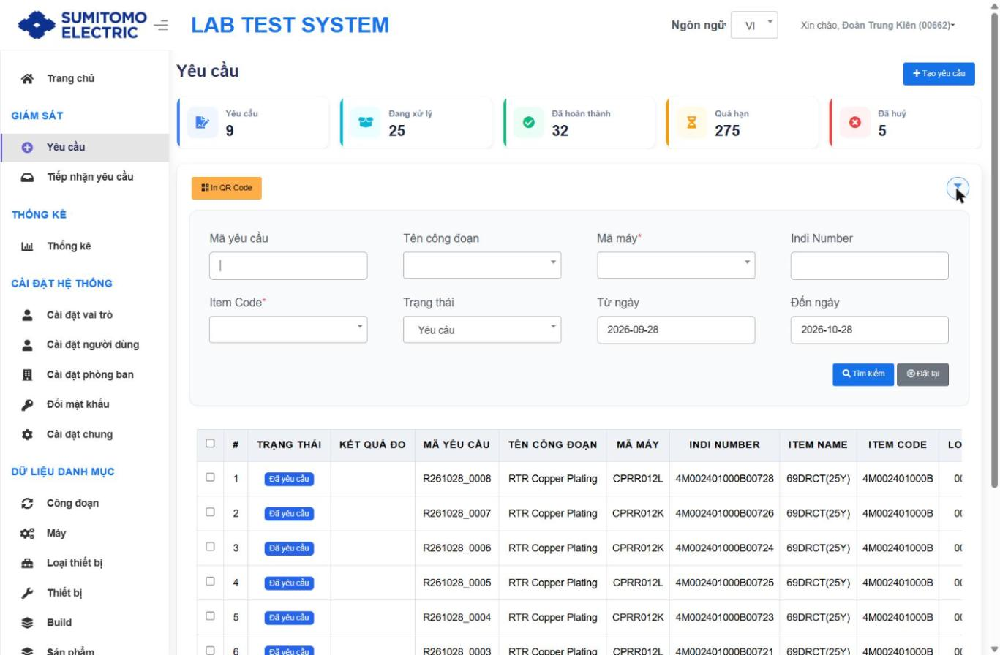
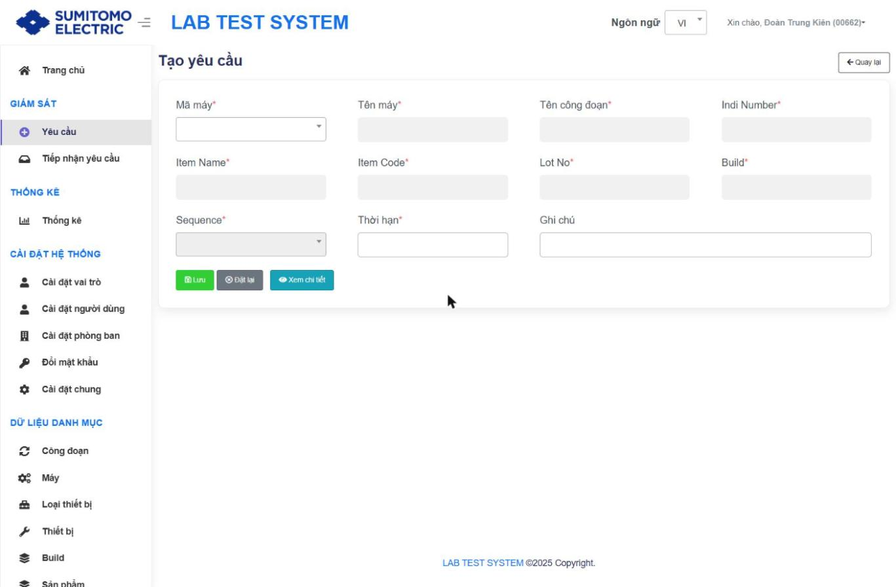
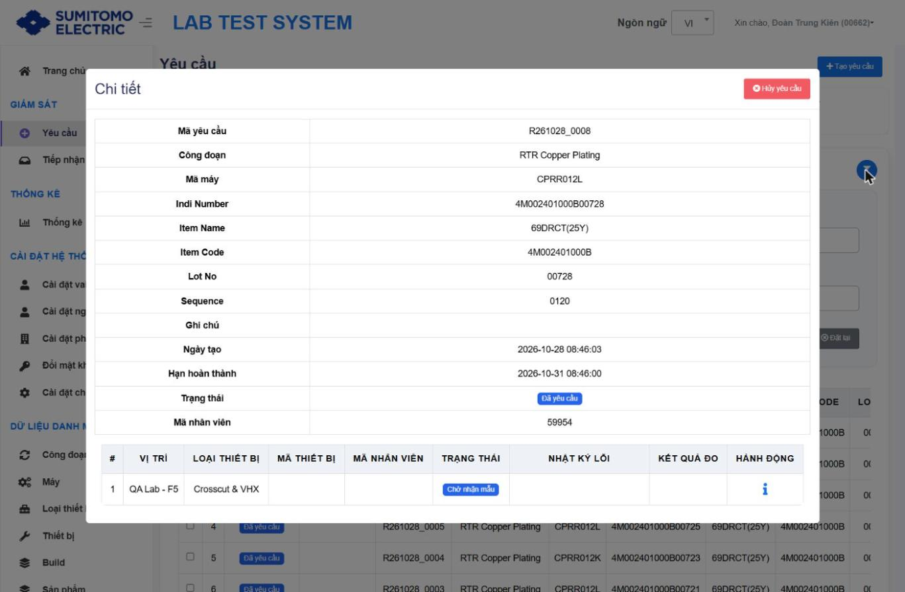
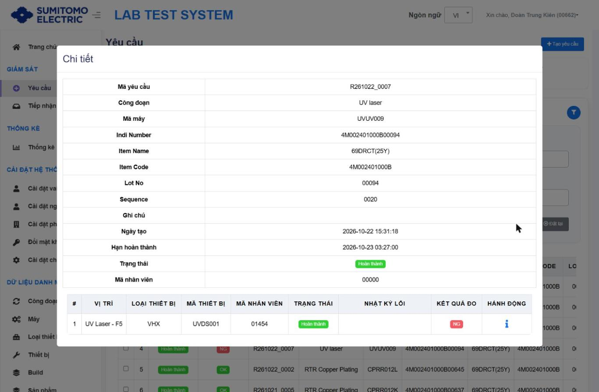

# Quản lý Yêu cầu đo (Request)

## Mục đích
Công đoạn tạo yêu cầu đo mẫu IPQC, in QR dán kèm mẫu, theo dõi trạng thái và kết quả.

## Quy tắc mã
**Request No** tự sinh: `RYYMMDD_XXXX` (YY năm, MM tháng, DD ngày, XXXX số thứ tự trong ngày). Ví dụ: request thứ 12 ngày 01/07/2026 → `R260701_0012`.

## 1. Màn danh sách `/request`

| Khu vực | Thành phần |
|---|---|
| Thẻ KPI (mới) | Yêu cầu · Đang xử lý · Đã hoàn thành · Quá hạn · Đã huỷ |
| Nút | `+ Tạo yêu cầu` (góc phải), `In QR Code`, icon phễu (bộ lọc) |
| Bảng | ☐ · # · TRẠNG THÁI · **KẾT QUẢ ĐO** (OK/NG, mới) · MÃ YÊU CẦU · TÊN CÔNG ĐOẠN · MÃ MÁY · INDI NUMBER · ITEM NAME · ITEM CODE · LOT NO · SEQUENCE · NGÀY TẠO · THỜI HẠN · HÀNH ĐỘNG (ℹ Chi tiết) |
| Phân trang | 10/25/50/75/100 dòng |

### Bộ lọc

| Trường | Loại | Ghi chú |
|---|---|---|
| Mã yêu cầu | text | |
| Tên công đoạn | select | |
| Mã máy | select | Nhãn có dấu `*` nhưng là bộ lọc `[Chưa xác minh có bắt buộc]` |
| Indi Number | text | |
| Item Code | select | Nhãn có dấu `*` |
| Trạng thái | select | Yêu cầu · Đang xử lý · Đã hoàn thành · Đã huỷ · Quá hạn |
| Từ ngày / Đến ngày | date | Mặc định 30 ngày gần nhất (tài liệu cũ ghi 7 ngày) |
| Nút | Tìm kiếm · Đặt lại | |

## 2. Tạo yêu cầu `/request/add`

| Trường | Bắt buộc | Nhập/Auto | Nguồn dữ liệu |
|---|---|---|---|
| Mã máy | ✔ | Chọn/Scan (select có tìm kiếm) | Danh mục Máy |
| Tên máy | ✔ | Auto (khoá) | Theo Mã máy |
| Tên công đoạn | ✔ | Auto (khoá) | Theo Mã máy |
| Indi Number | ✔ | Scan (mở khi đã chọn máy) | Tem Indication |
| Item Name | ✔ | Auto | Check từ Item Code (danh mục Item) |
| Item Code | ✔ | Auto | Cắt từ Indi Number |
| Lot No | ✔ | Auto | Cắt từ Indi Number |
| Build | ✔ | Auto | Theo Item Code (danh mục Item) |
| Sequence | ✔ | Chọn (mở sau khi có Item Code) | Spec đã khai báo cho Stage + Item Code |
| Thời hạn | ✔ | Auto, hiển thị ô nhập | Thời điểm chọn Sequence + Leadtime (phút) của Spec `[Từ tài liệu cũ]` |
| Ghi chú | | Nhập | |

Nút: **Lưu** · **Đặt lại** · **Xem chi tiết** (xem nội dung đo & tiêu chuẩn của Stage + Item Code + Sequence) · **Quay lại**.

### Các bước
| Bước | Thao tác | Kết quả mong đợi | Kiểm tra |
|---|---|---|---|
| 1 | Nhấn `+ Tạo yêu cầu` | Mở form Tạo yêu cầu | URL `/request/add` |
| 2 | Chọn/Scan **Mã máy** | Tên máy, Tên công đoạn tự điền | |
| 3 | Scan **Indi Number** | Item Name/Code, Lot No, Build tự điền | Build trống → kiểm tra danh mục Item |
| 4 | Chọn **Sequence** | Hệ thống lấy: Stage → nội dung đo/thiết bị/vị trí; Stage+ItemCode+Sequence → Spec/Leadtime; tính Thời hạn | Danh sách Sequence trống → chưa khai báo Spec cho Item Code |
| 5 | (Tuỳ chọn) Nhấn **Xem chi tiết** | Hiển thị nội dung đo & spec | |
| 6 | Nhập Ghi chú (nếu có) → **Lưu** | Request tạo ở trạng thái **Đã yêu cầu** | Xuất hiện đầu danh sách |

**Rule `[Từ tài liệu cũ]`:** Trùng **Stage + Indi Number + Sequence** với request chưa huỷ → hệ thống chặn tạo.

## 3. In QR Code `[Từ tài liệu cũ]`
1. Tích ☐ các request cần in → 2. Nhấn **In QR Code** → 3. Hộp thoại in của trình duyệt (Firefox/Edge) → 4. **Print** trên máy kết nối máy in QR, hoặc **Cancel** để chọn lại.

## 4. Chi tiết & trạng thái
Nhấn ℹ ở cột HÀNH ĐỘNG → modal **Chi tiết**.

- Thông tin chung: Mã yêu cầu, Công đoạn, Mã máy, Indi Number, Item Name, Item Code, Lot No, Sequence, Ghi chú, Ngày tạo, Hạn hoàn thành, Trạng thái, **Mã nhân viên** (người tạo, mới).
- Bảng con (1 dòng = 1 Vị trí + 1 Loại thiết bị): # · VỊ TRÍ · LOẠI THIẾT BỊ · MÃ THIẾT BỊ · MÃ NHÂN VIÊN · TRẠNG THÁI · NHẬT KÝ LỖI · KẾT QUẢ ĐO · HÀNH ĐỘNG (ℹ → màn Chi tiết nội dung yêu cầu).
- Nút **Hủy yêu cầu** (chỉ hiện khi request chưa nhận mẫu / quá hạn). ⚠ Không hoàn tác.
- Đóng modal: nhấn ra ngoài hộp thoại.

| Trạng thái (request) | Trạng thái dòng chi tiết | Ý nghĩa |
|---|---|---|
| Đã yêu cầu (Requested) | Chờ nhận mẫu | Mới tạo, chưa Location nào nhận mẫu; được Huỷ |
| Đang xử lý | Đã nhận mẫu (Received) | Đã nhận mẫu tại Location, chưa đo |
| Đang xử lý | Đang đo (Measuring) | Service đã scan; hiển thị Mã thiết bị, Mã nhân viên, Nhật ký lỗi nếu đọc file lỗi |
| Hoàn thành / Đã hoàn thành | Hoàn thành | Có kết quả; KẾT QUẢ ĐO = OK/NG |
| Quá hạn (Delayed) | — | Thời điểm hiện tại > Thời hạn; có thể Huỷ |
| Đã huỷ | — | Đã huỷ |

## Thay đổi so với xlsx
- Thêm thẻ KPI; cột KẾT QUẢ ĐO; trạng thái "Quá hạn" thành bộ lọc riêng; mặc định 30 ngày.
- Form tạo: trường bắt buộc có `*`, các trường auto bị khoá; nhãn "Thời hạn".
- Modal chi tiết thêm Mã nhân viên.
