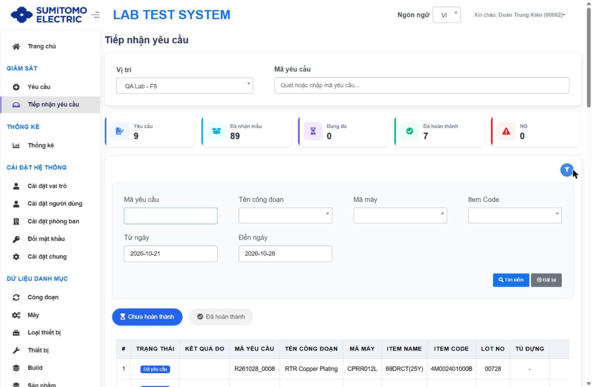
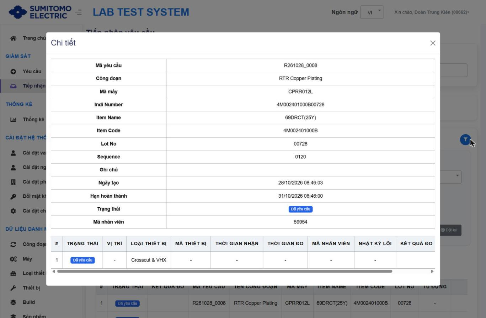

# Tiếp nhận mẫu tại vị trí đo

## Mục đích
Phòng đo xác nhận đã nhận mẫu của request (scan QR), hệ thống phân bổ Tủ/Vị trí chứa mẫu.

## Thành phần màn hình

| Khu vực | Thành phần |
|---|---|
| Đầu trang | **Vị trí** (Location: QA Lab - F1, Đo mạch - F1, Smart Factory - F1, Coverlay - F1, QA Lab - F5, UV Laser - F5) · **Mã yêu cầu** (ô "Quét hoặc nhập mã yêu cầu…") |
| Thẻ KPI theo Vị trí (mới) | Yêu cầu · Đã nhận mẫu · Đang đo · Đã hoàn thành · **NG** |
| Tab | Chưa hoàn thành · Đã hoàn thành |
| Bộ lọc (phễu) | Mã yêu cầu, Tên công đoạn, Mã máy, Item Code, Từ ngày, Đến ngày (mặc định 7 ngày); Tìm kiếm, Đặt lại |
| Bảng | # · TRẠNG THÁI · KẾT QUẢ ĐO · MÃ YÊU CẦU · TÊN CÔNG ĐOẠN · MÃ MÁY · ITEM NAME · ITEM CODE · LOT NO · **TỦ ĐỰNG** · **VỊ TRÍ** · THỜI HẠN · HÀNH ĐỘNG (Chi tiết) |

## Thao tác nhận mẫu `[Bước 3–5 từ tài liệu cũ – không thực hiện khi rà soát]`
| Bước | Thao tác | Kết quả mong đợi | Kiểm tra |
|---|---|---|---|
| 1 | Chọn **Vị trí** đang thao tác | Thẻ KPI & bảng hiển thị theo vị trí | Chưa chọn vị trí → bảng trống |
| 2 | Đặt con trỏ ở ô **Mã yêu cầu**, scan QR request | Hộp thoại xác nhận | |
| 3 | Nhấn **YES** để xác nhận | ⚠ Không hoàn tác. Thông báo: request đã nhận; trạng thái Requested → Received; Tủ (Rack) và Vị trí (Position) được phân bổ | Đặt mẫu đúng vị trí được thông báo |
| 3b | Nhấn **Cancel** | Đóng hộp thoại, không nhận | |

## Xem chi tiết
Nhấn **Chi tiết** → modal gồm thông tin request và bảng con: # · TRẠNG THÁI · VỊ TRÍ · LOẠI THIẾT BỊ · MÃ THIẾT BỊ · **THỜI GIAN NHẬN** · **THỜI GIAN ĐO** · MÃ NHÂN VIÊN · NHẬT KÝ LỖI · KẾT QUẢ ĐO · HÀNH ĐỘNG (→ Chi tiết nội dung yêu cầu). Đóng bằng nút X.

## Ghi chú
- Trong DOM có nút ẩn "Save Selected" `[Chưa xác minh – có thể là nhận nhiều request cùng lúc]`.
- Location chỉ xuất hiện ở đây nếu được bật "Nhận mẫu" trong danh mục Vị trí `[Suy luận]`.

## Thay đổi so với xlsx
Thêm thẻ KPI theo vị trí (có NG), cột Tủ đựng/Vị trí, Thời gian nhận/đo trong chi tiết; nhãn tiếng Việt.
