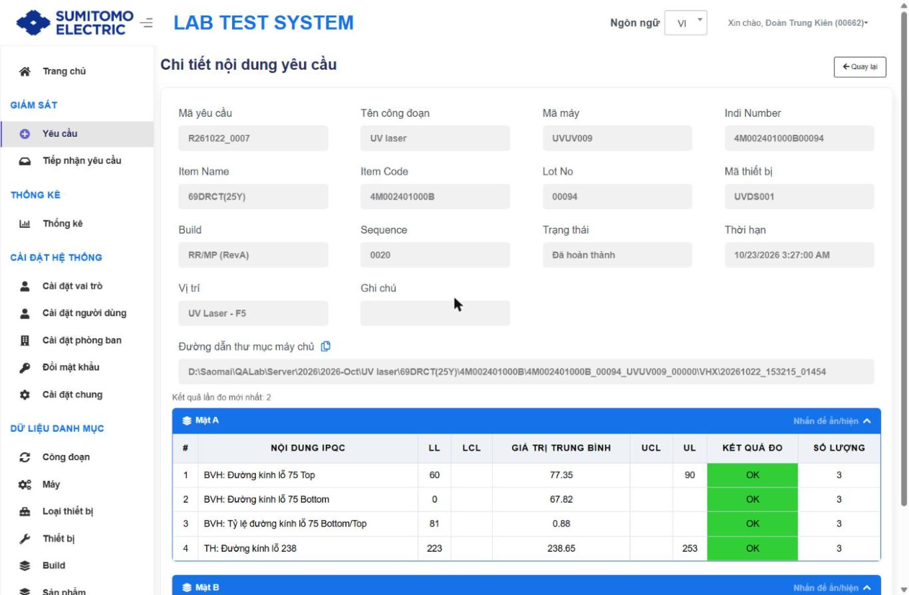
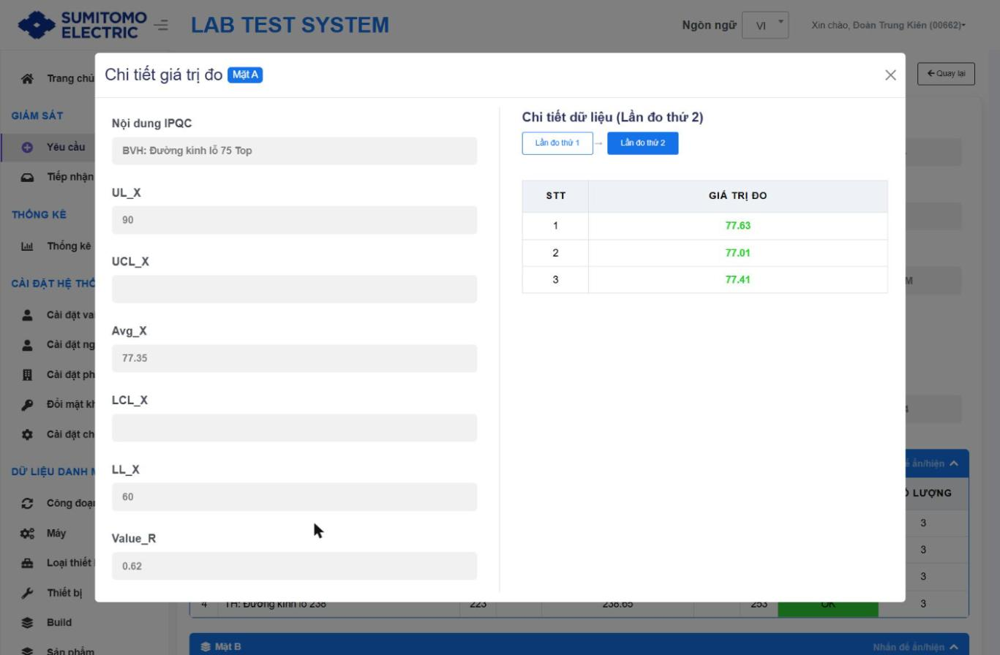

# Chi tiết nội dung yêu cầu & giá trị đo

## Cách truy cập
1. Màn **Yêu cầu** → ℹ ở dòng request → modal Chi tiết → ℹ ở dòng Vị trí/Loại thiết bị.
2. Màn **Tiếp nhận yêu cầu** → chọn Vị trí → **Chi tiết** → ℹ ở bảng con.

## Thành phần màn hình

| Khu vực | Nội dung |
|---|---|
| Thông tin chung (chỉ đọc) | Mã yêu cầu, Tên công đoạn, Mã máy, Indi Number, Item Name, Item Code, Lot No, **Mã thiết bị**, Build, Sequence, Trạng thái, Thời hạn, **Vị trí** (mới), Ghi chú |
| Đường dẫn thư mục máy chủ | Thư mục lưu kết quả lần đo cuối trên Server + icon copy. Trống khi trạng thái Đã yêu cầu/Đã nhận mẫu |
| "Kết quả lần đo mới nhất: N" | Mới – số lần đo gần nhất |
| Bảng **Mặt A** / **Mặt B** (thu gọn được – "Nhấn để ẩn/hiện") | # · NỘI DUNG IPQC · LL · LCL · GIÁ TRỊ TRUNG BÌNH · UCL · UL · KẾT QUẢ ĐO (OK xanh/NG đỏ) · **SỐ LƯỢNG** (mới) |
| Nút | Quay lại |

## Xem giá trị đo
Nhấn một dòng Nội dung IPQC → modal **Chi tiết giá trị đo [Mặt A/B]**:

- Trái: Nội dung IPQC, UL_X, UCL_X, Avg_X, LCL_X, LL_X, Value_R.
- Phải: "Chi tiết dữ liệu (Lần đo thứ N)", nút chuyển **Lần đo thứ 1 → Lần đo thứ 2…**; bảng STT · GIÁ TRỊ ĐO (xanh = trong spec).
- Chưa đo lần nào → bảng trống. Đóng bằng X.

## Rule
- Avg_X = trung bình các giá trị đo của nội dung; phán định theo X Spec (LL/LCL/CENTER/UCL/UL) và R Spec `[Suy luận từ nhãn]`.
- Dòng có **Công thức** (Cấu hình IPQC) được tính từ dòng khác, vd Tỷ lệ = #2/#1.

## Lưu ý phát hiện
Request R261022_0007 (UV laser): dòng "BVH: Tỷ lệ đường kính lỗ 75 Bottom/Top" hiển thị **LL = 81**, trong khi Spec hiện tại là **LL = 0.81** → xem `98_Findings.md` (F-01).

## Thay đổi so với xlsx
Thêm Vị trí, "Kết quả lần đo mới nhất", cột Số lượng; modal giá trị đo hiển thị đủ UL/UCL/Avg/LCL/LL/Value_R và chuyển lần đo bằng nút.
