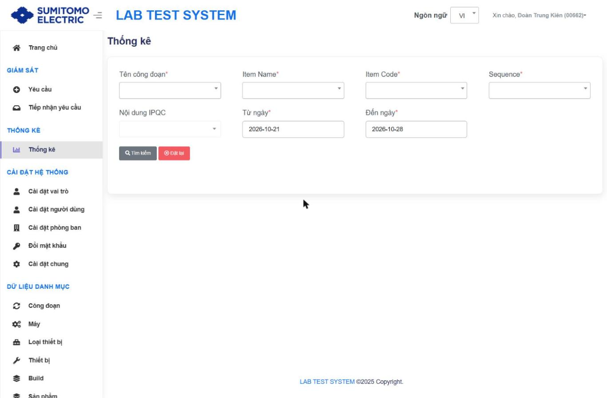
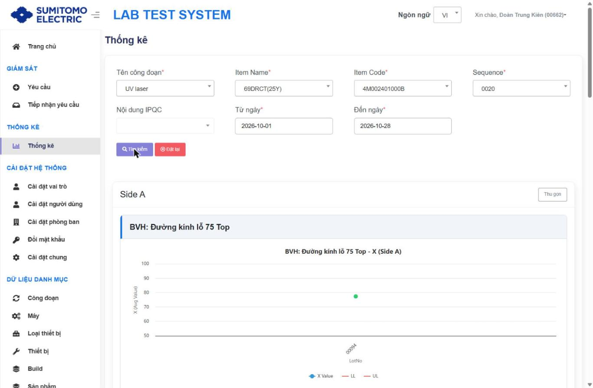

# Thống kê – Biểu đồ kiểm soát X/R

## Mục đích
Xem xu hướng giá trị đo theo Lot cho một Công đoạn + Item + Sequence, dạng biểu đồ X (giá trị trung bình) và R (biên độ) cho từng nội dung IPQC, từng mặt.

## Bộ lọc

| Trường | Bắt buộc | Ghi chú |
|---|---|---|
| Tên công đoạn | ✔ | |
| Item Name | ✔ | Lọc theo công đoạn |
| Item Code | ✔ | Lọc theo Item Name |
| Sequence | ✔ | Lọc theo Item Code (Spec đã khai báo) |
| Nội dung IPQC | | Danh sách nội dung của Sequence; bỏ trống = tất cả |
| Từ ngày / Đến ngày | ✔ | Mặc định 7 ngày |

Nút: **Tìm kiếm**, **Đặt lại**.

## Các bước
| Bước | Thao tác | Kết quả mong đợi |
|---|---|---|
| 1 | Chọn lần lượt Công đoạn → Item Name → Item Code → Sequence | Các dropdown sau được nạp dữ liệu |
| 2 | (Tuỳ chọn) chọn Nội dung IPQC; chỉnh khoảng ngày | |
| 3 | **Tìm kiếm** | Panel **Side A** / **Side B** (nút Thu gọn); mỗi nội dung IPQC 1 thẻ gồm 2 biểu đồ |

## Biểu đồ
- `<Nội dung> - X (Side A)`: trục Y "X (Avg Value)", trục X "LotNo"; series **X Value**, **LL**, **UL** (và LCL/UCL nếu có).
- `<Nội dung> - R (Side A)`: biểu đồ R tương ứng.
- Không có dữ liệu trong khoảng ngày → biểu đồ trống.
