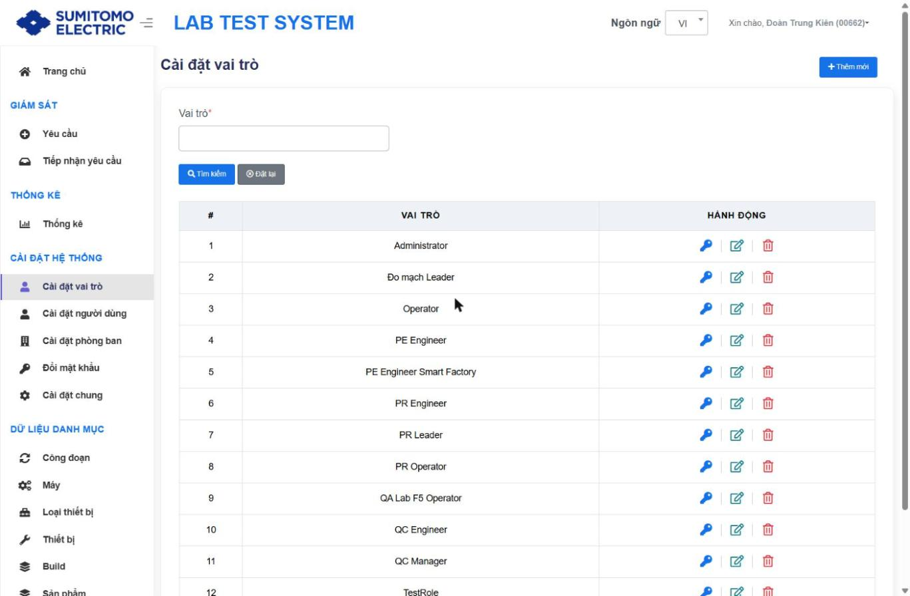
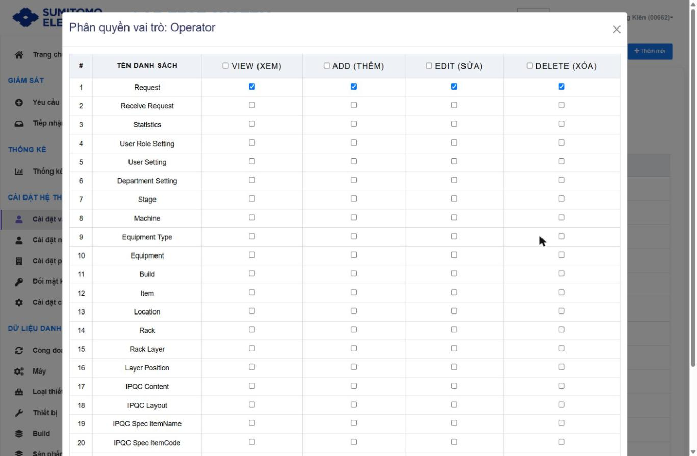
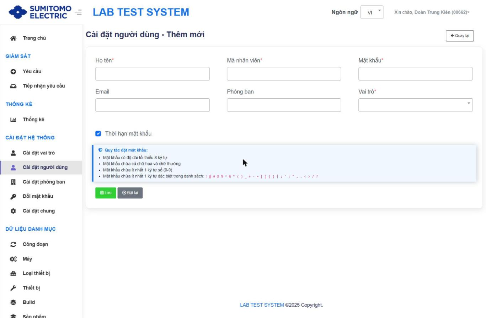
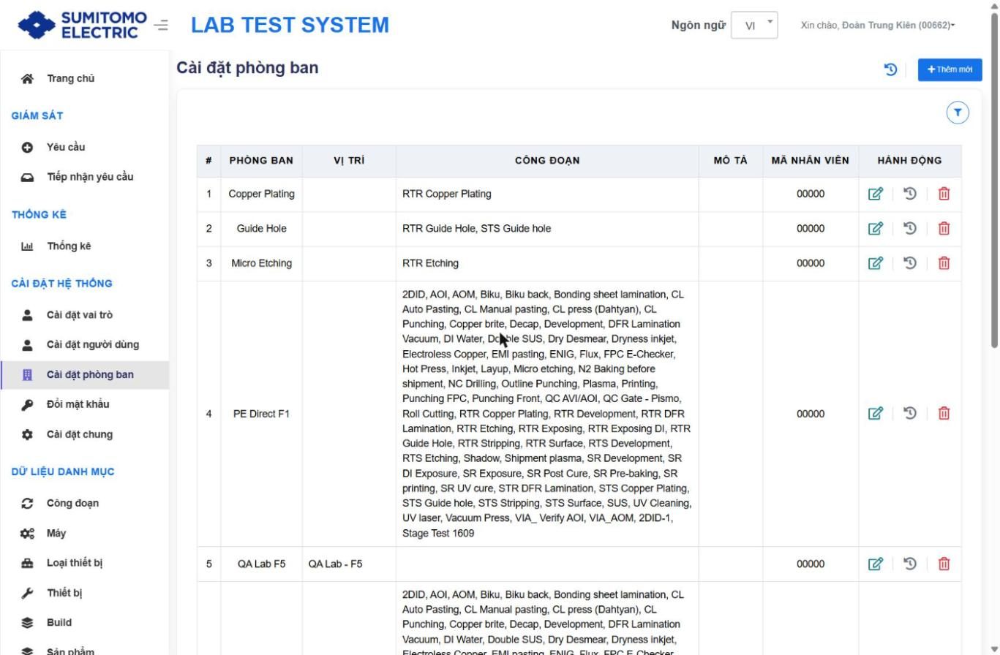
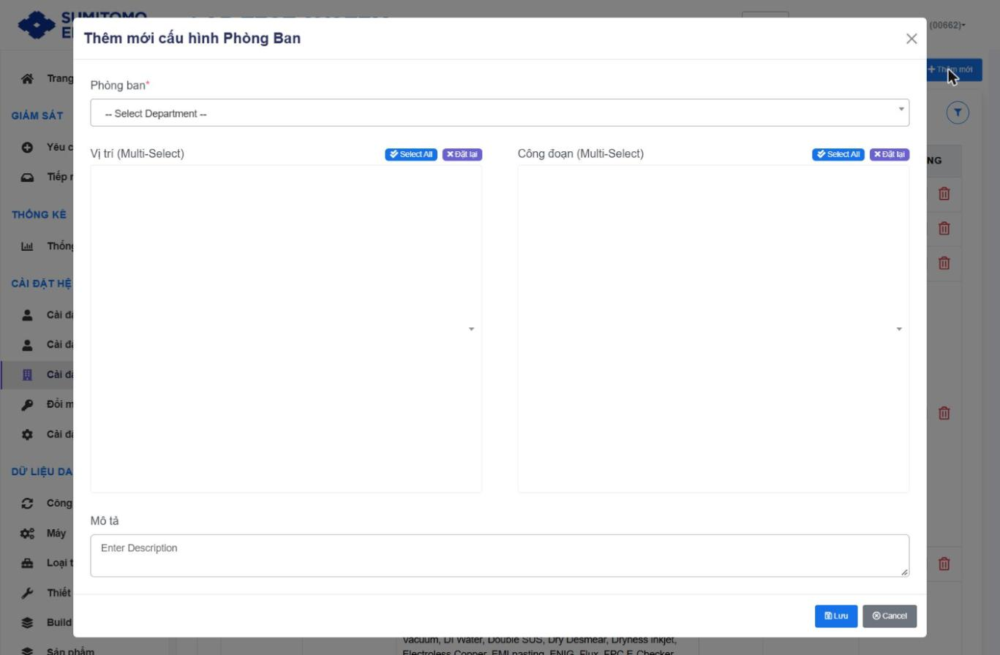
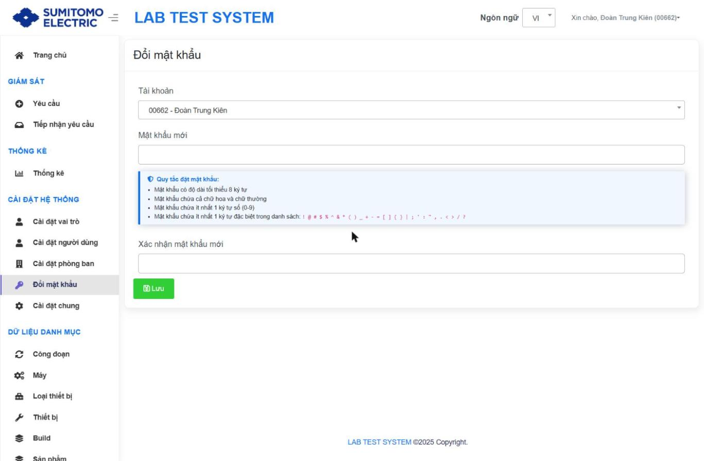
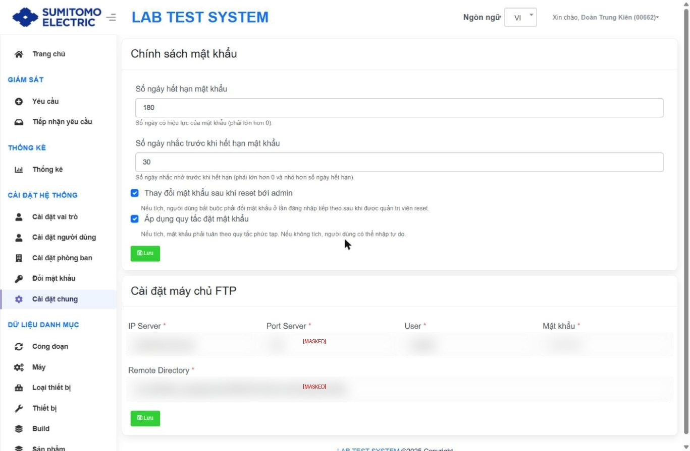

# Cài đặt hệ thống

> Nhóm chức năng quản trị. Thao tác Lưu/Xoá ở đây ảnh hưởng quyền truy cập toàn hệ thống → chỉ Administrator thực hiện; ghi lại thay đổi.

## 1. Cài đặt vai trò `/group`

- Tìm kiếm: **Vai trò**; Tìm kiếm, Đặt lại; `+ Thêm mới`.
- Bảng: # · VAI TRÒ · HÀNH ĐỘNG [**Phân quyền** (icon chìa khoá) · Sửa · Xoá].
- Vai trò hiện có (ví dụ): Administrator, Đo mạch Leader, Operator, PE Engineer, PE Engineer Smart Factory, PR Engineer, PR Leader, PR Operator, QA Lab F5 Operator, QC Engineer, QC Manager, TestRole.
- **Thêm mới** (`Cài đặt vai trò - Thêm mới`): Vai trò* → nút Thêm mới; Quay lại.

### Phân quyền

Modal "Phân quyền vai trò: <tên>": bảng # · TÊN DANH SÁCH · VIEW (XEM) · ADD (THÊM) · EDIT (SỬA) · DELETE (XÓA). Checkbox ở tiêu đề cột = chọn cả cột. Nút **Lưu**; X để đóng không lưu.

| Bước | Thao tác | Kết quả mong đợi | Kiểm tra |
|---|---|---|---|
| 1 | Nhấn icon chìa khoá ở vai trò | Modal phân quyền với quyền hiện tại | |
| 2 | Tích/bỏ tích quyền theo màn hình | | |
| 3 | **Lưu** | Quyền áp dụng cho mọi user thuộc vai trò | Đăng nhập user thuộc vai trò, kiểm tra menu |

⚠ Rủi ro: bỏ quyền của Administrator có thể khoá chính mình. Rollback: dùng tài khoản admin khác cấp lại quyền.

Danh sách quyền: xem `00_INDEX.md` §5. Ví dụ Operator: Request (V/A/E/D), Change Password (V, E).

## 2. Cài đặt người dùng `/account`
- Tìm kiếm: Họ tên, Mã nhân viên, Phòng ban, Vai trò; `+ Thêm mới`.
- Bảng: # · MÃ NHÂN VIÊN · HỌ TÊN · EMAIL · PHÒNG BAN · VAI TRÒ · NGÀY TẠO · HÀNH ĐỘNG [Sửa · Xoá].

| Trường (Thêm mới) | Bắt buộc | Ghi chú |
|---|---|---|
| Họ tên | ✔ | |
| Mã nhân viên | ✔ | Dùng làm tài khoản đăng nhập `[Suy luận]` |
| Mật khẩu | ✔ | Chỉ có ở Thêm mới, theo quy tắc mật khẩu |
| Email | | |
| Phòng ban | | Nhập tự do (text) |
| Vai trò | ✔ | Chọn từ danh sách vai trò |
| Thời hạn mật khẩu | | Checkbox, mặc định tích – áp chính sách hết hạn |

**Quy tắc đặt mật khẩu** (khi bật ở Cài đặt chung): tối thiểu 8 ký tự; có chữ hoa và chữ thường; ≥ 1 chữ số (0-9); ≥ 1 ký tự đặc biệt trong `! @ # $ % ^ & * ( ) _ + - = [ ] { } | ; ' : " , . < > / ?`.

Form **Cập nhật**: Họ tên*, Mã nhân viên*, Email, Phòng ban, Vai trò*, Thời hạn mật khẩu (không có ô mật khẩu – đặt lại mật khẩu dùng màn Đổi mật khẩu).

## 3. Cài đặt phòng ban `/Department`

Mục đích `[Suy luận]`: gán cho mỗi phòng ban các **Vị trí** và **Công đoạn** được phép thao tác/xem.

- Bảng: # · PHÒNG BAN · VỊ TRÍ · CÔNG ĐOẠN · MÔ TẢ · MÃ NHÂN VIÊN · HÀNH ĐỘNG [Sửa · Lịch sử · Xoá]. Bộ lọc: Phòng ban. Icon lịch sử tổng quát ("Department Change History").

| Trường (modal "Thêm mới cấu hình Phòng Ban") | Bắt buộc | Ghi chú |
|---|---|---|
| Phòng ban | ✔ | Chọn từ danh sách phòng ban (vd 4M-Copper, Au plating, Common-Analysis, Copper Plating, Đo mạch, Factory Common, Guide Hole…) |
| Vị trí (Multi-Select) | | Có "-- Tất cả --", Select All, Đặt lại; hiển thị kèm mã (vd QA Lab - F1 (F1L01)) |
| Công đoạn (Multi-Select) | | Có "-- Tất cả --", Select All, Đặt lại; kèm mã (vd 2DID (S01)) |
| Mô tả | | |
| Lý do | ✔ khi Sửa/Xoá | |

Nút: Lưu, Cancel. Lịch sử: Phòng ban · Hành động · Vị trí · Công đoạn · Chi tiết thay đổi · Mô tả · Lý do · Mã nhân viên · Ngày tạo.

## 4. Đổi mật khẩu `/changepassword`

| Trường | Ghi chú |
|---|---|
| Tài khoản | Dropdown, mặc định tài khoản đang đăng nhập; người có quyền có thể chọn tài khoản khác (đặt lại mật khẩu) |
| Mật khẩu mới | Theo quy tắc đặt mật khẩu |
| Xác nhận mật khẩu mới | Phải trùng |

Nút **Lưu**. Không có ô "mật khẩu hiện tại" – xem `98_Findings.md` (F-04).

## 5. Cài đặt chung `/setting`
 *(giá trị FTP đã được che)*

**Chính sách mật khẩu**
| Trường | Rule |
|---|---|
| Số ngày hết hạn mật khẩu | Số nguyên > 0 (hiện tại 180 ngày) |
| Số ngày nhắc trước khi hết hạn | > 0 và < số ngày hết hạn (hiện tại 30 ngày) |
| Thay đổi mật khẩu sau khi reset bởi admin | Tích → user bắt buộc đổi mật khẩu ở lần đăng nhập kế tiếp sau khi được reset |
| Áp dụng quy tắc đặt mật khẩu | Tích → bắt buộc quy tắc phức tạp; không tích → tự do |
Nút **Lưu**.

**Cài đặt máy chủ FTP** (nơi đẩy/nhận dữ liệu `[Suy luận]`): IP Server*, Port Server*, User*, Mật khẩu*, Remote Directory*; nút **Lưu**.
⚠ Thay đổi FTP sai có thể làm gián đoạn đồng bộ dữ liệu. Trước khi sửa: ghi lại giá trị cũ (rollback), kiểm tra kết nối sau khi lưu. Không lưu giá trị thật vào tài liệu.
