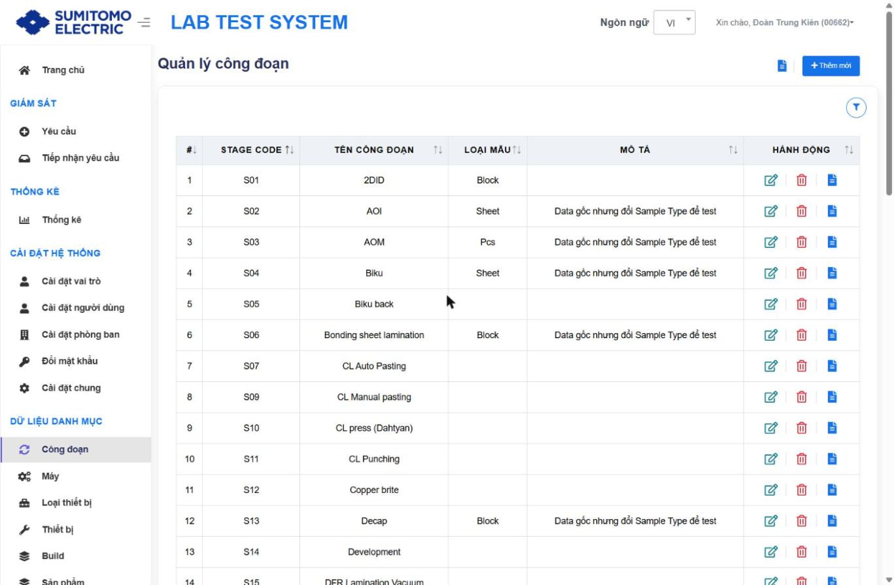
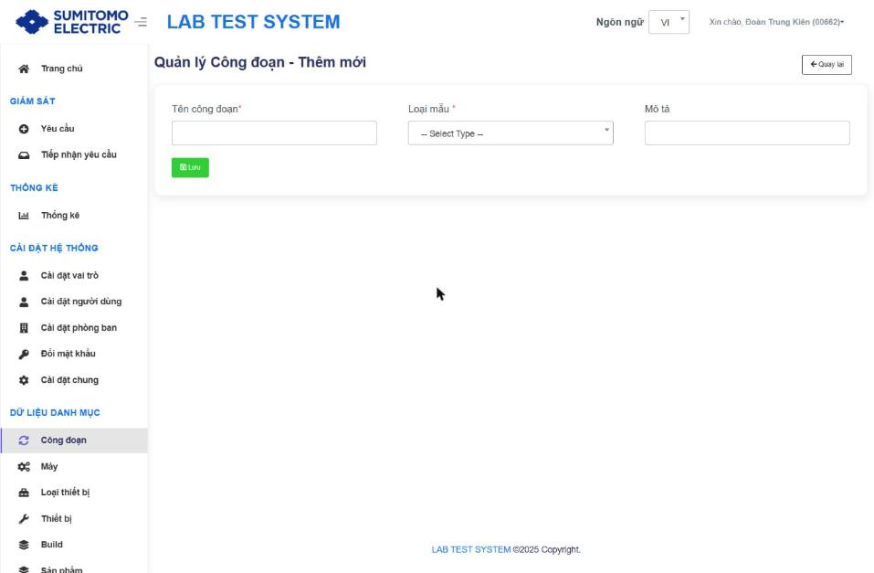
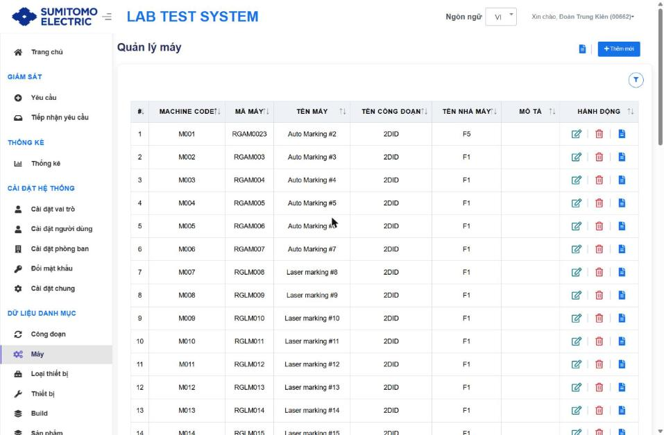
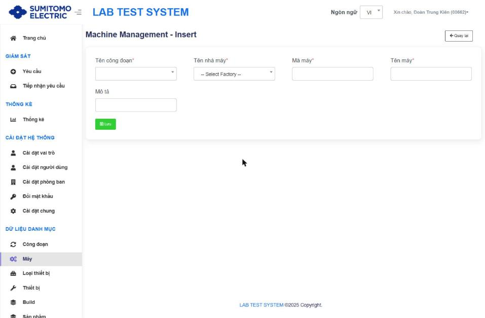
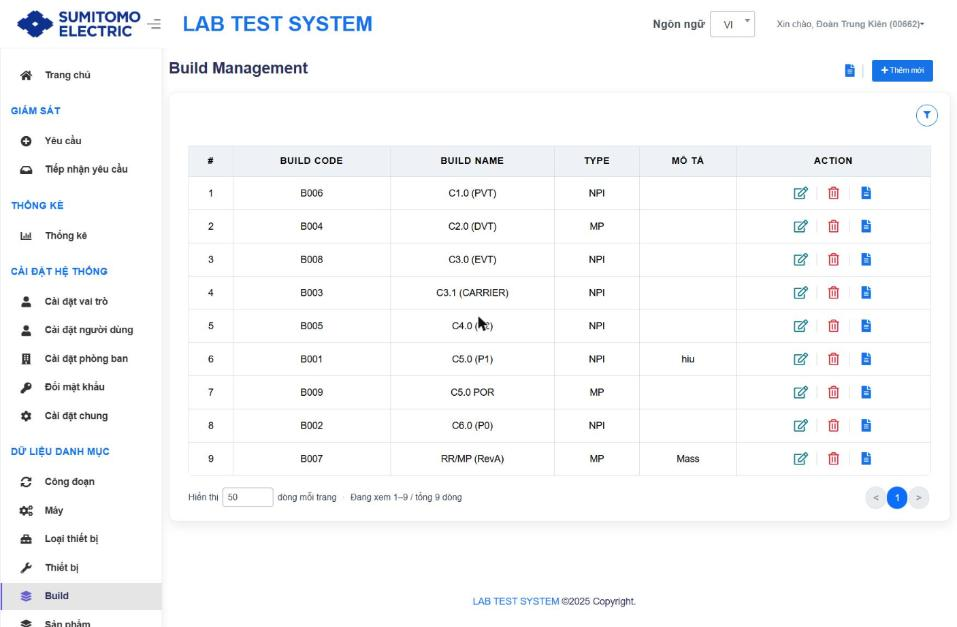
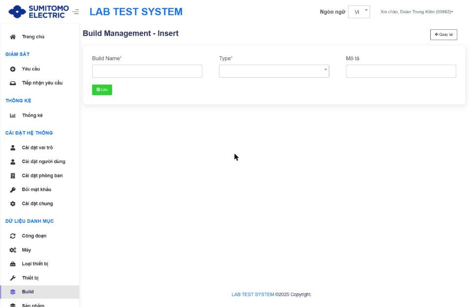
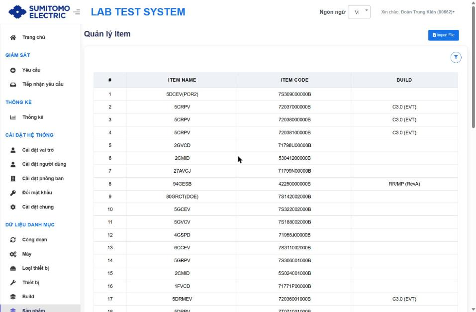

# Danh mục sản xuất

Quy ước chung (Sửa/Xoá cần Lý do, Lịch sử từng dòng, Lịch sử tổng quát): xem `00_INDEX.md` §4.

## 1. Công đoạn (Stage) `/Stage`

- Tiêu đề: "Quản lý công đoạn". Bộ lọc: Stage Code, Tên công đoạn.
- Bảng (sắp xếp được): # · **STAGE CODE** (mới, tự sinh S01, S02…) · TÊN CÔNG ĐOẠN · LOẠI MẪU · MÔ TẢ · HÀNH ĐỘNG [Sửa · Xoá · Lịch sử].

| Trường | Bắt buộc | Rule |
|---|---|---|
| Tên công đoạn | ✔ | Duy nhất, không trùng `[Từ tài liệu cũ]` |
| Loại mẫu (Sample Type) | ✔ | Sheet / Block / Pcs |
| Mô tả | | |
| Lý do | ✔ khi Sửa/Xoá | |

**Điều kiện xoá** `[Từ tài liệu cũ]`: không còn Máy phụ thuộc và chưa khai báo Nội dung IPQC.

## 2. Máy (Machine) `/Machine`

- Bộ lọc: Tên nhà máy (--All--, F1…F5), Tên công đoạn, Machine Code, Mã máy, Tên máy.
- Bảng: # · **MACHINE CODE** (mới, M001…) · MÃ MÁY · TÊN MÁY · TÊN CÔNG ĐOẠN · TÊN NHÀ MÁY · MÔ TẢ · HÀNH ĐỘNG.

| Trường ("Machine Management - Insert") | Bắt buộc | Rule |
|---|---|---|
| Tên công đoạn | ✔ | Từ danh mục Công đoạn |
| Tên nhà máy | ✔ | F1 … F5 |
| Mã máy (Machine ID) | ✔ | Duy nhất `[Từ tài liệu cũ]`; dùng để scan khi tạo Request |
| Tên máy | ✔ | |
| Mô tả | | |

## 3. Build `/Build`

- Tiêu đề "Build Management". Bộ lọc: Build Code, Build Name, Type.
- Bảng: # · **BUILD CODE** (mới, B001…) · BUILD NAME · TYPE · MÔ TẢ · ACTION.
- Dữ liệu ví dụ: C1.0 (PVT) NPI, C2.0 (DVT) MP, C3.0 (EVT) NPI, C5.0 POR MP, RR/MP (RevA) MP.

| Trường ("Build Management - Insert") | Bắt buộc | Rule |
|---|---|---|
| Build Name | ✔ | Duy nhất `[Từ tài liệu cũ]` |
| Type | ✔ | NPI / MP (quyết định dùng Quantity NPI hay MASS của nội dung IPQC `[Suy luận]`) |
| Mô tả | | |

## 4. Sản phẩm – Quản lý Item `/item`

- Menu hiển thị "Sản phẩm", tiêu đề "Quản lý Item".
- Bộ lọc: Item Name, Item Code, Build. Bảng: # · ITEM NAME · ITEM CODE · BUILD (không có cột hành động).
- **Import File**: modal kéo-thả file hoặc Browse → **Tải lên**. `[Từ tài liệu cũ]` Chức năng tạm thời; về sau link trực tiếp dữ liệu Item từ hệ thống bên Nhật.
- Item Code + Build được dùng tự động khi scan Indi Number lúc tạo Request.
