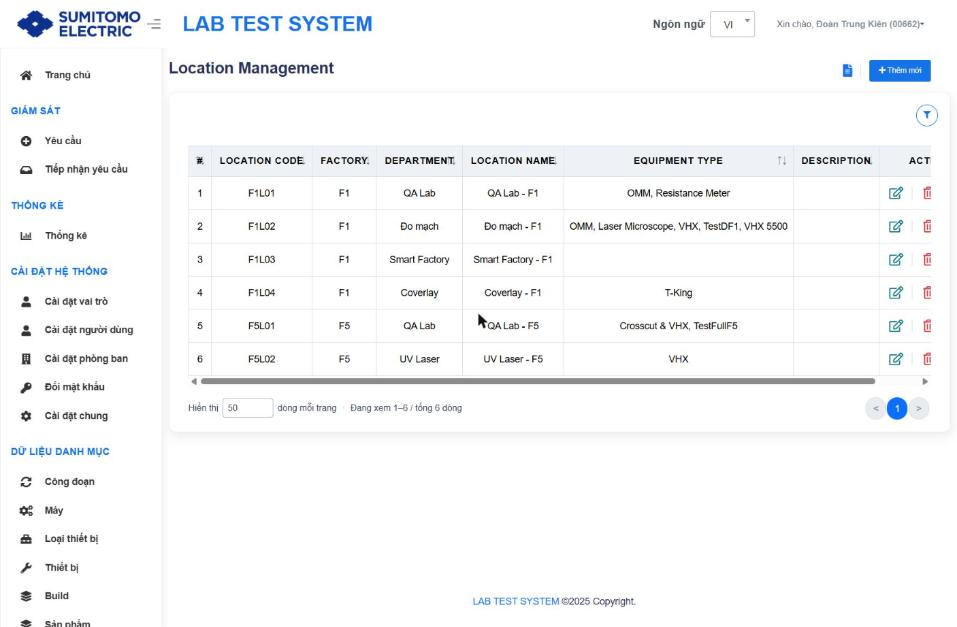
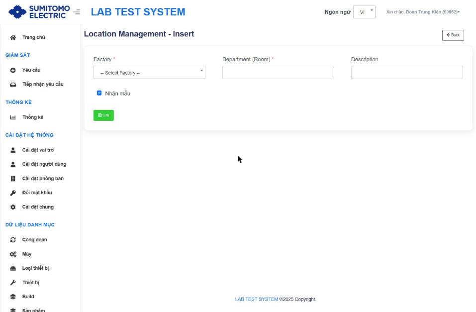
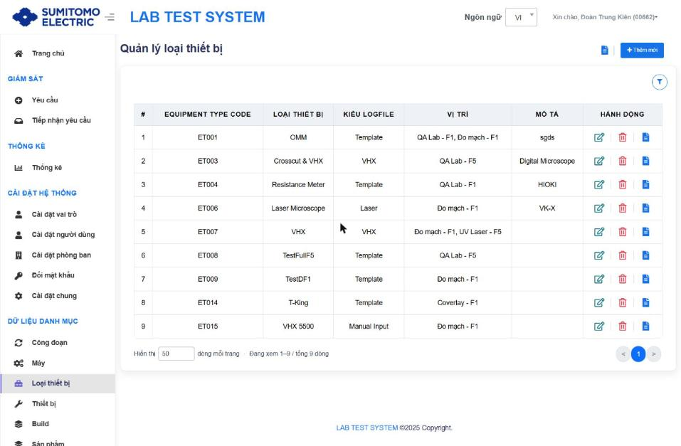
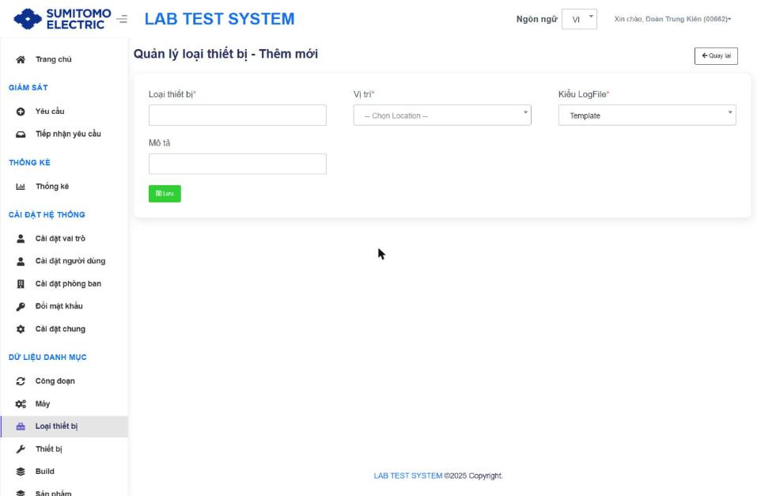
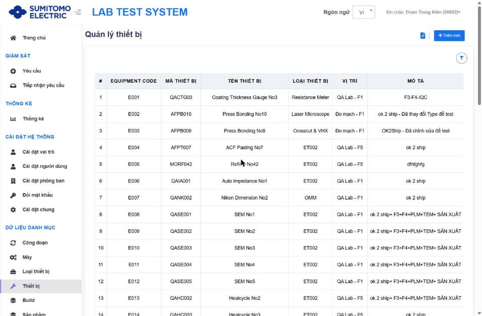
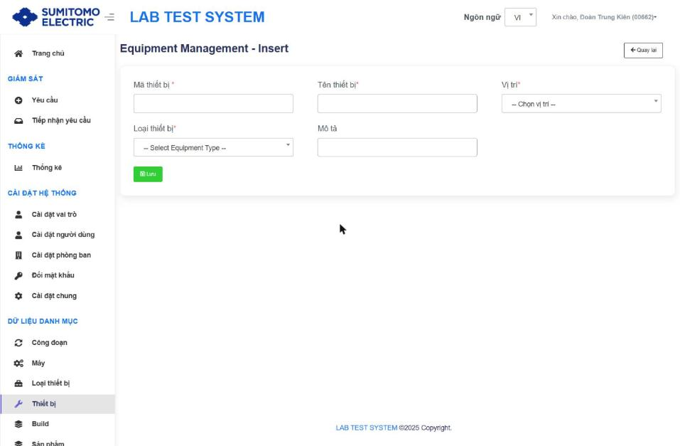

# Danh mục phòng đo

Thứ tự khai báo: **Vị trí → Loại thiết bị → Thiết bị**.

## 1. Vị trí (Location) `/Location`

- Tiêu đề "Location Management". Bộ lọc: Factory, Department, Location Code.
- Bảng: # · LOCATION CODE · FACTORY · DEPARTMENT · LOCATION NAME · EQUIPMENT TYPE (tự cập nhật từ danh mục Loại thiết bị) · DESCRIPTION · ACTION [**Sửa** (mới) · Delete · History].
- Dữ liệu hiện có: F1L01 QA Lab - F1 · F1L02 Đo mạch - F1 · F1L03 Smart Factory - F1 · F1L04 Coverlay - F1 · F5L01 QA Lab - F5 · F5L02 UV Laser - F5.

| Trường ("Location Management - Insert") | Bắt buộc | Rule |
|---|---|---|
| Factory | ✔ | F1 … F5 |
| Department (Room) | ✔ | Factory + Department duy nhất `[Từ tài liệu cũ]` |
| Description | | |
| **Nhận mẫu** (checkbox, mới) | | Mặc định tích. `[Suy luận]` Vị trí được phép tiếp nhận mẫu ở màn Tiếp nhận yêu cầu |

Tự sinh: **Location Code** = `F<Factory>L<STT department>` (vd F1L02); **Location Name** = `Department - Factory`. Code được tái sử dụng theo thứ tự sau khi xoá `[Từ tài liệu cũ]`.

## 2. Loại thiết bị (Equipment Type) `/EquipmentType`

- Bộ lọc: Vị trí, Equipment Type Code, Loại thiết bị.
- Bảng: # · **EQUIPMENT TYPE CODE** (ET001…) · LOẠI THIẾT BỊ · **KIỂU LOGFILE** (mới) · VỊ TRÍ (có thể nhiều) · MÔ TẢ · HÀNH ĐỘNG.

| Trường | Bắt buộc | Rule |
|---|---|---|
| Loại thiết bị | ✔ | Duy nhất `[Từ tài liệu cũ]` |
| Vị trí | ✔ | Vị trí đặt loại thiết bị; dữ liệu hiện có loại thuộc nhiều vị trí `[Chưa xác minh cách chọn nhiều trên form mới]` |
| **Kiểu LogFile** (mới) | ✔ | Template · VHX · Laser · Manual Input – quyết định cách Service đọc kết quả và giao diện ở Cấu hình IPQC |
| Mô tả | | |

Dữ liệu hiện có: ET001 OMM (Template) · ET003 Crosscut & VHX (VHX) · ET004 Resistance Meter (Template) · ET006 Laser Microscope (Laser) · ET007 VHX (VHX) · ET008 TestFullF5 · ET009 TestDF1 · ET014 T-King (Template) · ET015 VHX 5500 (Manual Input).

## 3. Thiết bị (Equipment) `/Equipment`

- Bộ lọc: Vị trí, Loại thiết bị, Equipment Code, Mã thiết bị, Tên thiết bị.
- Bảng: # · **EQUIPMENT CODE** (E001…) · MÃ THIẾT BỊ · TÊN THIẾT BỊ · LOẠI THIẾT BỊ · VỊ TRÍ · MÔ TẢ · HÀNH ĐỘNG.

| Trường ("Equipment Management - Insert") | Bắt buộc | Rule |
|---|---|---|
| Mã thiết bị | ✔ | Duy nhất `[Từ tài liệu cũ]`; Service ghi mã này vào kết quả đo |
| Tên thiết bị | ✔ | |
| Vị trí | ✔ | |
| Loại thiết bị | ✔ | |
| Mô tả | | |
| Model / SN / Maker | | Có trong form nhưng đang ẩn `[Chưa xác minh]` |

⚠ Nhiều thiết bị đang hiển thị Loại thiết bị = "ET002" (mã không còn trong danh mục) – xem `98_Findings.md` (F-05).
