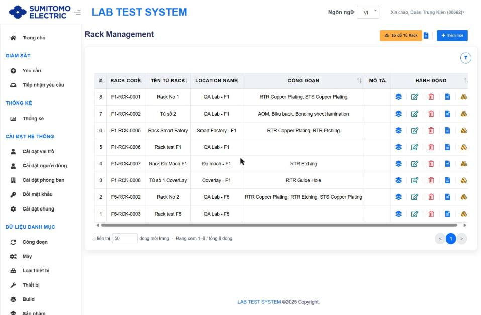
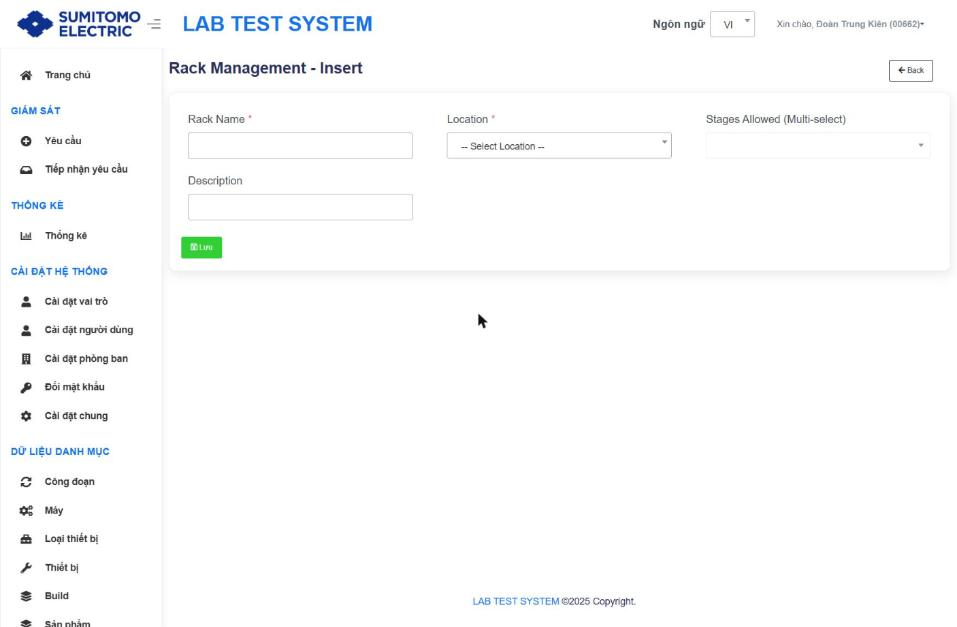
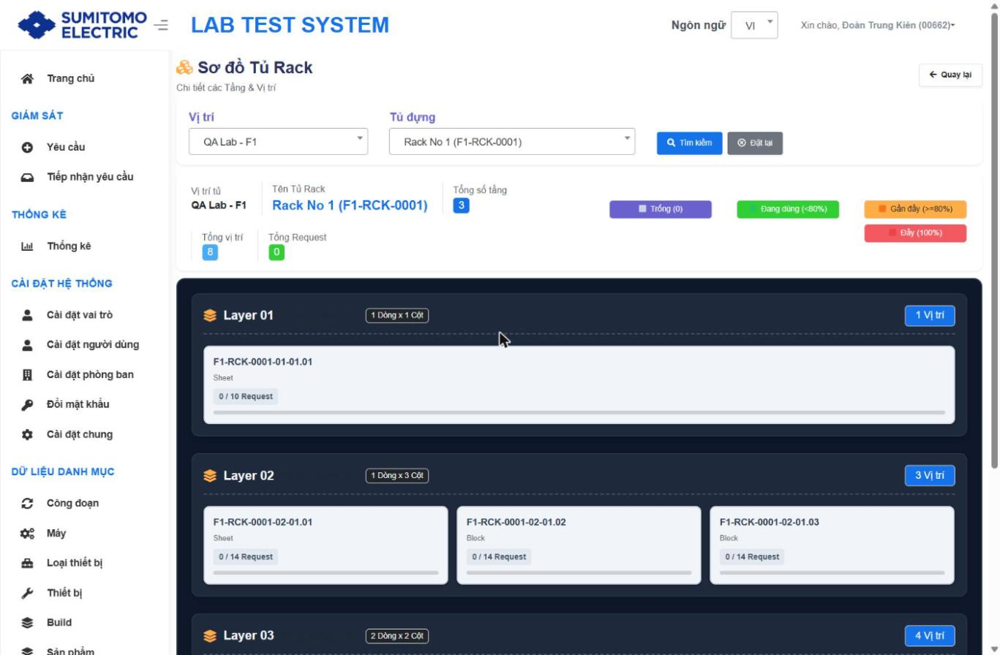
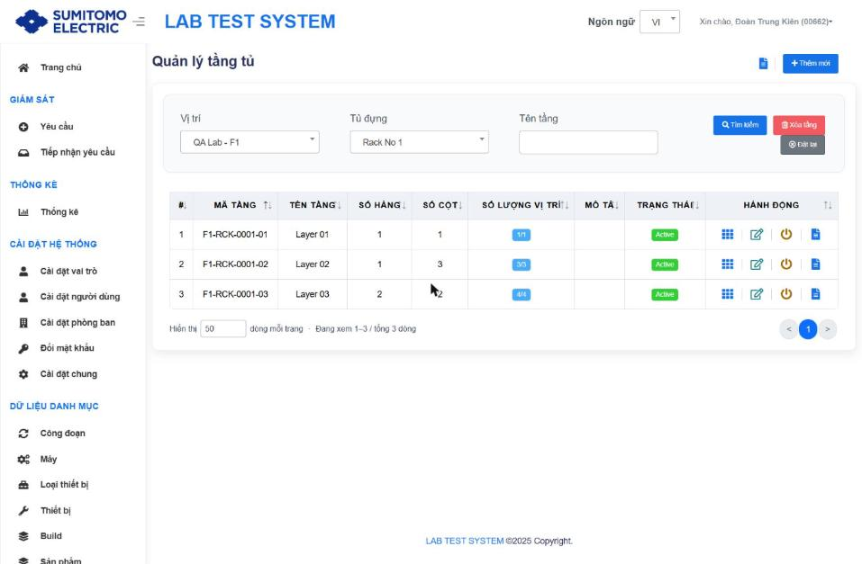
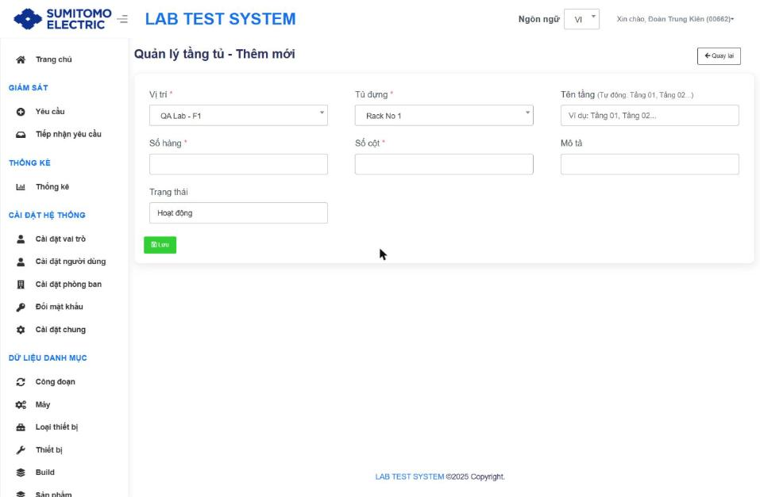
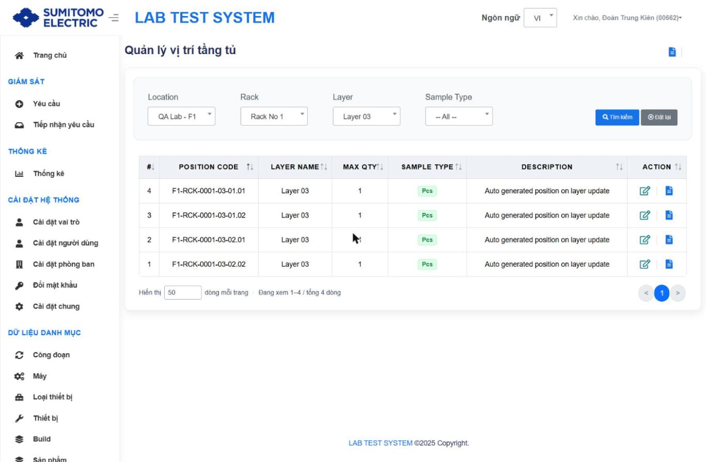
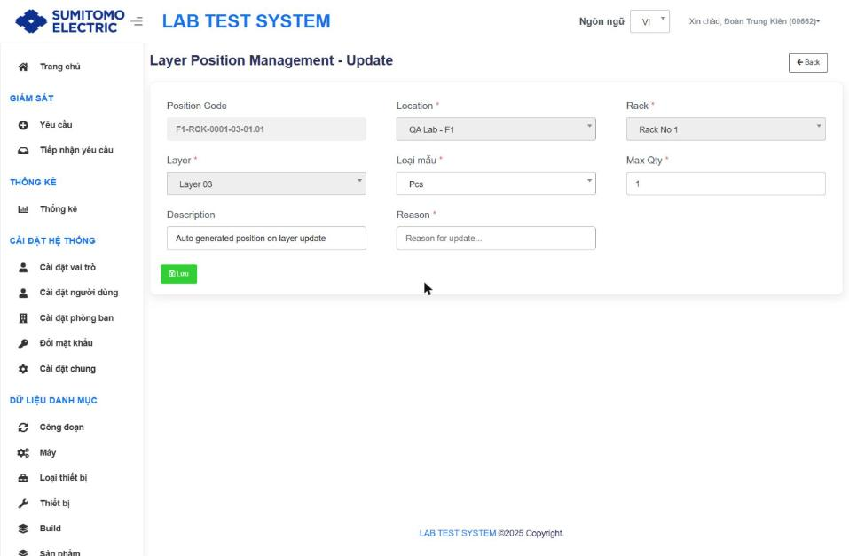

# Tủ đựng mẫu, tầng tủ, vị trí

Cấu trúc: **Vị trí (Location) → Tủ (Rack) → Tầng (Layer = hàng × cột) → Ô (Position)**. Khi tiếp nhận mẫu, hệ thống phân bổ request vào một Position phù hợp Công đoạn (Stages Allowed của tủ), Loại mẫu và Max Qty của ô `[Suy luận từ cấu trúc dữ liệu + tài liệu cũ]`.

Mã tự sinh:
| Đối tượng | Định dạng | Ví dụ |
|---|---|---|
| Rack Code | `F<Factory>-RCK-<STT 4 số>` | F1-RCK-0001 |
| Layer Code | `<Rack Code>-<STT tầng 2 số>` | F1-RCK-0001-03 |
| Position Code | `<Layer Code>-<Hàng 2 số>.<Cột 2 số>` | F1-RCK-0001-03-01.02 |

## 1. Tủ đựng `/Rack`

- Tiêu đề "Rack Management". Nút đầu trang: **Sơ đồ Tủ Rack** (mới), Lịch sử tổng quát, `+ Thêm mới`. Bộ lọc: Vị trí, Rack Code, Tên Tủ Rack.
- Bảng: # · RACK CODE · TÊN TỦ RACK · LOCATION NAME · CÔNG ĐOẠN · MÔ TẢ · HÀNH ĐỘNG [**Xem tầng** (mới → Tầng tủ) · Edit · Delete · History · **Sơ đồ**].

| Trường ("Rack Management - Insert") | Bắt buộc | Rule |
|---|---|---|
| Rack Name | ✔ | Duy nhất `[Từ tài liệu cũ]` |
| Location | ✔ | |
| Stages Allowed (Multi-select) | | Các công đoạn được để mẫu trong tủ; có ô tìm kiếm |
| Description | | |

Điều kiện xoá `[Từ tài liệu cũ]`: tủ chưa khai báo Layer. Rack Code được tái sử dụng.

### Sơ đồ Tủ Rack `/Rack/Diagram` (thiết kế lại)

| Khu vực | Nội dung |
|---|---|
| Bộ lọc | Vị trí, Tủ đựng (dạng "Rack No 1 (F1-RCK-0001)"); Tìm kiếm, Đặt lại; Quay lại |
| Tóm tắt | Vị trí tủ · Tên Tủ Rack · Tổng số tầng · Tổng vị trí · Tổng Request |
| Chú giải màu | Trống (số lượng) · Đang dùng (<80%) · Gần đầy (≥80%) · Đầy (100%) |
| Thẻ Layer | "Layer 01" · "<r> Dòng x <c> Cột" · "<n> Vị trí"; mỗi ô: Position Code, Loại mẫu, "x / max Request", thanh tiến độ |
| Nhấn vào ô | Modal "Danh sách Request tại vị trí": # · Mã yêu cầu · Item Name · Item Code · Lô sản xuất · Build · Số lượng · Trình tự · Thiết bị · Trạng thái · Operator · Ngày tạo; Đóng |

Tủ chưa có Layer → không hiển thị sơ đồ `[Từ tài liệu cũ]`.

## 2. Tầng tủ `/RackShelf`

- Bộ lọc: Vị trí, Tủ đựng, Tên tầng; nút **Tìm kiếm**, **Xóa tầng** (mới), **Đặt lại**.
- Bảng: # · MÃ TẦNG · TÊN TẦNG · SỐ HÀNG · SỐ CỘT · SỐ LƯỢNG VỊ TRÍ (x/y) · MÔ TẢ · TRẠNG THÁI (Active/Inactive) · HÀNH ĐỘNG [**Xem vị trí** (mới) · Edit · Disable/Enable · History].

| Trường ("Quản lý tầng tủ - Thêm mới") | Bắt buộc | Rule |
|---|---|---|
| Vị trí | ✔ | Tự điền nếu đã chọn ở bộ lọc |
| Tủ đựng | ✔ | Tự điền nếu đã chọn ở bộ lọc |
| Tên tầng | | Bỏ trống → tự đặt (UI ghi "Tầng 01…"; dữ liệu thực tế "Layer 01") |
| Số hàng | ✔ | Thay đổi → tự thêm/bớt Position |
| Số cột | ✔ | Thay đổi → tự thêm/bớt Position |
| Mô tả | | |
| Trạng thái | | Hoạt động / Không hoạt động |

**Xoá tầng** (modal "Delete Layer", bắt buộc Lý do) – `[Từ tài liệu cũ]` điều kiện: không còn mẫu trong tầng; xoá từ tầng lớn nhất. ⚠ Không hoàn tác.
**Disable/Enable**: đổi Active ↔ Inactive qua hộp thoại xác nhận (hoặc sửa Trạng thái trong form Edit + Lý do).

## 3. Vị trí theo tầng `/ShelfPosition`

- Tiêu đề "Quản lý vị trí tầng tủ". Bộ lọc: Location, Rack, Layer, Sample Type (Sheet/Block/Pcs). Không có Thêm mới – Position sinh tự động khi tạo/sửa tầng ("Auto generated position on layer update").
- Bảng: # · POSITION CODE · LAYER NAME · MAX QTY · SAMPLE TYPE · DESCRIPTION · ACTION [Edit · History].

| Trường ("Layer Position Management - Update") | Bắt buộc | Ghi chú |
|---|---|---|
| Position Code, Location, Rack, Layer | — | Khoá |
| Loại mẫu | ✔ | Sheet / Block / Pcs – điều kiện nhận mẫu tại ô |
| Max Qty | ✔ | Số request tối đa trong ô |
| Description | | |
| Reason | ✔ | |

Trong mã nguồn trang có modal "Delete Row"/"Delete Column" (Lý do*) nhưng không thấy nút hiển thị `[Chưa xác minh]`.
