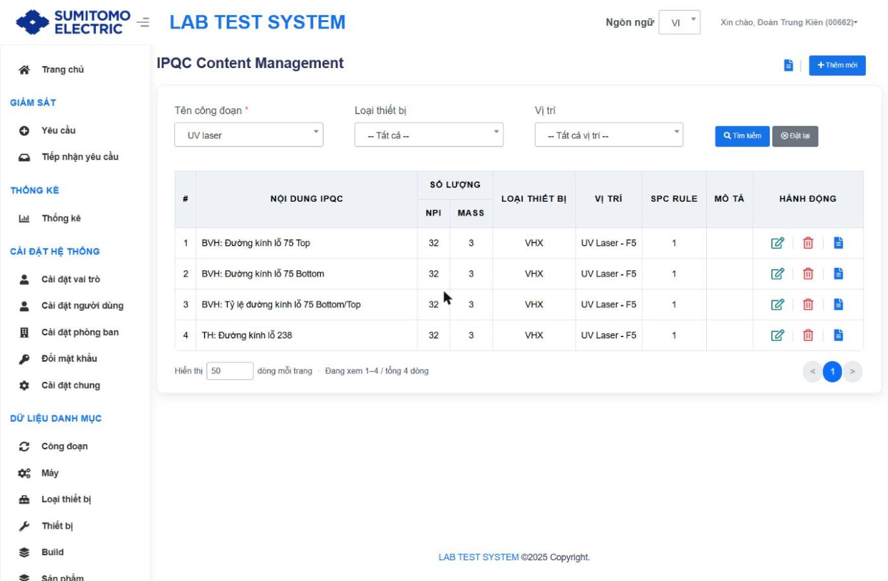
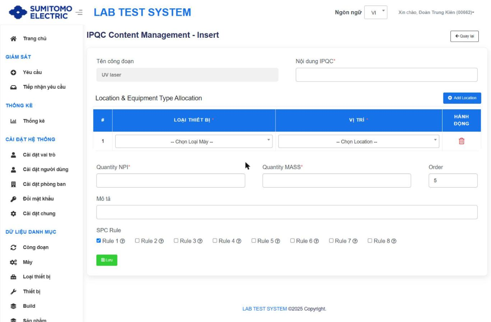
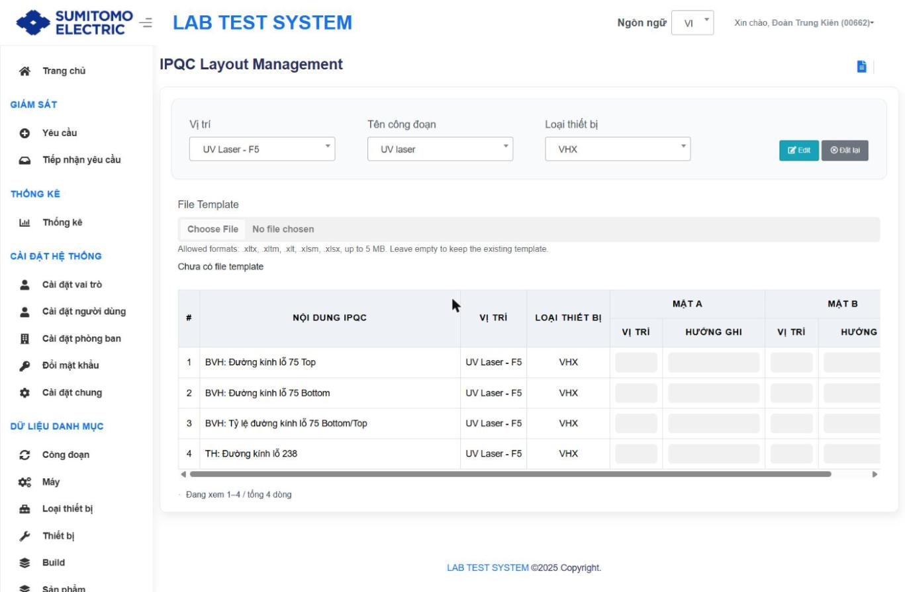
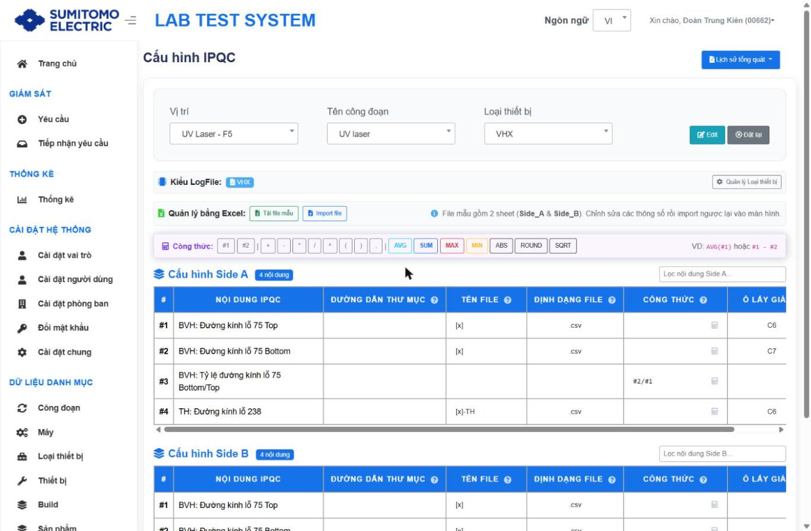
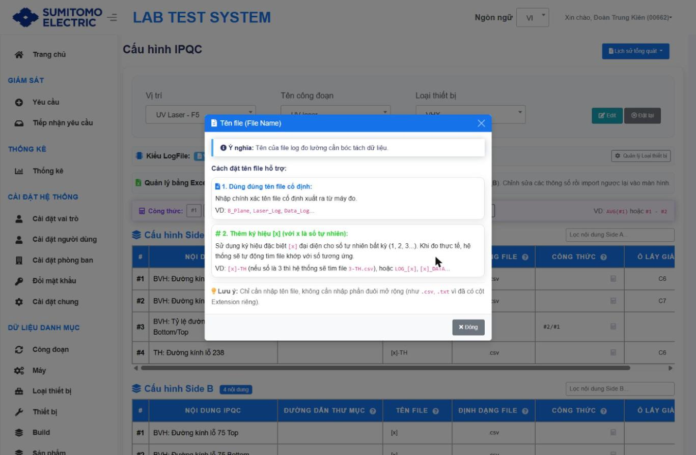
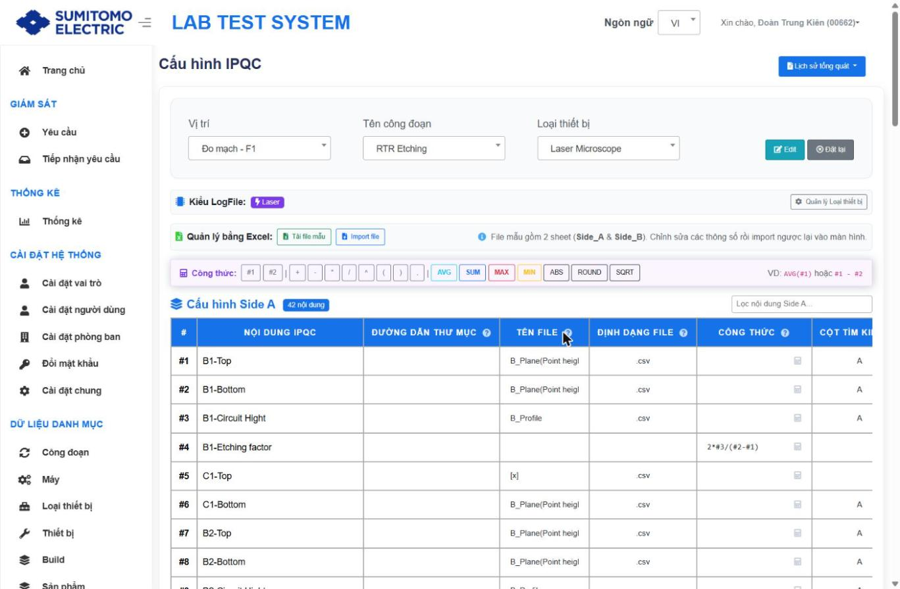

# IPQC: Nội dung đo, Bố cục file, Cấu hình đọc log

## 1. Nội dung IPQC `/IPQCContent`
Mục đích: khai báo nội dung đo của Công đoạn, số lượng mẫu, phân bổ Loại thiết bị + Vị trí đo, SPC Rule.

- Bộ lọc: **Tên công đoạn*** (phải chọn để hiển thị), Loại thiết bị, Vị trí; Tìm kiếm, Đặt lại.
- Bảng: # · NỘI DUNG IPQC · SỐ LƯỢNG (NPI | MASS) · LOẠI THIẾT BỊ · VỊ TRÍ · SPC RULE · MÔ TẢ · HÀNH ĐỘNG [Sửa · Xoá · Lịch sử].

| Trường ("IPQC Content Management - Insert") | Bắt buộc | Rule |
|---|---|---|
| Tên công đoạn | — | Khoá, lấy từ bộ lọc (phải chọn Stage trước khi Thêm mới) |
| Nội dung IPQC | ✔ | Duy nhất trong công đoạn `[Từ tài liệu cũ]` |
| Location & Equipment Type Allocation | ✔ | Bảng: LOẠI THIẾT BỊ* · VỊ TRÍ* (lọc theo loại) · xoá dòng; nút **Add Location**. Các dòng không trùng nhau `[Từ tài liệu cũ]` |
| Quantity NPI | ✔ | Số mẫu đo với Build NPI `[Suy luận]` |
| Quantity MASS | ✔ | Số mẫu đo với Build MP |
| Order | | Tự tăng (thứ tự hiển thị) |
| Mô tả | | |
| SPC Rule | | Checkbox Rule 1 … Rule 8, mặc định Rule 1; icon (?) chưa hiển thị giải thích `[Chưa xác minh nội dung từng rule]` |

Thay đổi nội dung/phân bổ → tự thêm/xoá dòng tương ứng ở Bố cục IPQC / Cấu hình IPQC `[Từ tài liệu cũ]`.

## 2. Bố cục IPQC `/Layout`
Mục đích: với loại thiết bị kiểu **Template**, khai báo ô bắt đầu và hướng ghi dữ liệu trong file báo cáo Excel.

| Thành phần | Mô tả |
|---|---|
| Bộ lọc dây chuyền | **Vị trí → Tên công đoạn → Loại thiết bị** (mục sau mở khi chọn mục trước); nút **Edit** (khi đủ 3), **Đặt lại** |
| File Template (mới) | Chọn file `.xltx, .xltm, .xlt, .xlsm, .xlsx` ≤ 5 MB; để trống = giữ template hiện có; hiển thị "Chưa có file template" nếu chưa có |
| Bảng | # · NỘI DUNG IPQC · VỊ TRÍ · LOẠI THIẾT BỊ · MẶT A (VỊ TRÍ · HƯỚNG GHI) · MẶT B (VỊ TRÍ · HƯỚNG GHI) |

Rule `[Từ tài liệu cũ]`:
- Vị trí = ô Excel bắt đầu (vd C7); Hướng ghi = Horizontal (ngang) / Vertical (dọc).
- Phải nhập đủ cặp Vị trí + Hướng ghi, và đủ toàn bộ 1 mặt mới được lưu; bắt buộc Lý do.
- Cùng nội dung nhưng khác Vị trí hoặc khác Loại thiết bị → layout khác nhau.

## 3. Cấu hình IPQC `/LogConfig` (MỚI)
Mục đích: một màn hợp nhất cấu hình cách Service đọc kết quả theo **Kiểu LogFile** của loại thiết bị.

- Bộ lọc: Vị trí → Tên công đoạn (chỉ công đoạn có nội dung IPQC tại vị trí) → Loại thiết bị; **Edit**, **Đặt lại**.
- Dropdown **Lịch sử tổng quát**: "Lịch sử tổng quát (Template Layout)" · "Lịch sử Logfile Config".
- Hiển thị **Kiểu LogFile: <…>** + nút **Quản lý Loại thiết bị**.

### 3a. Kiểu Template
Giao diện giống Bố cục IPQC (File Template + bảng Vị trí/Hướng ghi theo Mặt A/B).

### 3b. Kiểu VHX / Laser

| Khu vực | Nội dung |
|---|---|
| Quản lý bằng Excel | **Tải file mẫu**, **Import file**. File mẫu gồm 2 sheet `Side_A` & `Side_B`; sửa thông số rồi import lại |
| Thanh Công thức | `#1 #2 + - * / ^ ( ) ,` và hàm `AVG SUM MAX MIN ABS ROUND SQRT`; VD `AVG(#1)` hoặc `#1 - #2` |
| Cấu hình Side A / Side B | Badge số nội dung; ô "Lọc nội dung Side A/B"; bảng cột dưới đây |

| Cột | Ý nghĩa (theo help trên UI) |
|---|---|
| NỘI DUNG IPQC | Từ danh mục Nội dung IPQC; `#n` = số dòng dùng trong công thức |
| ĐƯỜNG DẪN THƯ MỤC (Folder Path) | Thư mục con chứa file log trên máy đo, vd `BVH NBS/DK DATA/IPQC_LOG`; để trống nếu file ở thư mục gốc mặc định của phần mềm |
| TÊN FILE (File Name) | (1) Tên cố định, vd `B_Plane`, `Laser_Log`, `Data_Log`; (2) dùng `[x]` = số tự nhiên bất kỳ, vd `[x]-TH` → tìm `3-TH.csv`, `LOG_[x]`, `[x]_DATA`. Không nhập phần đuôi |
| ĐỊNH DẠNG FILE (Extension) | `.csv` (phổ biến), `.txt`, `.xlsx/.xls` |
| CÔNG THỨC (Formula) | Dùng khi giá trị tính từ dòng khác: `#1 - #2`, `AVG(#1)`, `(#1 + #2) / 2`, `#1 / #2 * 100`, `MAX(#1)`, `MIN(#1)`, `ROUND(#1 - #2, 3)`. Có công thức → các ô Thư mục, Tên file, Ô/Cột lấy giá trị bị vô hiệu hoá. Nút máy tính mở bảng soạn công thức |
| CỘT TÌM KIẾM (ColumnFind) | Chỉ cho thiết bị **Laser** |
| TÊN MẪU ĐO (ContentIndexName) | Chỉ cho thiết bị **Laser** |
| Ô LẤY GIÁ TRỊ (Position) | Toạ độ ô chứa kết quả trong file log, vd `C6`, `D10`. Nút slider → cài vị trí riêng theo ItemName/ItemCode nếu khác mặc định |

Ví dụ thực tế:
- UV laser / VHX @ UV Laser - F5: #1 "75 Top" file `[x]` .csv ô C6; #2 "75 Bottom" `[x]` .csv C7; #3 "Tỷ lệ 75 Bottom/Top" = `#2/#1`; #4 "TH: Đường kính lỗ 238" file `[x]-TH` .csv C6.
- RTR Etching / Laser Microscope @ Đo mạch - F1 (42 nội dung): "B1-Top" file `B_Plane(Point height…)` .csv, ColumnFind A; "B1-Etching factor" = `2*#3/(#2-#1)`.

### Quy trình cấu hình (khuyến nghị)
| Bước | Mục đích | Thao tác | Kết quả mong đợi | Kiểm tra |
|---|---|---|---|---|
| 1 | Chọn đối tượng | Vị trí → Công đoạn → Loại thiết bị | Hiện Kiểu LogFile & bảng Side A/B | Kiểu LogFile đúng với thiết bị |
| 2 | Lấy mẫu | **Tải file mẫu** | File Excel 2 sheet Side_A/Side_B | |
| 3 | Khai báo | Điền Thư mục, Tên file, Định dạng, Ô lấy giá trị/Công thức → **Import file** (hoặc **Edit** trực tiếp) | Bảng cập nhật | So khớp 1 file log thật |
| 4 | Thử | Tạo request test → Service đọc file | Giá trị hiển thị đúng ở Chi tiết nội dung yêu cầu | So với giá trị trên máy đo |
⚠ High-risk: sai cấu hình → đọc sai giá trị/phán định sai cho mọi request sau đó. Rollback: dùng "Lịch sử Logfile Config" để khôi phục giá trị cũ; trước khi import nên Tải file mẫu (bản hiện tại) làm backup `[Suy luận: file mẫu chứa cấu hình hiện tại – cần xác minh]`.
