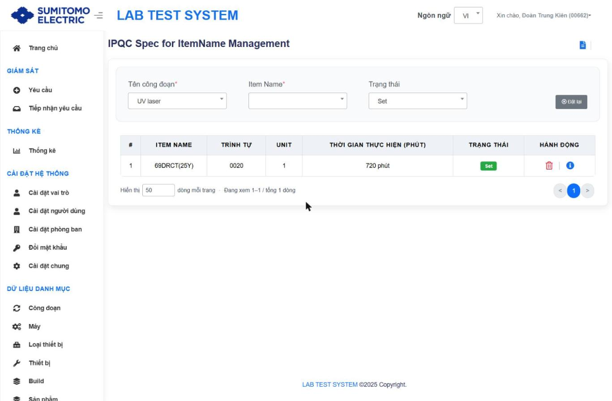
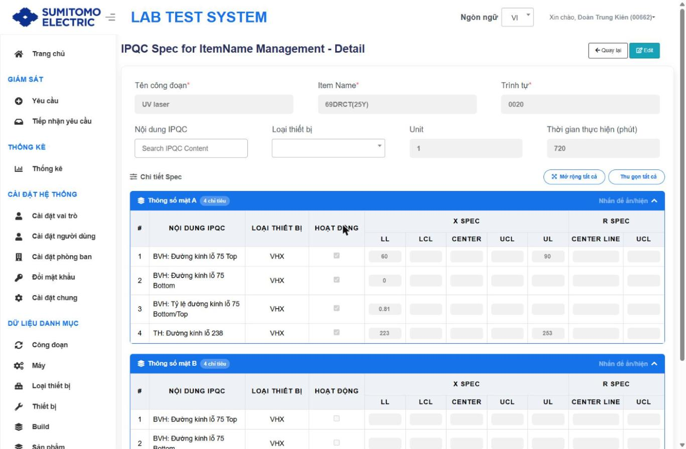
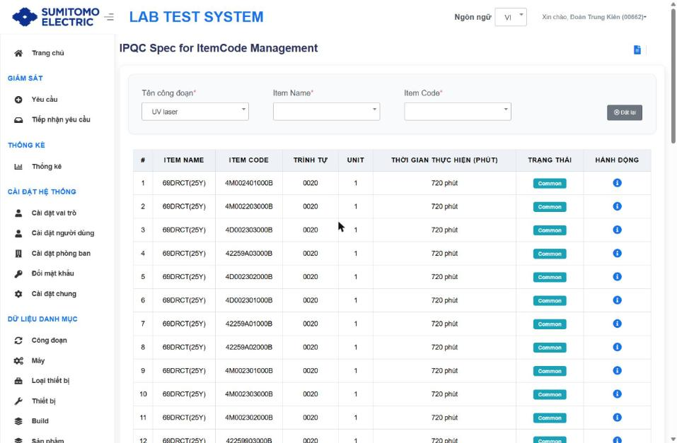
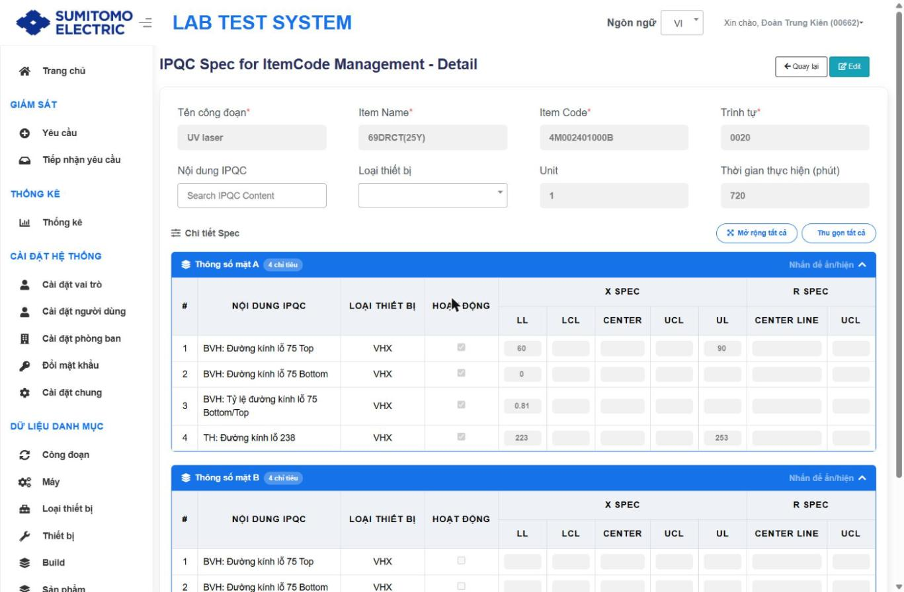

# Tiêu chuẩn IPQC (Spec)

Khoá dữ liệu: **Stage Name + Item Name + Sequence** (duy nhất). Spec theo ItemName tự sinh spec cho mọi ItemCode thuộc ItemName (tag **Common**); ItemCode sửa riêng → tag **Individual** `[Từ tài liệu cũ, tag Common quan sát được]`.

## 1. Theo tên sản phẩm `/spec/itemname`

- Tiêu đề "IPQC Spec for ItemName Management". Bộ lọc: Tên công đoạn*, Item Name*, **Trạng thái** (mới: Tất cả / Set / Not Set); Đặt lại.
- Bảng: # · ITEM NAME · TRÌNH TỰ · UNIT · THỜI GIAN THỰC HIỆN (PHÚT) · TRẠNG THÁI (**Set** / **Not Set**) · HÀNH ĐỘNG [Xóa · Chi tiết]. Lọc "Not Set" để thấy Item Name chưa có spec.
- Nút đầu trang: Lịch sử tổng quát, Thêm mới.

**Chi tiết / Thêm / Sửa** ("… - Detail", nút Edit, Quay lại):
| Trường | Bắt buộc | Rule |
|---|---|---|
| Tên công đoạn | ✔ | |
| Item Name | ✔ | Từ danh mục Item |
| Trình tự (Sequence) | ✔ | Đổi Sequence khi sửa → tạo spec mới; giữ nguyên → cập nhật spec hiện tại `[Từ tài liệu cũ]` |
| Unit | | |
| Thời gian thực hiện (phút) | | = Leadtime, dùng tính Thời hạn request |
| Lọc hiển thị | | Nội dung IPQC (Search IPQC Content), Loại thiết bị; Mở rộng tất cả / Thu gọn tất cả |

Bảng "Thông số mặt A (n chỉ tiêu)" / "Thông số mặt B": # · NỘI DUNG IPQC · LOẠI THIẾT BỊ · **HOẠT ĐỘNG** (checkbox) · X SPEC (LL · LCL · CENTER · UCL · UL) · R SPEC (CENTER LINE · UCL).

Rule nhập spec `[Từ tài liệu cũ]`:
- Tích **Hoạt động** để nhập spec cho nội dung theo loại thiết bị; có thể chỉ Side A, chỉ Side B hoặc cả hai.
- X Spec: `LL < LCL < CENTER < UCL < UL`; R Spec: `UCL < UL`. Chỉ cần UL hoặc LL khi Active; R Spec có thể bỏ trống.
- Lưu cần ≥ 1 nội dung Active. Hộp thoại xác nhận "Lưu và ghi đè tiêu chuẩn Sequence này cho toàn bộ Item Code" → OK. Khi Update: ghi đè các ItemCode tag Common, không ghi đè tag Individual. Sửa bắt buộc Lý do.
- Xoá (OK/Cancel): xoá toàn bộ spec ItemCode theo ItemName, không phân biệt tag. ⚠ Không hoàn tác.

Ví dụ: UV laser / 69DRCT(25Y) / 0020: Unit 1, 720 phút; Mặt A Active: 75 Top LL 60 – UL 90; 75 Bottom LL 0; Tỷ lệ 75 Bottom/Top LL 0.81; TH 238 LL 223 – UL 253; Mặt B không Active.

## 2. Theo mã sản phẩm `/spec/itemcode`

- Bộ lọc: Tên công đoạn*, Item Name*, Item Code*; Đặt lại. Không có Thêm mới (sinh từ ItemName).
- Bảng: # · ITEM NAME · ITEM CODE · TRÌNH TỰ · UNIT · THỜI GIAN THỰC HIỆN (PHÚT) · TRẠNG THÁI (**Common** / **Individual**) · HÀNH ĐỘNG [Chi tiết].
- Chi tiết như ItemName + trường Item Code*; **Edit** → lưu thành công thì ItemCode chuyển tag **Individual**, không bị ghi đè khi sửa ở ItemName.

