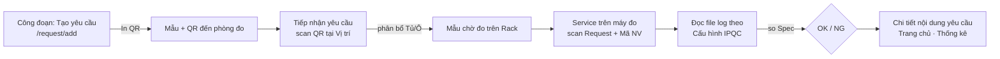

# Luồng nghiệp vụ & thứ tự khai báo

## 1. Thứ tự khai báo master data (phụ thuộc)
| Thứ tự | Màn hình | Phụ thuộc vào | Ghi chú |
|---|---|---|---|
| 1 | Vị trí (Location) | — | Bật "Nhận mẫu" cho phòng đo tiếp nhận mẫu |
| 2 | Loại thiết bị | Vị trí | Chọn đúng **Kiểu LogFile** |
| 3 | Thiết bị | Vị trí, Loại thiết bị | |
| 4 | Công đoạn | — | Loại mẫu |
| 5 | Máy | Công đoạn | Mã máy dùng để scan khi tạo request |
| 6 | Build | — | NPI / MP |
| 7 | Sản phẩm (Item) | Build | Import file |
| 8 | Tủ đựng | Vị trí, Công đoạn (Stages Allowed) | |
| 9 | Tầng tủ | Tủ | Sinh Position tự động |
| 10 | Vị trí theo tầng | Tầng | Chỉnh Loại mẫu, Max Qty |
| 11 | Nội dung IPQC | Công đoạn, Loại thiết bị, Vị trí | Số lượng NPI/MASS, SPC Rule |
| 12 | Cấu hình IPQC / Bố cục IPQC | Nội dung IPQC | Template: vị trí/hướng ghi + file template; VHX/Laser: thư mục, tên file, ô lấy giá trị, công thức |
| 13 | Tiêu chuẩn IPQC theo ItemName | Nội dung IPQC, Item | Sequence, Leadtime, X/R Spec |
| 14 | Tiêu chuẩn IPQC theo ItemCode | (tự sinh) | Chỉ sửa khi ItemCode khác chuẩn chung |
| 15 | Vai trò, Người dùng, Phòng ban | — | Phân quyền & phạm vi dữ liệu |

## 2. Luồng vận hành

## 3. Điểm kiểm tra khi không tạo được request
| Triệu chứng | Nguyên nhân thường gặp | Kiểm tra tại |
|---|---|---|
| Không thấy Mã máy | Máy chưa khai báo / thuộc phòng ban không được phép | Máy; Cài đặt phòng ban |
| Item Name/Build trống sau khi scan Indi | Item Code chưa có trong danh mục Item | Sản phẩm |
| Sequence trống | Chưa có Spec cho Stage + Item | Tiêu chuẩn IPQC (lọc Not Set) |
| Báo trùng | Đã có request cùng Stage + Indi + Sequence chưa huỷ | Yêu cầu |
| Không nhận được mẫu / không có vị trí trống | Tủ không cho phép công đoạn; ô sai Loại mẫu; đầy | Tủ đựng (Stages Allowed), Vị trí theo tầng, Sơ đồ tủ |
| Service đọc lỗi | Sai thư mục/tên file/ô giá trị | Cấu hình IPQC; Nhật ký lỗi ở chi tiết request |
