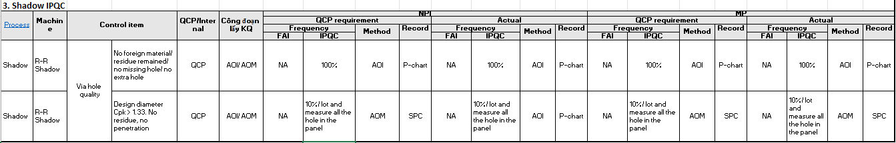

# 50. 2DID Laser marking

> Nguồn: sheet `50. 2DID Laser marking` trong `LAB_Test_system_261013.xlsx`. Chuyển đổi tự động, giữ nguyên câu chữ gốc. Cột `Row` và tên cột (A, B, ...) là tọa độ ô trong Excel.

**13. 2DID Laser marking** (dòng 1)

| Row | A: Process | B: Machine | C: Control item | D: Control item | E: QCP/Internal | F: Công đoạn lấy KQ | G: NPI / QCP requirement / Frequency / FAI | H: NPI / QCP requirement / Frequency / IPQC | I: NPI / QCP requirement / Method | J: NPI / QCP requirement / Record method | K: NPI / Actual / Frequency / FAI | L: NPI / Actual / Frequency / IPQC | M: NPI / Actual / Method | N: NPI / Actual / Record method | O: MP / QCP requirement / Frequency / FAI | P: MP / QCP requirement / Frequency / IPQC | Q: MP / QCP requirement / Method | R: MP / QCP requirement / Record method | S: MP / Actual / Frequency / FAI | T: MP / Actual / Frequency / IPQC | U: MP / Actual / Method | V: MP / Actual / Record method |
|---|---|---|---|---|---|---|---|---|---|---|---|---|---|---|---|---|---|---|---|---|---|---|
| 6 | 2DID Laser marking | PMTT and Daito machine | Appreance | MQC | Internal | MQC | N/A | N/A | N/A | N/A | 3 blocks/ table x all tables | 3 blocks/ table x all tables/ lot x all lot | Visual checking | Manual | N/A | N/A | N/A | N/A | 3 blocks/ table x all tables | 3 blocks/ table x all tables/ lot x all lot | Visual checking | Manual |
| 7 | 2DID Laser marking | PMTT and Daito machine | Appreance | VHX | Internal | QA | N/A | N/A | N/A | N/A | 5pcs/ table x all tables | N/A | VHX machine | Manual | N/A | N/A | N/A | N/A | 5pcs/ table x all tables | N/A | VHX machine | Manual |
| 8 | 2DID Laser marking | PMTT and Daito machine | Etching depth | (1 ~ 5µm) | Internal | QA lab | N/A | N/A | N/A | N/A | 2 pcs/1table x all table | 2 pcs/1table x all table/ machine/ 2 weeks | Crosscut | Manual | N/A | N/A | N/A | N/A | 2 pcs/1table x all table | 2 pcs/1table x all table/ machine/ 2 weeks | Crosscut | Manual |
| 9 | 2DID Laser marking | PMTT and Daito machine | Grade | Grade B < 2.5% No grade C,D,F,Miss | QCP | MQC cognex | N/A | N/A | N/A | N/A | 3 blocks/ table x all tables | 3 blocks/ table x all tables | Cognex DM363 | Manual | N/A | N/A | N/A | N/A | 3 blocks/ table x all tables | 3 blocks/ table x all tables | Cognex DM363 | Manual |
| 10 | 2DID Laser marking | PMTT and Daito machine | 2DID code size and 2DID location | Cpk > 1.67 No shift | QCP | QA lab | FAI | N/A | N/A | N/A | 1. Non pismo 12pcs/block x 3blocks/1table x all table 2. Pismo item 18pcs/block x 2 blocks/ table x all tables | 1. 9pcs/block/table x all table/ machine/week 2. 12pcs/block x 3 blocks/table x all table/ machine/month | Mitutoyo | Manual | FAI | N/A | N/A | N/A | 1. Non pismo 12pcs/block x 3blocks/1table x all table 2. Pismo item 18pcs/block x 2 blocks/ table x all tables | 1. 9pcs/block/table x all table/ machine/week 2. 12pcs/block x 3 blocks/table x all table/ machine/month | Mitutoyo | Manual |

<!-- ảnh neo tại ô A39 -->
