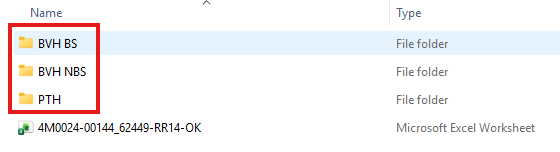
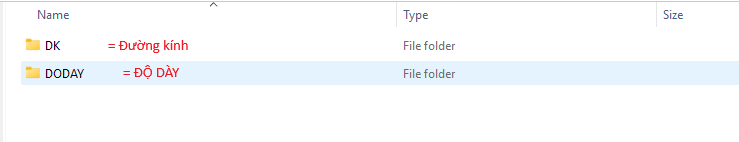
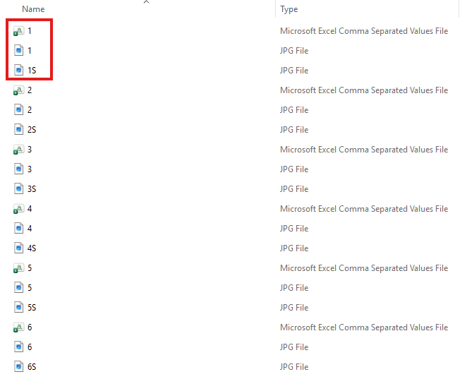
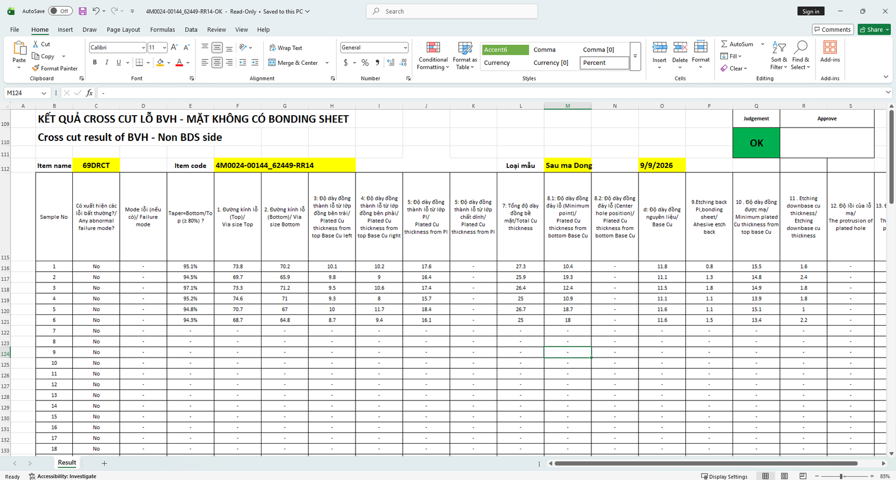
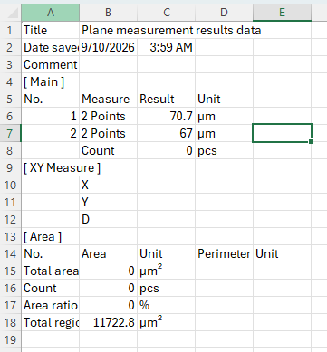
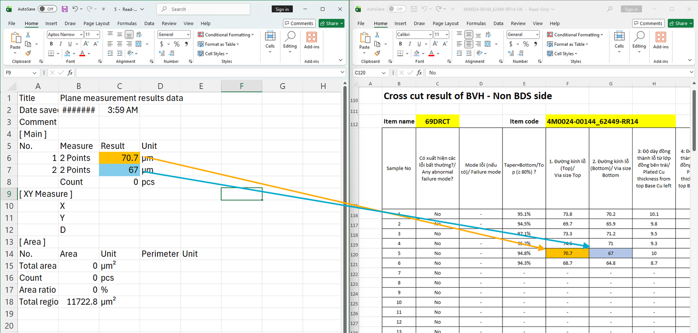
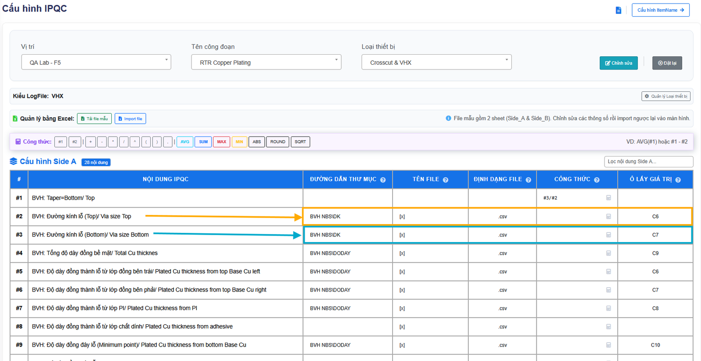

# Thao tác và logic đọc logfile VHX

- **File gốc:** `ThaoTac_Logic_ReadLog-VHX.xlsx` (483 195 byte), 1 sheet `VHX`, nhận ngày 2026-11-04.
- **Vai trò:** tham chiếu (reference) mô tả cách phòng đo đang tạo folder, file và tổng hợp logfile VHX thành báo cáo, và cách khai báo tương ứng trên màn Cấu hình IPQC của demo. Không phải yêu cầu đã chốt.
- **Phạm vi ví dụ trong file:** công đoạn RTR Copper Plating, đo cross-cut lỗ BVH và PTH bằng VHX tại QA Lab – F5, Item `4M0024-00144_62449-RR14`.
- **Quy ước chuyển đổi:** giống [README](../README.md#quy-ước-chuyển-đổi) của `docs/source/`. Câu chữ giữ nguyên, kể cả lỗi chính tả ("thicknes", "Ahesive", "do tương tự", "xử dụng"). Ô gộp `I2:I17` và `I18:I29` được lặp lại xuống các dòng nó phủ. Không có chữ đỏ.

## Nội dung đo của công đoạn (vùng `A1:J29`)

**Với các request cần đo tại máy VHX** <!-- A1 -->

Đặt vấn đề: <!-- A3 -->

Công đoạn bao gồm các nội dung khai báo trên hệ thống như sau <!-- A4 -->

| Row | H: No | I: Hole Type | J: Content |
|---|---|---|---|
| 2 | 1 | BVH | Taper=Bottom/ Top |
| 3 | 2 | BVH | Đường kính lỗ (Top)/ Via size Top |
| 4 | 3 | BVH | Đường kính lỗ (Bottom)/ Via size Bottom |
| 5 | 4 | BVH | Tổng độ dày đồng bề mặt/ Total Cu thicknes |
| 6 | 5 | BVH | Độ dày đồng thành lỗ từ lớp đồng bên trái/ Plated Cu thickness from top Base Cu left |
| 7 | 6 | BVH | Độ dày đồng thành lỗ từ lớp đồng bên phải/ Plated Cu thickness from top Base Cu right |
| 8 | 7 | BVH | Độ dày đồng thành lỗ từ lớp PI/ Plated Cu thickness from PI |
| 9 | 8 | BVH | Độ dày đồng thành lỗ từ lớp chất dính/ Plated Cu thickness from adhesive |
| 10 | 9 | BVH | Độ dày đồng đáy lỗ (Minimum point)/ Plated Cu thickness from bottom Base Cu |
| 11 | 10 | BVH | Độ dày đồng đáy lỗ (Center hole position)/ Plated Cu thickness from bottom Base Cu |
| 12 | 11 | BVH | Độ dày đồng nguyên liệu/ Base Cu |
| 13 | 12 | BVH | Etching back PI, bonding sheet/ Ahesive etch back |
| 14 | 13 | BVH | Độ dày đồng được mạ/ Minimum plated Cu thickness from top base Cu |
| 15 | 14 | BVH | Etching downbase cu thickness/ Etching downbase cu thickness |
| 16 | 15 | BVH | Độ lồi của lỗ mạ/ The protrusion of plated hole |
| 17 | 16 | BVH | Độ lõm của lỗ mạ/ The dimple of plated hole |
| 18 | 17 | PTH | Đường kính lỗ (Top)/ Via size Top |
| 19 | 18 | PTH | Đường kính lỗ (Bottom)/ Via size Bottom |
| 20 | 19 | PTH | Độ dày đồng thành lỗ từ lớp đồng bên trên (trái)/ Plated Cu thickness from top Base Cu top |
| 21 | 20 | PTH | Độ dày đồng thành lỗ từ lớp đồng bên trên (trái)/ Plated Cu thickness from top Base Cu bottom |
| 22 | 21 | PTH | Độ dày đồng thành lỗ từ lớp đồng bên trên (phải)/ Plated Cu thickness from top Base Cu top |
| 23 | 22 | PTH | Độ dày đồng thành lỗ từ lớp đồng bên dưới (phải)/ Plated Cu thickness from top Base Cu bottom |
| 24 | 23 | PTH | Độ dày đồng thành lỗ từ lớp PI/ Plated Cu thickness from PI |
| 25 | 24 | PTH | Tổng độ dày đồng bề mặt/ Total Cu thickness |
| 26 | 25 | PTH | Etching back PI,bonding sheet/ Ahesive etch back |
| 27 | 26 | PTH | Độ dày đồng được mạ/ Minimum plated Cu thickness from top base Cu |
| 28 | 27 | PTH | Độ dày đồng nguyên liệu dưới/ Base Cu bottom (1) |
| 29 | 28 | PTH | Độ dày đồng nguyên liệu dưới/ Base Cu bottom (2) |

Trong đó: <!-- A5 -->

- Các nội dung từ 2->3 là nội dung đo Đường kính <!-- B6 -->
- Các nội dung còn lại của lỗ BVH đo độ dày <!-- B7 -->
- Các nội dung lỗ PTH được do tương tự <!-- B9 -->

Shape trong vùng này (không có chữ): mũi tên từ B6 tới dấu ngoặc `{` ở cột I bao dòng 3–4 (No 2, 3); mũi tên từ B7 tới dấu ngoặc ở cột I bao dòng 5–17 (No 4–16, tức gồm cả No 1 Taper không được bao); mũi tên từ B9 chỉ vào vùng PTH (khoảng dòng 23).

## Thao tác số 1: tạo folder và file khi đo (vùng `A31:I79`)

**Thao tác số 1** <!-- A31 --> Khi thực hiện đo, công nhân tạo các folder tương ứng với lỗ đo <!-- B31 -->

 <!-- ảnh neo tại ô B32 -->

Ảnh 01-B32 (chép lại): folder chứa 3 folder con `BVH BS`, `BVH NBS`, `PTH` (khung đỏ) và file Microsoft Excel Worksheet `4M0024-00144_62449-RR14-OK`.

Với lỗ BVH NBS (BVH NonBondingSheet), bên trong thư mục chứa 2 thư mục con tương ứng với 2 nội dung chính cần đo là Đường kính và Độ dày <!-- B41 -->

 <!-- ảnh neo tại ô B42 -->

Ảnh 02-B42 (chép lại): 2 folder `DK` (chú thích đỏ "= Đường kính") và `DODAY` (chú thích đỏ "= ĐỘ DÀY").

Trong các folder chứa ảnh, thông tin đo; mỗi một file = một PCS, được đặt tên file bằng số <!-- B51 -->

- Tùy theo từng loại hàng, trong folder bắt buộc chứa số lượng ảnh, số lượng ảnh đo, số lượng file kết quả gốc = số lượng pcs <!-- C52 -->
- Ví dụ: Loại hàng chỉ yêu cầu đo 6 pcs <!-- C53 -->
- 1 PCS bao gồm: <!-- C54 -->
  1\. File ảnh gốc <!-- D55 -->\
  2\. File ảnh đo, đặt tên số thứ tự + kí tự S <!-- D56 -->\
  3\. File csv giá trị đo được -> Hệ thống cần xử lý file này <!-- D57 -->

 <!-- ảnh neo tại ô I53 -->

Ảnh 03-I53 (chép lại): với mỗi số 1..6 có ba file: `n` (Microsoft Excel Comma Separated Values File), `n` (JPG File), `nS` (JPG File). Bộ ba của pcs 1 được đóng khung đỏ.

Với lỗ BVH BS và PTH, bên trong thư mục chứa 2 thư mục con cũng chứa các nội dung chính tương tự BVH NBS <!-- B79 -->

## Thao tác số 2: tổng hợp logfile raw thành báo cáo (vùng `A81:B105`)

**Thao tác số 2** <!-- A81 --> Xử lý logfile raw để thành file báo cáo <!-- B81 -->

Hiện tại công nhân sau khi thực hiện đo xong sẽ xử dụng VBA để tổng hợp kết quả đo thành báo cáo <!-- B82 -->

 <!-- ảnh neo tại ô B83; ảnh gốc 1919 px, thu nhỏ còn 1600 px -->

Ảnh 04-B83 (chép lại phần đọc được): sheet `Result` của file `4M0024-00144_62449-RR14-OK` (Read-Only).

- Tiêu đề: "KẾT QUẢ CROSS CUT LỖ BVH - MẶT KHÔNG CÓ BONDING SHEET" / "Cross cut result of BVH - Non BDS side". Judgement `OK`, ô Approve để trống.
- Item name `69DRCT`, Item code `4M0024-00144_62449-RR14`, Loại mẫu `Sau ma Dong`, ngày `9/9/2026`.
- Cột: Sample No; Có xuất hiện các lỗi bất thường?/ Any abnormal failure mode?; Mode lỗi (nếu có)/ Failure mode; Taper=Bottom/Top (≥ 80%) ?; 1. Đường kính lỗ (Top)/ Via size Top; 2. Đường kính lỗ (Bottom)/ Via size Bottom; 3: Độ dày đồng thành lỗ từ lớp đồng bên trái/ Plated Cu thickness from top Base Cu left; 4: … bên phải/ … right; 5: Độ dày đồng thành lỗ từ lớp PI/ Plated Cu thickness from PI; 5: Độ dày đồng thành lỗ từ lớp chất dính/ Plated Cu thickness from PI; 7: Tổng độ dày đồng bề mặt/ Total Cu thickness; 8.1: Độ dày đồng đáy lỗ (Minimum point)/ Plated Cu thickness from bottom Base Cu; 8.2: Độ dày đồng đáy lỗ (Center hole position)/ Plated Cu thickness from bottom Base Cu; d: Độ dày đồng nguyên liệu/ Base Cu; 9.Etching back PI,bonding sheet/ Ahesive etch back; 10 . Độ dày đồng được mạ/ Minimum plated Cu thickness from top base Cu; 11 . Etching downbase cu thickness/ Etching downbase cu thickness; 12. Độ lồi của lỗ mạ/ The protrusion of plated hole; 13. … (bị cắt).
- Dữ liệu (hàng 116–121, Sample No 1..6; Sample No 7..18 trở đi chỉ có `No` và `-`):

| Sample No | Abnormal? | Failure mode | Taper | Via size Top | Via size Bottom | 3: left | 4: right | 5: PI | 5: adhesive | 7: Total Cu | 8.1: Min point | 8.2: Center | d: Base Cu | 9: Etch back | 10: Min plated | 11: Etching downbase | 12: Protrusion |
|---|---|---|---|---|---|---|---|---|---|---|---|---|---|---|---|---|---|
| 1 | No | - | 95.1% | 73.8 | 70.2 | 10.1 | 10.2 | 17.6 | - | 27.3 | 10.4 | - | 11.8 | 0.8 | 15.5 | 1.6 | - |
| 2 | No | - | 94.5% | 69.7 | 65.9 | 9.8 | 9 | 16.4 | - | 25.9 | 19.3 | - | 11.1 | 1.3 | 14.8 | 2.4 | - |
| 3 | No | - | 97.1% | 73.3 | 71.2 | 9.5 | 10.6 | 17.4 | - | 26.4 | 12.4 | - | 11.5 | 1.8 | 14.9 | 1.8 | - |
| 4 | No | - | 95.2% | 74.6 | 71 | 9.3 | 8 | 15.7 | - | 25 | 10.9 | - | 11.1 | 1.1 | 13.9 | 1.8 | - |
| 5 | No | - | 94.8% | 70.7 | 67 | 10 | 11.7 | 18.4 | - | 26.7 | 18.7 | - | 11.6 | 1.1 | 15.1 | 1 | - |
| 6 | No | - | 94.3% | 68.7 | 64.8 | 8.7 | 9.4 | 16.1 | - | 25 | 18 | - | 11.6 | 1.5 | 13.4 | 2.2 | - |

## Logic fill kết quả đo vào báo cáo (vùng `A106:J133`)

**Logic fill kết quả đo vào báo cáo** <!-- A106 -->

Nội dung đo lỗ BVH NonBonding, đo thông tin đường kính <!-- B107 -->

| Row | C: Nội dung | G: Vị trí lấy giá trị |
|---|---|---|
| 108 | Đường kính lỗ (Top)/ Via size Top | được lấy từ vị trí C6 trong file (do bên phòng đo quy định) |
| 109 | Đường kính lỗ (Bottom)/ Via size Bottom | được lấy từ vị trí C7 trong file (do bên phòng đo quy định) |

Nội dung file CSV <!-- B111 --> · Fill kết quả đo vào báo cáo <!-- J111 -->

 <!-- ảnh neo tại ô B112; có 2 khung đỏ vẽ đè quanh ô C6, C7 -->

Ảnh 05-B112 (chép lại):

| Row | A | B | C | D |
|---|---|---|---|---|
| 1 | Title | Plane measurement results data | | |
| 2 | Date save… | 9/10/2026 | 3:59 AM | |
| 3 | Comment | | | |
| 4 | [ Main ] | | | |
| 5 | No. | Measure | Result | Unit |
| 6 | 1 | 2 Points | 70.7 | µm |
| 7 | 2 | 2 Points | 67 | µm |
| 8 | | Count | 0 | pcs |
| 9 | [ XY Measure ] | | | |
| 10 | | X | | |
| 11 | | Y | | |
| 12 | | D | | |
| 13 | [ Area ] | | | |
| 14 | No. | Area | Unit | Perimeter · Unit |
| 15 | Total area | 0 | µm² | |
| 16 | Count | 0 | pcs | |
| 17 | Area ratio | 0 | % | |
| 18 | Total regio… | 11722.8 | µm² | |

 <!-- ảnh neo tại ô J112; ảnh gốc 1919 px, thu nhỏ còn 1600 px -->

Ảnh 06-J112 (chép lại): bên trái là file CSV tên `5` (Read-Only), C6 = 70.7 (tô cam), C7 = 67 (tô xanh). Bên phải là báo cáo `4M0024-00144_62449-RR14-OK`. Mũi tên cam nối C6 sang ô "1. Đường kính lỗ (Top)/ Via size Top" của Sample No 5 (70.7). Mũi tên xanh nối C7 sang ô "2. Đường kính lỗ (Bottom)/ Via size Bottom" của Sample No 5 (67).

## Khai báo trên hệ thống (vùng `A134:G163`)

Khi khai báo trên hệ thống: <!-- B134 -->

Theo từng loại Content IPQC <!-- B135 -->

- Đường dẫn thư mục: Vị trí của file CSV cần tổng hợp <!-- B136 -->
- Tên file = [x]: Tên file thuộc kí tự số, tương ứng với các pcs <!-- B137 -->
- Định dạng file: Mặc định CSV <!-- B138 -->
- Ô lấy giá trị: Vị trí cần lấy giá trị trong file <!-- B139 -->

 <!-- ảnh neo tại ô G135; ảnh gốc 1675 px, thu nhỏ còn 1600 px -->

Ảnh 07-G135 (chép lại): màn "Cấu hình IPQC", Vị trí `QA Lab - F5`, Tên công đoạn `RTR Copper Plating`, Loại thiết bị `Crosscut & VHX`, Kiểu LogFile `VHX`. Cấu hình Side A có badge "28 nội dung". Hai mũi tên chỉ từ #2 và #3 sang các ô đã đóng khung.

| # | Nội dung IPQC | Đường dẫn thư mục | Tên file | Định dạng file | Công thức | Ô lấy giá trị |
|---|---|---|---|---|---|---|
| #1 | BVH: Taper=Bottom/ Top | | | | #3/#2 | |
| #2 | BVH: Đường kính lỗ (Top)/ Via size Top | BVH NBS\DK | [x] | .csv | | C6 |
| #3 | BVH: Đường kính lỗ (Bottom)/ Via size Bottom | BVH NBS\DK | [x] | .csv | | C7 |
| #4 | BVH: Tổng độ dày đồng bề mặt/ Total Cu thicknes | BVH NBS\DODAY | [x] | .csv | | C9 |
| #5 | BVH: Độ dày đồng thành lỗ từ lớp đồng bên trái/ Plated Cu thickness from top Base Cu left | BVH NBS\DODAY | [x] | .csv | | C6 |
| #6 | BVH: Độ dày đồng thành lỗ từ lớp đồng bên phải/ Plated Cu thickness from top Base Cu right | BVH NBS\DODAY | [x] | .csv | | C7 |
| #7 | BVH: Độ dày đồng thành lỗ từ lớp PI/ Plated Cu thickness from PI | BVH NBS\DODAY | [x] | .csv | | C8 |
| #8 | BVH: Độ dày đồng thành lỗ từ lớp chất dính/ Plated Cu thickness from adhesive | | [x] | .csv | | |
| #9 | BVH: Độ dày đồng đáy lỗ (Minimum point)/ Plated Cu thickness from bottom Base Cu | BVH NBS\DODAY | [x] | .csv | | C10 |

Các nội dung khác khai báo tương tự, tùy thuộc quy định của các thiết bị đo thuộc từng phòng đo đối với các công đoạn khác nhau <!-- B163 -->

## Quan sát khi chuyển đổi

Chỉ ghi điều thấy trong file, chưa quyết định gì; cần chủ tài liệu xác nhận.

1. Ví dụ dùng Item code `4M0024-00144_62449-RR14`, khác Item code `4M0024-00234_520704+RR14_76281` của [Ref.05](../ref/ref-05-copper-plating.md). Cấu trúc folder `BVH BS` / `BVH NBS` / `PTH` → `DK` / `DODAY` → `n.csv, n.jpg, nS.jpg` thì giống nhau.
2. Bảng nội dung (`H1:J29`) đánh số liền 1..28 cho cả BVH và PTH. Cột báo cáo (ảnh 04-B83) lại đánh số khác: 1, 2, 3, 4, 5, **5**, 7, 8.1, 8.2, d, 9, 10, 11, 12, 13. Có hai cột cùng số 5, và cột "5: … chất dính" có tiêu đề tiếng Anh "Plated Cu thickness from PI".
3. Bảng nội dung đặt Taper ở No 1 ("Taper=Bottom/ Top"). Màn cấu hình đặt Taper là #1, công thức `#3/#2`, tức Bottom/Top. Báo cáo ghi "(≥ 80%)" và hiển thị dạng phần trăm, ví dụ 95.1% ở Sample 1, khớp với 70.2 / 73.8 = 0.951.
4. Màn cấu hình chỉ có `BVH NBS\…` ở Side A. File không nói `BVH BS` và `PTH` khai ở Side nào. Báo cáo của ví dụ là "Non BDS side".
5. Dòng #8 trên màn cấu hình có Tên file `[x]` và `.csv` nhưng để trống Đường dẫn thư mục và Ô lấy giá trị. Cột tương ứng trên báo cáo cũng toàn `-`.
6. Ô lấy giá trị là địa chỉ ô cố định (C6, C7, C9…), "do bên phòng đo quy định". Ảnh CSV của folder `DODAY` không có trong file, nên chưa đối chiếu được C6..C10 với số dòng `No.` trong mục `[ Main ]`.
7. Ảnh 06-J112 cho thấy file `5.csv` được điền vào Sample No 5, tức số trong tên file là Sample No trên báo cáo.
