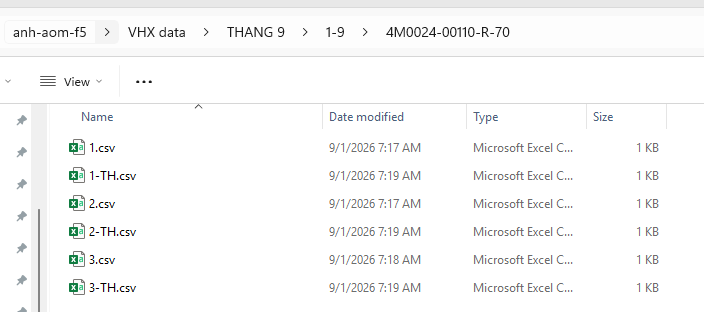
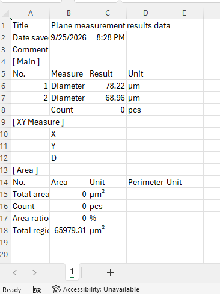
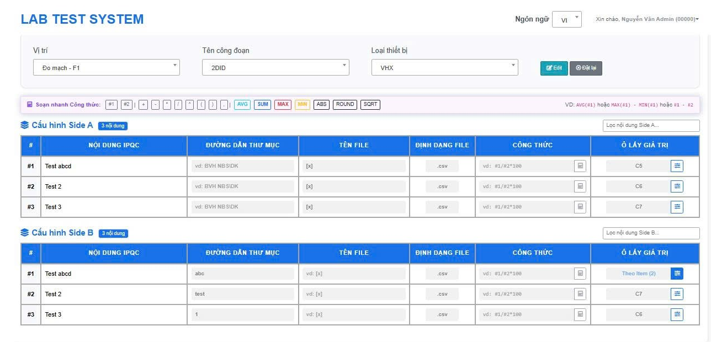
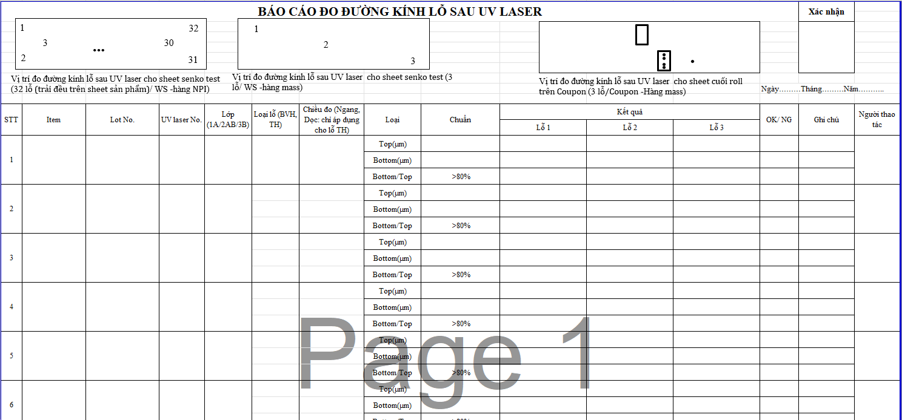
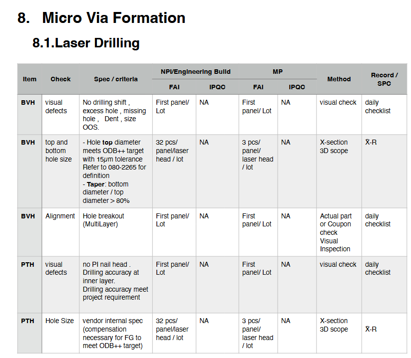
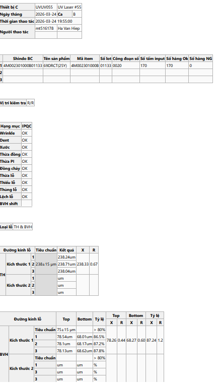

# Ref.01. UV Laser

> Nguồn: sheet `Ref.01. UV Laser` trong `LAB_Test_system_261013.xlsx`. Chuyển đổi tự động, giữ nguyên câu chữ gốc. Cột `Row` và tên cột (A, B, ...) là tọa độ ô trong Excel.

Ref.01. UV Laser <!-- A1 -->

Content <!-- A2 -->

Logic for template processing <!-- A3 -->

IPQC content in WI (Watch | Pismo |Camera) <!-- A4 -->

IPQC contents in WCS <!-- A5 -->

Customer requirement <!-- A6 -->

I.  Logic for template processing <!-- A8 -->

<!-- ảnh neo tại ô A9 -->

<!-- ảnh neo tại ô D9 -->

<!-- ảnh neo tại ô G10 -->

Bảng dữ liệu rộng (6 dòng × 61 cột có dữ liệu, cột A..BI, dòng 32–37) được xuất nguyên vẹn ra [`data/ref-01-uv-laser-rows32-37.csv`](data/ref-01-uv-laser-rows32-37.csv). Trích 6 dòng đầu, cột A..L:

| Row | A | B | C | D | E | F | G | H | I | J | K | L |
|---|---|---|---|---|---|---|---|---|---|---|---|---|
| 32 | ID Công  nhân | Ngày Input | Máy | Item | Lot | Loại hàng | Mặt chạy | Kiểu lỗ (BVH/TH) | Loại đường kính lỗ | Kích  thước (Top/Bot/Ratio) | Tiêu chuẩn | 1 |
| 33 | 73971 | 2026-09-23 08:52:40 | 31 | 4M0024 | 00400 | R | NA | BVH | 75 | Top | 60.-90. | 78.35 |
| 34 |  |  |  |  |  |  |  | BVH | 75 | Bot |  | 68.95 |
| 35 |  |  |  |  |  |  |  | BVH | 75 | Bot/Top | >80% | 0.880025526483727 |
| 36 | 73971 | 2026-09-23 08:52:40 | 31 | 4M0024 | 00400 | R | NA | TH | 238 | Top | 223.-253. | 238 |
| 37 | 73971 | 2026-09-23 08:52:40 | 14 | 4M0024 | 00401 | R | NA | BVH | 75 | Top | 60.-90. | 78.71 |

<!-- ảnh neo tại ô A39 -->

<!-- ảnh neo tại ô E39 -->

<!-- ảnh neo tại ô J39 -->

## Chú thích vẽ trên sheet (shape)

Các hộp chú thích vẽ đè lên ảnh/bảng, chép nguyên văn:

- Tên file tương ứng với pcs no
- Tên file tương ưng với PCS No
- Nội dung IPQC tương ứng của PCS No
- ô gái trị tương ứng với nội dung
