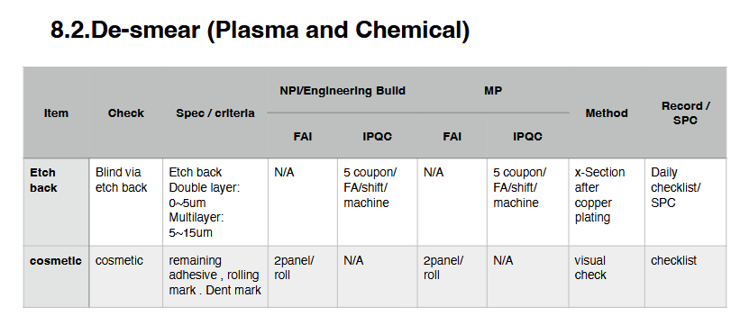
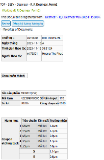

# Ref.02. De-smear (Plasma)

> Nguồn: sheet `Ref.02. De-smear (Plasma)` trong `LAB_Test_system_261013.xlsx`. Chuyển đổi tự động, giữ nguyên câu chữ gốc. Cột `Row` và tên cột (A, B, ...) là tọa độ ô trong Excel.

<!-- ảnh neo tại ô A1 -->

<!-- ảnh neo tại ô I1 -->

| Row | A | B | C | D | E | F | G | H | I | J | K | L | M | N | O | P | Q | R | S |
|---|---|---|---|---|---|---|---|---|---|---|---|---|---|---|---|---|---|---|---|
| 25 | KẾT QUẢ CROSS CUT LỖ BVH - MẶT KHÔNG CÓ BONDING SHEET |  |  |  |  |  |  |  |  |  |  |  |  |  |  | Judgement | Approve |  |  |
| 26 | Cross cut result of BVH - Non BDS side |  |  |  |  |  |  |  |  |  |  |  |  |  |  | OK |  |  |  |
| 27 |  |  |  |  |  |  |  |  |  |  |  |  |  |  |  | OK |  |  |  |
| 28 | Item name | 69DRCT |  | Item code | 4M0024-00235_520704+RR14_76281 |  |  |  |  |  | Loại mẫu | Sau ma Dong |  | 2026-11-09 |  |  |  |  |  |
| 29 |  |  |  |  | 1 | 2 | 3 | 4 | 5 | 6 | 7 | 8 | 9 | 10 | 11 | 12 | 13 | 14 | 15 |
| 30 |  |  |  |  | - | - | 1 | 2 | 3 | - | 4 | 5 | - | - | 6 | 7 | 8 | 9 | 10 |
| 31 | Sample No | Có xuất hiện các lỗi bất thường?/ Any abnormal failure mode? | Mode lỗi (nếu có)/ Failure mode | Taper=Bottom/Top (≥ 80%) ? | 1. Đường kính lỗ (Top)/  Via size Top | 2. Đường kính lỗ (Bottom)/ Via size Bottom | 3: Độ dày đồng thành lỗ từ lớp đồng bên trái/ Plated Cu thickness from top Base Cu left | 4: Độ dày đồng thành lỗ từ lớp đồng bên phải/  Plated Cu thickness from top Base Cu right | 5: Độ dày đồng thành lỗ từ lớp PI/  Plated Cu thickness from PI | 5: Độ dày đồng thành lỗ từ lớp chất dính/  Plated Cu thickness from PI | 7: Tổng độ dày đồng bề mặt/Total Cu thickness | 8.1: Độ dày đồng đáy lỗ (Minimum point)/  Plated Cu thickness from bottom Base Cu | 8.2: Độ dày đồng đáy lỗ (Center hole position)/  Plated Cu thickness from bottom Base Cu | d: Độ dày đồng nguyên liệu/ Base Cu | 9.Etching back PI,bonding sheet/  Ahesive etch back | 10 . Độ dày đồng được mạ/  Minimum plated Cu thickness from top base Cu | 11 . Etching downbase cu thickness/  Etching downbase cu thickness | 12. Độ lồi của lỗ mạ/  The protrusion of plated hole | 13. Độ lõm của lỗ mạ/  The dimple of plated hole |
| 32 | 1 | No | - | 0.939477303988996 | 72.7 | 68.3 | 9.8 | 8.9 | 14.4 | - | 25.7 | 9.6 | - | 11.3 | 1.1 | 14.4 | 1.9 | - | - |
| 33 | 2 | No | - | 0.933975240715268 | 72.7 | 67.9 | 11.1 | 10.8 | 17.4 | - | 28.6 | 10.6 | - | 12.1 | 1.4 | 16.5 | 2.7 | - | - |
| 34 | 3 | No | - | 0.94750656167979 | 76.2 | 72.2 | 8.8 | 9.6 | 14.7 | - | 25.6 | 9.9 | - | 12 | 1.5 | 13.6 | 2.4 | - | - |
| 35 | 4 | No | - | 0.956175298804781 | 75.3 | 72 | 9.4 | 9.7 | 14.5 | - | 25 | 9.4 | - | 11.3 | 1.2 | 13.7 | 2.8 | - | - |
| 36 | 5 | No | - | 0.959942775393419 | 69.9 | 67.1 | 10.4 | 10.8 | 17.4 | - | 27.2 | 13.8 | - | 11.2 | 1.7 | 16 | 2.4 | - | - |
| 37 | 6 | No | - | 0.936054421768707 | 73.5 | 68.8 | 9.6 | 9.3 | 15.1 | - | 25.6 | 9.4 | - | 11.9 | 1.4 | 13.7 | 2.1 | - | - |
| 38 | 7 | No | - | - | - | - | - | - | - | - | - | - | - | - | - | - | - | - | - |

| Row | A | B | C | D | E | F | G | H | I | J | K | L | M | N | O | P | Q | R | S | T | U | V | W | Y | Z | AA | AB | AC |
|---|---|---|---|---|---|---|---|---|---|---|---|---|---|---|---|---|---|---|---|---|---|---|---|---|---|---|---|---|
| 40 | Test etching rate máy R/R plasma No.6 |  |  |  |  |  |  |  |  |  |  |  |  |  |  |  |  |  |  |  |  |  |  |  |  |  |  |  |
| 41 | Ngày/ tháng | thoi gian |  | 1 | 2 | 3 | 4 | 5 | 6 | 7 | 8 | 9 | Max | Min | Aver | Unif | Loại nguyên liệu | Comment | Date | Etc amount | Etc amount  target > 0.6 | Unif | Unif  Target: >75% | Date | Etc amount | Etc amount  target > 0.6 | Unif | Unif  Target: >75% |
| 42 | 2026-08-01 | 1 | Before | 0.8886 | 0.8861 | 0.8837 | 0.8933 | 0.879 | 0.8765 | 0.8795 | 0.8755 | 0.8846 | 0.8933 | 0.8755 |  |  | MB |  | 2026-08-01 | 1.70572916666667 | 0.63 | 0.961832061068702 | 0.75 | 2026-08-01 | 1.93142361111111 | 0.63 | 0.939325842696632 | 0.75 |
| 43 | 2026-08-01 | 1 | After | 0.8761 | 0.8734 | 0.8709 | 0.88 | 0.8655 | 0.863 | 0.8661 | 0.8627 | 0.8712 | 0.88 | 0.8627 |  |  | MB |  | 2026-08-02 | 1.67824074074074 | 0.63 | 0.95344827586207 | 0.75 | 2026-08-02 | 1.84751157407407 | 0.63 | 0.911902897415816 | 0.75 |
| 44 | 2026-08-01 | 1 | Diff | 0.0125 | 0.0127 | 0.0128 | 0.0133 | 0.0135 | 0.0135 | 0.0134 | 0.0127999999999999 | 0.0134000000000001 | 0.0135 | 0.0125 |  |  | MB |  | 2026-08-03 | 0 | 0.63 | 0 | 0.75 | 2026-08-03 | 0 | 0.63 | 0 | 0.75 |
| 45 | 2026-08-01 | 1 | Etc amount | 1.62760416666666 | 1.65364583333334 | 1.66666666666667 | 1.73177083333333 | 1.75781249999999 | 1.75781249999999 | 1.74479166666666 | 1.66666666666666 | 1.74479166666668 | 1.75781249999999 | 1.62760416666666 | 1.70572916666667 | 0.961832061068702 | MB |  | 2026-08-04 | 0 | 0.63 | 0 | 0.75 | 2026-08-04 | 0 | 0.63 | 0 | 0.75 |
| 46 | 2026-08-01 | 1 | Etc rate | 0.0678168402777775 | 0.0689019097222225 | 0.0694444444444446 | 0.0721571180555555 | 0.0732421874999998 | 0.0732421874999998 | 0.0726996527777776 | 0.069444444444444 | 0.0726996527777782 | 0.0732421874999998 | 0.0678168402777775 |  |  | MB |  | 2026-08-05 | 0 | 0.63 | 0 | 0.75 | 2026-08-05 | 0 | 0.63 | 0 | 0.75 |
| 47 | 2026-08-01 | 1 | Before | 0.7896 | 0.7929 | 0.7898 | 0.7972 | 0.7938 | 0.7904 | 0.7904 | 0.774 | 0.7807 | 0.7938 | 0.774 |  |  | PK |  | 2026-08-06 | 0 | 0.63 | 0 | 0.75 | 2026-08-06 | 0 | 0.63 | 0 | 0.75 |
| 48 | 2026-08-01 | 1 | After | 0.774 | 0.7774 | 0.775 | 0.7828 | 0.7794 | 0.7756 | 0.776 | 0.7601 | 0.765 | 0.7828 | 0.7601 |  |  | PK |  | 2026-08-07 | 0 | 0.63 | 0 | 0.75 | 2026-08-07 | 0 | 0.63 | 0 | 0.75 |
| 49 | 2026-08-01 | 1 | Diff | 0.0155999999999999 | 0.0155000000000001 | 0.0147999999999999 | 0.0144 | 0.0144 | 0.0148 | 0.0144 | 0.0139 | 0.0156999999999999 | 0.0156999999999999 | 0.0139 |  |  | PK |  | 2026-08-08 | 0 | 0.63 | 0 | 0.75 | 2026-08-08 | 0 | 0.63 | 0 | 0.75 |
| 50 | 2026-08-01 | 1 | Etc amount | 2.03124999999999 | 2.01822916666668 | 1.92708333333332 | 1.875 | 1.875 | 1.92708333333334 | 1.875 | 1.80989583333334 | 2.04427083333333 | 2.04427083333333 | 1.80989583333334 | 1.93142361111111 | 0.939325842696632 | PK |  | 2026-08-09 | 0 | 0.63 | 0 | 0.75 | 2026-08-09 | 0 | 0.63 | 0 | 0.75 |
| 51 | 2026-08-01 | 1 | Etc rate | 0.0846354166666664 | 0.0840928819444448 | 0.0802951388888885 | 0.0781249999999998 | 0.0781249999999998 | 0.0802951388888891 | 0.0781249999999998 | 0.075412326388889 | 0.0851779513888885 | 0.0851779513888885 | 0.075412326388889 |  |  | PK |  | 2026-08-10 | 0 | 0.63 | 0 | 0.75 | 2026-08-10 | 0 | 0.63 | 0 | 0.75 |
| 52 | 2026-08-02 | 7h-10h | Before | 0.888 | 0.881 | 0.8875 | 0.8916 | 0.8845 | 0.8883 | 0.8818 | 0.8861 | 0.8878 | 0.8916 | 0.881 |  |  | MB |  | 2026-08-11 | 0 | 0.63 | 0 | 0.75 | 2026-08-11 | 0 | 0.63 | 0 | 0.75 |
| 53 | 2026-08-02 | 7h-10h | After | 0.8749 | 0.8678 | 0.874 | 0.8788 | 0.8722 | 0.8757 | 0.8689 | 0.873 | 0.8753 | 0.8788 | 0.8678 |  |  | MB |  | 2026-08-12 | 0 | 0.63 | 0 | 0.75 | 2026-08-12 | 0 | 0.63 | 0 | 0.75 |
| 54 | 2026-08-02 | 7h-10h | Diff | 0.0131 | 0.0132 | 0.0135 | 0.0127999999999999 | 0.0123 | 0.0125999999999999 | 0.0129 | 0.0131 | 0.0125000000000001 | 0.0135 | 0.0123 |  |  | MB |  | 2026-08-13 | 0 | 0.63 | 0 | 0.75 | 2026-08-13 | 0 | 0.63 | 0 | 0.75 |
| 55 | 2026-08-02 | 7h-10h | Etc amount | 1.70572916666667 | 1.71875 | 1.75781249999999 | 1.66666666666666 | 1.6015625 | 1.64062499999999 | 1.6796875 | 1.70572916666667 | 1.62760416666668 | 1.75781249999999 | 1.6015625 | 1.67824074074074 | 0.95344827586207 | MB |  | 2026-08-14 | 0 | 0.63 | 0 | 0.75 | 2026-08-14 | 0 | 0.63 | 0 | 0.75 |
| 56 | 2026-08-02 | 7h-10h | Etc rate | 0.0710720486111111 | 0.0716145833333333 | 0.0732421874999998 | 0.069444444444444 | 0.0667317708333332 | 0.0683593749999997 | 0.0699869791666668 | 0.0710720486111111 | 0.0678168402777782 | 0.0732421874999998 | 0.0667317708333332 |  |  | MB |  | 2026-08-15 | 0 | 0.63 | 0 | 0.75 | 2026-08-15 | 0 | 0.63 | 0 | 0.75 |
| 57 | 2026-08-02 | 1 | Before | 0.7883 | 0.7863 | 0.7865 | 0.7897 | 0.7914 | 0.7841 | 0.7891 | 0.7873 | 0.7847 | 0.7914 | 0.7841 |  |  | PK |  | 2026-08-16 | 0 | 0.63 | 0 | 0.75 | 2026-08-16 | 0 | 0.63 | 0 | 0.75 |
| 58 | 2026-08-02 | 1 | After | 0.7742 | 0.7704 | 0.7731 | 0.7757 | 0.7775 | 0.7701 | 0.775 | 0.7735 | 0.7702 | 0.7775 | 0.7701 |  |  | PK |  | 2026-08-17 | 0 | 0.63 | 0 | 0.75 | 2026-08-17 | 0 | 0.63 | 0 | 0.75 |
| 59 | 2026-08-02 | 1 | Diff | 0.0141 | 0.0159 | 0.0134 | 0.014 | 0.0139 | 0.014 | 0.0141 | 0.0138 | 0.0145 | 0.0159 | 0.0134 |  |  | PK |  | 2026-08-18 | 0 | 0.63 | 0 | 0.75 | 2026-08-18 | 0 | 0.63 | 0 | 0.75 |
| 60 | 2026-08-02 | 1 | Etc amount | 1.8359375 | 2.0703125 | 1.74479166666666 | 1.82291666666667 | 1.80989583333334 | 1.82291666666667 | 1.8359375 | 1.796875 | 1.88802083333333 | 2.0703125 | 1.74479166666666 | 1.84751157407407 | 0.911902897415816 | PK |  | 2026-08-19 | 0 | 0.63 | 0 | 0.75 | 2026-08-19 | 0 | 0.63 | 0 | 0.75 |
| 61 | 2026-08-02 | 1 | Etc rate | 0.0764973958333333 | 0.0862630208333335 | 0.0726996527777776 | 0.0759548611111112 | 0.075412326388889 | 0.0759548611111112 | 0.0764973958333333 | 0.0748697916666669 | 0.078667534722222 | 0.0862630208333335 | 0.0726996527777776 |  |  | PK |  | 2026-08-20 | 0 | 0.63 | 0 | 0.75 | 2026-08-20 | 0 | 0.63 | 0 | 0.75 |
