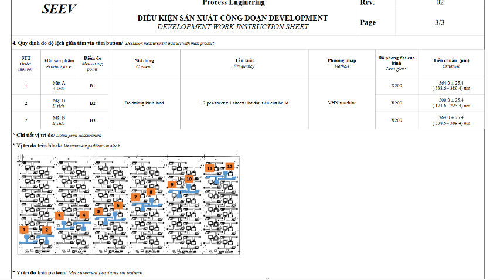
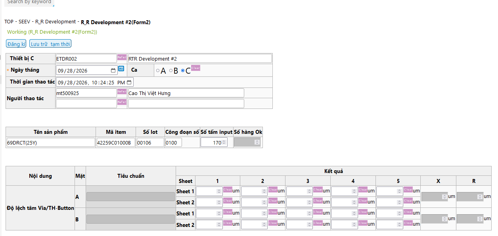

# Ref.03. DFR Development

> Nguồn: sheet `Ref.03. DFR Development` trong `LAB_Test_system_261013.xlsx`. Chuyển đổi tự động, giữ nguyên câu chữ gốc. Cột `Row` và tên cột (A, B, ...) là tọa độ ô trong Excel.

Ref.03. DFR Development <!-- A1 -->

Content <!-- A2 -->

Logic for template processing <!-- A3 -->

IPQC content in WI (Watch | Pismo |Camera) <!-- A4 -->

IPQC contents in WCS <!-- A5 -->

Customer requirement <!-- A6 -->

Bảng dữ liệu rộng (8 dòng × 143 cột có dữ liệu, cột A..EM, dòng 9–16) được xuất nguyên vẹn ra [`data/ref-03-dfr-development-rows9-16.csv`](data/ref-03-dfr-development-rows9-16.csv). Trích 6 dòng đầu, cột A..L:

| Row | A | B | C | D | E | F | G | H | I | J | K | L |
|---|---|---|---|---|---|---|---|---|---|---|---|---|
| 9 | Date | Item Code | Batch No | B1 |  |  |  |  |  |  |  |  |
| 10 | Date | Item Code | Batch No | Center | 1 | 2 | 3 | 4 | 5 | 6 | 7 | 8 |
| 11 | Date | Item Code | Batch No | Center | 1 | 2 | 3 | 4 | 5 | 6 | 7 | 8 |
| 12 | Date | Item Code | Batch No | Center | 1 | 2 | 3 | 4 | 5 | 6 | 7 | 8 |
| 13 | 2026-09-27 | 7M044N01000B | 85 | #REF! | 8.85 | 15.24 | 6.67 | 15.28 | 6.25 | 2.14 | 6.28 | 15.2 |
| 14 | 2026-09-27 | 7M044N01000B | 81 | #REF! | 5.49 | 6.59 | 9.89 | 5.49 | 3.3 | 7.69 | 18.24 | 6.28 |

<!-- ảnh neo tại ô A17 -->

<!-- ảnh neo tại ô AA17 -->

<!-- ảnh neo tại ô K18 -->

## Chú thích vẽ trên sheet (shape)

Các hộp chú thích vẽ đè lên ảnh/bảng, chép nguyên văn:

- Nhìn giá trị đo trên máy VHX rồi nhập vào file
