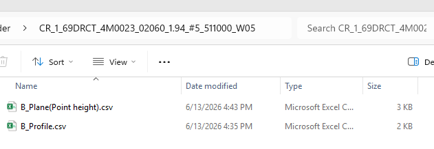
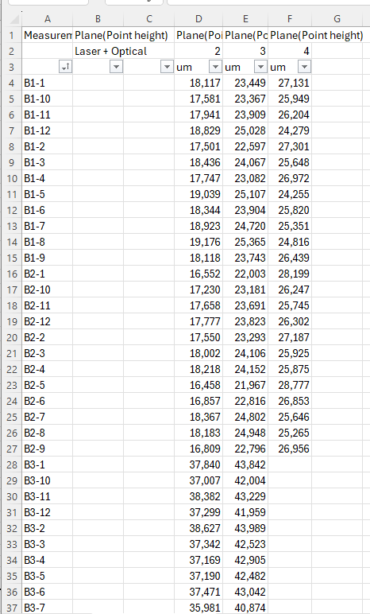
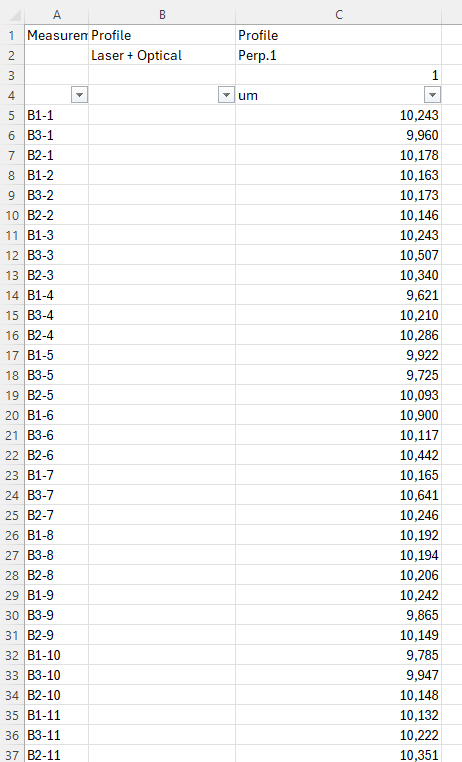
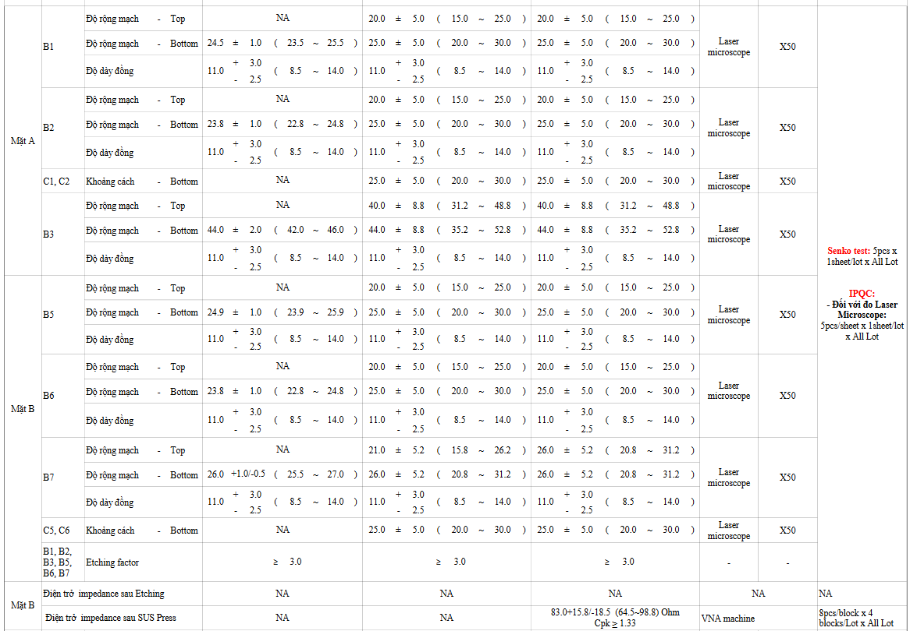
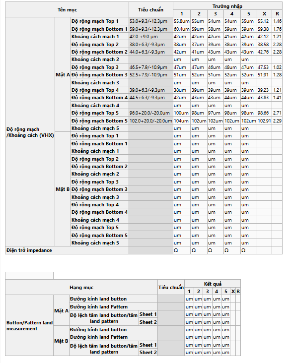
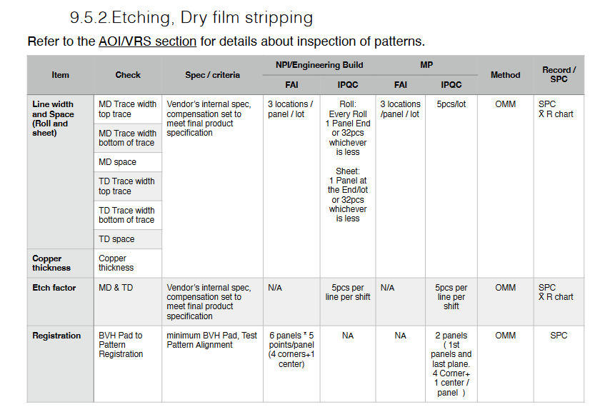

# Ref.04. RR SS Etching

> Nguồn: sheet `Ref.04. RR SS Etching` trong `LAB_Test_system_261013.xlsx`. Chuyển đổi tự động, giữ nguyên câu chữ gốc. Cột `Row` và tên cột (A, B, ...) là tọa độ ô trong Excel.

Ref.04. RR SS Etching <!-- A1 -->

Content <!-- A2 -->

Logic for template processing <!-- A3 -->

IPQC content in WI (Watch | Pismo |Camera) <!-- A4 -->

IPQC contents in WCS <!-- A5 -->

Customer requirement <!-- A6 -->

I. Logic for template processing <!-- A8 -->

<!-- ảnh neo tại ô A9 -->

<!-- ảnh neo tại ô J9 -->

<!-- ảnh neo tại ô V9 -->

Laser Microscope - Đo mạch <!-- A42 -->

Bảng dữ liệu rộng (10 dòng × 1512 cột có dữ liệu, cột A..BFD, dòng 44–53) được xuất nguyên vẹn ra [`data/ref-04-rr-ss-etching-rows44-53.csv`](data/ref-04-rr-ss-etching-rows44-53.csv). Trích 6 dòng đầu, cột A..L:

| Row | A | B | C | E | F | G | H | I | J | K | L |
|---|---|---|---|---|---|---|---|---|---|---|---|
| 44 | Daily report of Etching machine Inner |  |  |  |  |  |  |  |  |  |  |
| 45 | BÁO CÁO SẢN XUẤT HÀNG NGÀY MÁY ETCHING  RTR NO.1 No.4 |  |  |  |  |  |  |  |  |  |  |
| 46 | Date | Item code | Batch No | Điều kiện Etching | LAZER NO | Chú ý | B1 - T |  |  |  |  |
| 47 | Date | Item code | Batch No | Điều kiện Etching | LAZER NO | Chú ý | Center | MIN | MAX | Min | Max |
| 48 | 🔴**KHÔNG XÓA DÒNG NÀY NHÉ ⇒⇒** |  |  |  |  |  | TBC | TBC | TBC |  |  |
| 49 | 2025-10-01 | 4M002001000B | 00009 |  | 5 | CR | 20 | 15 | 25 | 17.5189400588959 | 21.0588115989039 |

VHX - QA Lab <!-- A56 -->

| Row | A | B | C | D | E | F | G | H | I | J | K | L | M | N | O | P | Q | R | S | T | U |
|---|---|---|---|---|---|---|---|---|---|---|---|---|---|---|---|---|---|---|---|---|---|
| 58 | CPK Data Sheet - Rev 06 |  |  |  |  |  |  |  |  |  |  |  |  |  |  |  |  |  |  |  |  |
| 59 | Part Number : | Item | 7S4683 |  |  |  |  |  | IN |  |  |  | Công đoạn | CROSSCUT |  |  |  |  | Judge | OK |  |
| 60 | Part Description : | Lot No | 00002 |  |  |  |  |  |  |  |  |  | ID | 506451 | 519943 |  |  |  | Xác nhận |  |  |
| 61 |  | Date | 2026-09-05 |  |  |  |  |  |  |  |  |  |  |  |  |  |  |  |  |  |  |
| 62 |  |  |  |  |  |  |  |  |  |  |  |  |  |  | OPA-QA-0225-01-rev 03 |  |  |  |  |  |  |
| 63 | Comments | B1 |  |  | C1 |  | B2 |  |  | C2 |  | B3 |  |  | C3 |  | B4 |  |  | C4 |  |
| 64 | Proposed +Tol |  |  |  |  |  |  |  |  |  |  |  |  |  |  |  |  |  |  |  |  |
| 65 | Proposed -Tol |  |  |  |  |  |  |  |  |  |  |  |  |  |  |  |  |  |  |  |  |
| 66 | Mean Shift Amount |  |  |  |  |  |  |  |  |  |  |  |  |  |  |  |  |  |  |  |  |
| 67 | Changed Mean |  |  |  |  |  |  |  |  |  |  |  |  |  |  |  |  |  |  |  |  |
| 68 | Proposed USL |  |  |  |  |  |  |  |  |  |  |  |  |  |  |  |  |  |  |  |  |
| 69 | Proposed LSL |  |  |  |  |  |  |  |  |  |  |  |  |  |  |  |  |  |  |  |  |
| 70 | Proposed Yield |  |  |  |  |  |  |  |  |  |  |  |  |  |  |  |  |  |  |  |  |
| 71 | Distribution Type | DoubleSides | DoubleSides | DoubleSides | DoubleSides | DoubleSides | DoubleSides | DoubleSides | DoubleSides | DoubleSides | DoubleSides | DoubleSides | DoubleSides | DoubleSides | DoubleSides | DoubleSides | DoubleSides | DoubleSides | DoubleSides | DoubleSides | DoubleSides |
| 72 | Dim. No. | TOP | BOTTOM | CIRCUIT HIGHT | TOP | BOTTOM | TOP | BOTTOM | CIRCUIT HIGHT | TOP | BOTTOM | TOP | BOTTOM | CIRCUIT HIGHT | TOP | BOTTOM | TOP | BOTTOM | CIRCUIT HIGHT | TOP | BOTTOM |
| 73 | Nominal Dim. | 51.5 | 54.5 | 11 | TBC | 58 | 51.5 | 54.5 | 11 | TBC | 58 | 32 | 35 | 11 | TBC | 40 | 32 | 35 | 11 | TBC | 40 |
| 74 | Tol. Max. (+) | 10.2 | 10.2 | 3 |  | 11.6 | 10.2 | 10.2 | 3 |  | 11.6 | 7 | 7 | 3 |  | 8 | 7 | 7 | 3 |  | 8 |
| 75 | Tol. Min. (-) | 10.2 | 10.2 | 2.5 |  | 11.6 | 10.2 | 10.2 | 2.5 |  | 11.6 | 7 | 7 | 2.5 |  | 8 | 7 | 7 | 2.5 |  | 8 |
| 76 | Instrument |  |  |  |  |  |  |  |  |  |  |  |  |  |  |  |  |  |  |  |  |
| 77 | Resolution |  |  |  |  |  |  |  |  |  |  |  |  |  |  |  |  |  |  |  |  |
| 78 | USL | 61.7 | 64.7 | 14 | #VALUE! | 69.6 | 61.7 | 64.7 | 14 | #VALUE! | 69.6 | 39 | 42 | 14 | #VALUE! | 48 | 39 | 42 | 14 | #VALUE! | 48 |
| 79 | LSL | 41.3 | 44.3 | 8.5 | #VALUE! | 46.4 | 41.3 | 44.3 | 8.5 | #VALUE! | 46.4 | 25 | 28 | 8.5 | #VALUE! | 32 | 25 | 28 | 8.5 | #VALUE! | 32 |
| 80 | Std Dev | #DIV/0! | #DIV/0! | #DIV/0! | #DIV/0! | #DIV/0! | #DIV/0! | #DIV/0! | #DIV/0! | #DIV/0! | #DIV/0! | #DIV/0! | #DIV/0! | #DIV/0! | #DIV/0! | #DIV/0! | #DIV/0! | #DIV/0! | #DIV/0! | #DIV/0! | #DIV/0! |
| 81 | Mean | #DIV/0! | #DIV/0! | #DIV/0! | #DIV/0! | #DIV/0! | #DIV/0! | #DIV/0! | #DIV/0! | #DIV/0! | #DIV/0! | #DIV/0! | #DIV/0! | #DIV/0! | #DIV/0! | #DIV/0! | #DIV/0! | #DIV/0! | #DIV/0! | #DIV/0! | #DIV/0! |
| 82 | Maximum | #DIV/0! | #DIV/0! | #DIV/0! | #DIV/0! | #DIV/0! | #DIV/0! | #DIV/0! | #DIV/0! | #DIV/0! | #DIV/0! | #DIV/0! | #DIV/0! | #DIV/0! | #DIV/0! | #DIV/0! | #DIV/0! | #DIV/0! | #DIV/0! | #DIV/0! | #DIV/0! |
| 83 | Minimum | #DIV/0! | #DIV/0! | #DIV/0! | #DIV/0! | #DIV/0! | #DIV/0! | #DIV/0! | #DIV/0! | #DIV/0! | #DIV/0! | #DIV/0! | #DIV/0! | #DIV/0! | #DIV/0! | #DIV/0! | #DIV/0! | #DIV/0! | #DIV/0! | #DIV/0! | #DIV/0! |
| 84 | Cp | #DIV/0! | #DIV/0! | #DIV/0! | #VALUE! | #DIV/0! | #DIV/0! | #DIV/0! | #DIV/0! | #VALUE! | #DIV/0! | #DIV/0! | #DIV/0! | #DIV/0! | #VALUE! | #DIV/0! | #DIV/0! | #DIV/0! | #DIV/0! | #VALUE! | #DIV/0! |
| 85 | Cpkl | #DIV/0! | #DIV/0! | #DIV/0! | #DIV/0! | #DIV/0! | #DIV/0! | #DIV/0! | #DIV/0! | #DIV/0! | #DIV/0! | #DIV/0! | #DIV/0! | #DIV/0! | #DIV/0! | #DIV/0! | #DIV/0! | #DIV/0! | #DIV/0! | #DIV/0! | #DIV/0! |
| 86 | Cpku | #DIV/0! | #DIV/0! | #DIV/0! | #VALUE! | #DIV/0! | #DIV/0! | #DIV/0! | #DIV/0! | #VALUE! | #DIV/0! | #DIV/0! | #DIV/0! | #DIV/0! | #VALUE! | #DIV/0! | #DIV/0! | #DIV/0! | #DIV/0! | #VALUE! | #DIV/0! |
| 87 | Cpk | #DIV/0! | #DIV/0! | #DIV/0! | #VALUE! | #DIV/0! | #DIV/0! | #DIV/0! | #DIV/0! | #VALUE! | #DIV/0! | #DIV/0! | #DIV/0! | #DIV/0! | #VALUE! | #DIV/0! | #DIV/0! | #DIV/0! | #DIV/0! | #VALUE! | #DIV/0! |

| Row | A | B | C | D | E | F | G | H | I | J | K | L | M | N | O | P | Q | R | S | T | U |
|---|---|---|---|---|---|---|---|---|---|---|---|---|---|---|---|---|---|---|---|---|---|
| 89 | Projected Yields | #DIV/0! | #DIV/0! | #DIV/0! | #VALUE! | #DIV/0! | #DIV/0! | #DIV/0! | #DIV/0! | #VALUE! | #DIV/0! | #DIV/0! | #DIV/0! | #DIV/0! | #VALUE! | #DIV/0! | #DIV/0! | #DIV/0! | #DIV/0! | #VALUE! | #DIV/0! |
| 90 | Mean Drift | #DIV/0! | #DIV/0! | #DIV/0! | #DIV/0! | #DIV/0! | #DIV/0! | #DIV/0! | #DIV/0! | #DIV/0! | #DIV/0! | #DIV/0! | #DIV/0! | #DIV/0! | #DIV/0! | #DIV/0! | #DIV/0! | #DIV/0! | #DIV/0! | #DIV/0! | #DIV/0! |

| Row | A | B | C | D | E | F | G | H | I | J | K | L | M | N | O | P | Q | R | S | T | U |
|---|---|---|---|---|---|---|---|---|---|---|---|---|---|---|---|---|---|---|---|---|---|
| 92 | 1 | 54.4 | 57.9 | 12 | 57 | 52.4 | 52.8 | 55.7 | 11.4 | 57.6 | 54.6 | 32 | 36.5 | 11.5 | 43.3 | 38.6 | 31.9 | 38.3 | 11.5 | 42.4 | 36.4 |
| 93 | 2 | 54.7 | 58 | 11.9 | 55.9 | 51.6 | 54.7 | 57.1 | 11.6 | 56.6 | 53.7 | 31.4 | 37.2 | 11.6 | 43.5 | 37.8 | 31.7 | 36.5 | 11.4 | 42.7 | 37.1 |
| 94 | 3 | 54 | 58.8 | 12.2 | 56.4 | 51.8 | 52.5 | 55.5 | 11.9 | 57.1 | 54.1 | 30.9 | 37 | 10.9 | 43.6 | 37.8 | 31.7 | 36.3 | 11.3 | 43.6 | 39 |
| 95 | 4 | 52.9 | 56.6 | 11.9 | 57.4 | 52.6 | 52.5 | 54.6 | 11.9 | 57.9 | 54.4 | 30.8 | 34.5 | 11.5 | 44 | 40.6 | 30.1 | 34.7 | 11.6 | 44.1 | 39.6 |
| 96 | 5 | 53 | 55.3 | 11.9 | 57.4 | 54 | 56.2 | 58.9 | 12 | 53.1 | 50 | 37 | 41.8 | 11.6 | 38.7 | 32.6 | 30.8 | 36.3 | 11.4 | 43.7 | 37.8 |
| 97 | 6 | 56 | 59.7 | 12.2 | 52.8 | 49.1 | 56.2 | 58.8 | 11.8 | 54.6 | 50.4 | 35.1 | 41.7 | 11.3 | 39.3 | 33.3 | 36.4 | 41.4 | 10.9 | 39.4 | 32.9 |
| 98 | 7 | 53.5 | 56.8 | 12.2 | 56.2 | 53.2 | 53.1 | 56.5 | 11.5 | 57.1 | 53.5 | 31.1 | 36.2 | 11.3 | 43.6 | 38.3 | 32.7 | 37.8 | 11.5 | 42.2 | 36.4 |
| 99 | 8 | 53.3 | 56.5 | 12.1 | 57 | 53.6 | 51.6 | 54.5 | 11.5 | 59 | 55.8 | 30 | 34 | 11.1 | 44.7 | 41 | 29.3 | 34.2 | 11.6 | 45.2 | 41 |
| 100 | 9 | 53.5 | 56.4 | 12.2 | 56.9 | 52.7 | 53.5 | 56 | 11.5 | 57.3 | 54.6 | 29.9 | 34 | 11.2 | 45.6 | 41.5 | 30 | 34.4 | 11.3 | 44.6 | 40.1 |
| 101 | 10 | 52.9 | 56.5 | 12.2 | 56.6 | 53.3 | 50.5 | 54.2 | 11.8 | 58.9 | 54.6 | 30.3 | 35.4 | 11.3 | 44.1 | 39.1 | 30 | 34.8 | 11.1 | 44.8 | 39.7 |
| 102 | 11 | 54.7 | 57.8 | 12.2 | 56.7 | 52.1 | 54.7 | 56.5 | 11.6 | 56.3 | 52.6 | 31.4 | 36.4 | 11.7 | 43.2 | 37.6 | 30.3 | 36 | 11.5 | 42.9 | 38.2 |
| 103 | 12 | 54.3 | 57.8 | 12 | 57 | 52.7 | 51.8 | 55.2 | 11.6 | 57.3 | 54.9 | 31.6 | 36.5 | 11.2 | 43.9 | 38.7 | 31 | 36.5 | 11.6 | 43.8 | 37.9 |
| 104 | 13 | 53.7 | 56.9 | 12.1 | 57.2 | 53.7 | 52.3 | 55.7 | 11.9 | 57.5 | 53.6 | 30.6 | 36.1 | 11.3 | 43.4 | 39 | 31.8 | 36.5 | 11.5 | 41.8 | 37.7 |
| 105 | 14 | 54.4 | 57.2 | 12.3 | 56 | 52.1 | 53 | 56 | 11.6 | 57.9 | 54.6 | 29.9 | 36.2 | 11.6 | 44.6 | 38 | 29.6 | 34.9 | 11.9 | 44.8 | 40.6 |
| 106 | 15 | 52.9 | 56.3 | 12.1 | 56.6 | 52.6 | 51.3 | 54 | 11.5 | 58.8 | 55.4 | 31 | 36.8 | 11.8 | 43.3 | 37.9 | 31.2 | 35.4 | 11.5 | 43.7 | 38.8 |
| 107 | 16 | 52.9 | 56.5 | 12 | 57.8 | 54.1 | 52.1 | 54.3 | 11.6 | 58.9 | 56.5 | 28.9 | 33.6 | 11.2 | 46 | 40.9 | 30.6 | 33.9 | 11.3 | 44.3 | 40.4 |
| 108 | 17 | 54.1 | 57.3 | 12.2 | 56.7 | 52.8 | 51.3 | 54.3 | 11.5 | 57.7 | 54.6 | 31.7 | 36.8 | 11.5 | 43.8 | 39.3 | 33.1 | 35.5 | 11.9 | 41.3 | 37.9 |
| 109 | 18 | 53.1 | 57 | 12.2 | 56.9 | 52.8 | 53.5 | 56.4 | 11.9 | 56.6 | 52.7 | 31.7 | 35.6 | 11.6 | 43.2 | 38.9 | 31.1 | 35.5 | 11.2 | 43.3 | 38.7 |
| 110 | 19 | 54.1 | 57.2 | 12.3 | 56.1 | 52.7 | 52.2 | 55.7 | 11.4 | 57.1 | 53.8 | 31.4 | 37.1 | 11.5 | 43.6 | 38 | 32.4 | 37.4 | 11.9 | 43.2 | 38.4 |
| 111 | 20 | 53.2 | 56.6 | 12.2 | 57.5 | 53.6 | 53.6 | 56.2 | 12 | 56.8 | 54.3 | 30.7 | 34.8 | 11.4 | 44.8 | 40.5 | 30.6 | 36.2 | 11.5 | 44.2 | 39.5 |
| 112 | 21 | 54.8 | 57 | 12.1 | 56.8 | 53.6 | 52.2 | 56.3 | 11.4 | 57.3 | 53.7 | 32 | 37.6 | 11.3 | 43.6 | 37.8 | 33.1 | 38.3 | 11.3 | 41.1 | 36.5 |
| 113 | 22 | 53.1 | 56.9 | 12.2 | 56.8 | 52.7 | 53.4 | 56.4 | 12.1 | 57.1 | 53.5 | 32.1 | 37.2 | 11.2 | 42.5 | 37.7 | 30.8 | 35.1 | 11.4 | 44.6 | 39.7 |
| 114 | 23 | 53.7 | 56.9 | 11.7 | 55.5 | 52.1 | 53.6 | 56 | 11.9 | 56.6 | 53.5 | 31.2 | 36.7 | 11.1 | 43.1 | 37.8 | 32.6 | 37.6 | 11.8 | 41.7 | 35.9 |
| 115 | 24 | 54.1 | 56.4 | 12.2 | 57 | 53.7 | 52.9 | 56.1 | 11.4 | 56.6 | 53 | 30 | 34.4 | 11.1 | 45.5 | 41.7 | 30.1 | 34.3 | 11.3 | 44.3 | 39.1 |
| 116 | 25 | 54.3 | 58 | 12 | 56.6 | 52.9 | 53.2 | 55.3 | 11.1 | 57.2 | 54.8 | 32.3 | 37.5 | 11 | 42.3 | 37.9 | 31.7 | 36.6 | 11.4 | 42.4 | 37.9 |
| 117 | 26 | 54.2 | 57 | 12 | 56 | 53.2 | 53.2 | 56.6 | 11.7 | 57.2 | 53.3 | 31.9 | 37.6 | 11.4 | 42.9 | 37.4 | 31.1 | 37.4 | 11.3 | 42 | 36.4 |
| 118 | 27 | 54.4 | 57 | 11.5 | 55.8 | 52.4 | 53.7 | 56.7 | 11.9 | 56.6 | 53.3 | 31.6 | 38.2 | 10.9 | 43.6 | 37.2 | 31.8 | 37.8 | 11.4 | 42.4 | 36.9 |
| 119 | 28 | 53.9 | 56.7 | 11.7 | 58.6 | 53.5 | 52.5 | 56 | 11.5 | 57.9 | 54.1 | 30.1 | 35.3 | 10.8 | 44.5 | 39.1 | 30 | 35.2 | 11.5 | 43.6 | 40 |
| 120 | 29 | 54.4 | 57.3 | 12.1 | 57.1 | 53.2 | 52.1 | 55.3 | 10.5 | 58.9 | 56 | 31 | 36.3 | 11.5 | 43.2 | 37.4 | 32 | 36.6 | 10.8 | 42.7 | 37.9 |
| 121 | 30 | 53.9 | 57.2 | 12.2 | 56.7 | 52.8 | 52.1 | 55.1 | 11.4 | 57.7 | 54.5 | 32 | 37.5 | 11.3 | 42.4 | 37.6 | 30.9 | 35.4 | 11.1 | 43 | 38.5 |
| 122 | 31 | 54.7 | 57.4 | 11.8 | 55 | 51.8 | 52.3 | 55.3 | 11.8 | 56.5 | 53.4 | 32.9 | 37.7 | 11.1 | 42.3 | 37 | 31.2 | 36.6 | 11.7 | 43.3 | 37.1 |
| 123 | 32 | 53.3 | 56.6 | 11.9 | 56.7 | 52.7 | 52.6 | 55.1 | 11.6 | 57 | 54.3 | 32.8 | 39.1 | 10.9 | 42.1 | 36.7 | 32.6 | 37 | 11.4 | 42.2 | 37.9 |

Impedance - QA Lab <!-- A126 -->

| Row | A | B | D | E | G | H | J | O | BP | BQ | BR | BS | BT | BU |
|---|---|---|---|---|---|---|---|---|---|---|---|---|---|---|
| 128 | CPK Data Sheet - Rev 06 |  |  |  |  |  | OPA-QA-0225-01-rev 03 | Yiled<90% |  |  |  |  |  |  |
| 129 | Part Number : | 821-02069-02 | Revision : | 056-05982-25 | Supplier : |  | Inspector: | 90%<=Yield<99.5% | Item | 4M0023 | Công đoạn | CROSSCUT | Judge | OK |
| 130 | Part Description : | D705 D-Flex Carrier SE1&SE2 | ISR No : | NA | Cavity / Tool # : | 1# | Date: | Yield>=99.5% | Lot No | 02831 | ID | 509369 | Xác nhận |  |
| 131 |  |  |  |  |  |  |  |  | Date | 2026-08-20 |  |  |  |  |

Bảng dữ liệu rộng (25 dòng × 69 cột có dữ liệu, cột A..BQ, dòng 133–157) được xuất nguyên vẹn ra [`data/ref-04-rr-ss-etching-rows133-157.csv`](data/ref-04-rr-ss-etching-rows133-157.csv). Trích 6 dòng đầu, cột A..L:

| Row | A |
|---|---|
| 133 | Comments |
| 134 | Proposed +Tol |
| 135 | Proposed -Tol |
| 136 | Mean Shift Amount |
| 137 | Changed Mean |
| 138 | Proposed USL |

Bảng dữ liệu rộng (2 dòng × 69 cột có dữ liệu, cột A..BQ, dòng 159–160) được xuất nguyên vẹn ra [`data/ref-04-rr-ss-etching-rows159-160.csv`](data/ref-04-rr-ss-etching-rows159-160.csv). Trích 6 dòng đầu, cột A..L:

| Row | A | B | C | D | E | F | G | H | I | J | K | L |
|---|---|---|---|---|---|---|---|---|---|---|---|---|
| 159 | Projected Yields | #DIV/0! | #DIV/0! | #DIV/0! | #DIV/0! | #DIV/0! | #DIV/0! | #DIV/0! | #DIV/0! | #DIV/0! | #DIV/0! | #DIV/0! |
| 160 | Mean Drift | #DIV/0! | #DIV/0! | #DIV/0! | #DIV/0! | #DIV/0! | #DIV/0! | #DIV/0! | #DIV/0! | #DIV/0! | #DIV/0! | #DIV/0! |

| Row | A | BP | BQ |
|---|---|---|---|
| 162 | 1 | 39 | 39.5 |
| 163 | 2 | 41.1 | 40.1 |
| 164 | 3 | 38.3 | 39.6 |
| 165 | 4 | 39.9 | 39.1 |
| 166 | 5 | 39.8 | 40.4 |
| 167 | 6 | 39.6 | 39.6 |
| 168 |  | OPA-QA-0225-01-rev 03 |  |

<!-- ảnh neo tại ô A169 -->

<!-- ảnh neo tại ô F169 -->

<!-- ảnh neo tại ô J169 -->

## Chú thích vẽ trên sheet (shape)

Các hộp chú thích vẽ đè lên ảnh/bảng, chép nguyên văn:

- 1. Tên file tương ứng với các nội dung đo khác nhau của PCS
- 1
- 2
- Cột A: Tên điểm đo-pcs novd: B1-1: Điểm đo B1 - Pcs 1
- Nội dung 1
- Nội dung 2
- Nội dung 3
- 1
- 2
- Nội dung 4
- Cột A: Tên điểm đo-pcs novd: B1-1: Điểm đo B1 - Pcs 1
