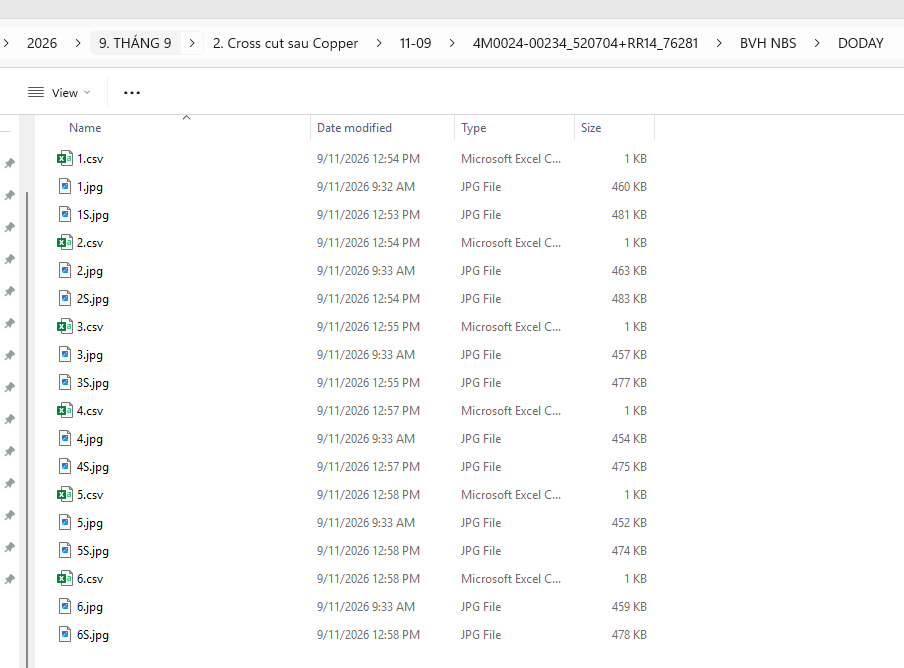
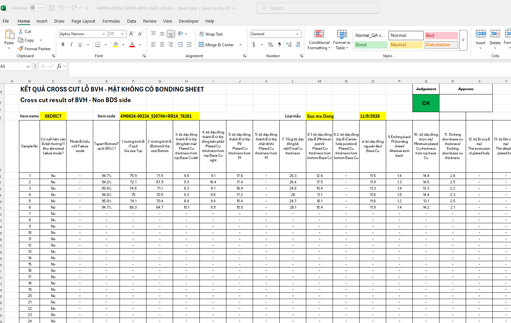
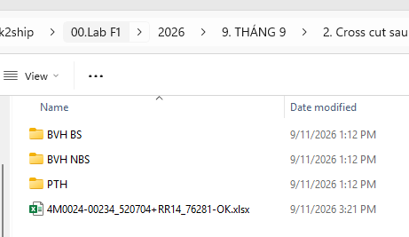
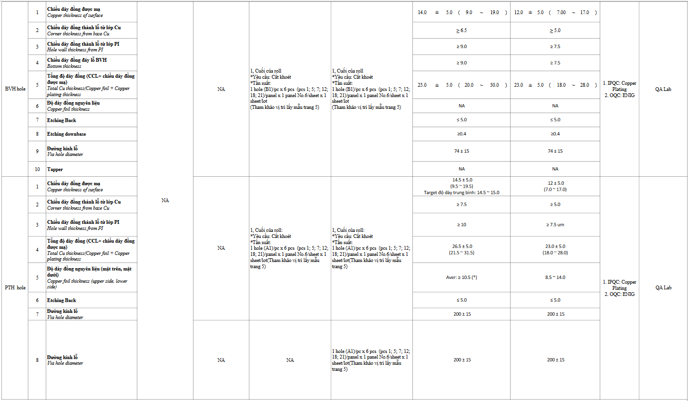
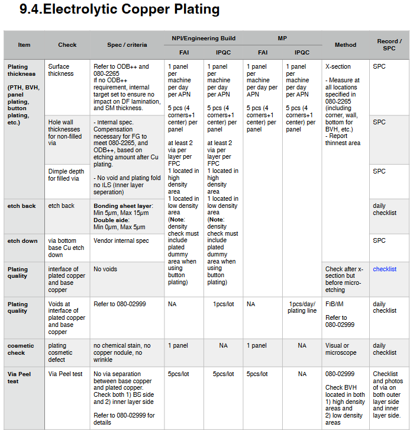
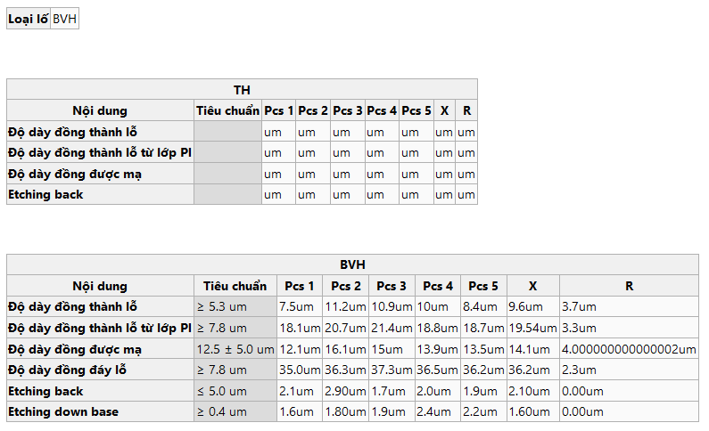
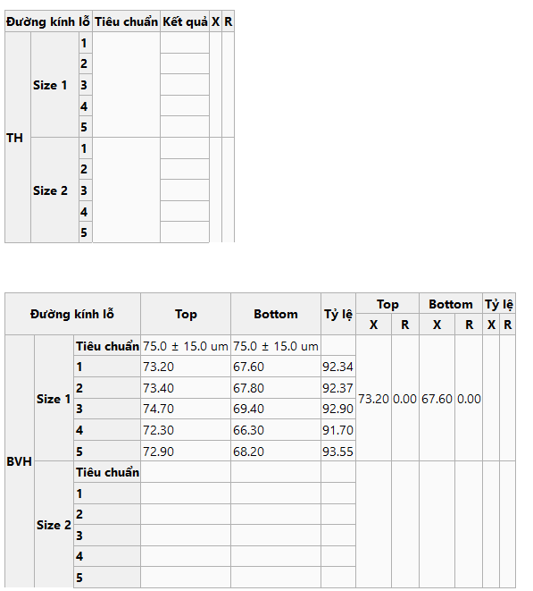

# Ref.05. Copper Plating

> Nguồn: sheet `Ref.05. Copper Plating` trong `LAB_Test_system_261013.xlsx`. Chuyển đổi tự động, giữ nguyên câu chữ gốc. Cột `Row` và tên cột (A, B, ...) là tọa độ ô trong Excel.

Ref.05. Copper Plating <!-- A1 -->

Content <!-- A2 -->

Logic for template processing <!-- A3 -->

IPQC content in WI (Watch | Pismo |Camera) <!-- A4 -->

IPQC contents in WCS <!-- A5 -->

Customer requirement <!-- A6 -->

<!-- ảnh neo tại ô G7 -->

<!-- ảnh neo tại ô P7 -->

<!-- ảnh neo tại ô A8 -->

<!-- ảnh neo tại ô A27 -->

<!-- ảnh neo tại ô H27 -->

<!-- ảnh neo tại ô S27 -->

<!-- ảnh neo tại ô Z27 -->
