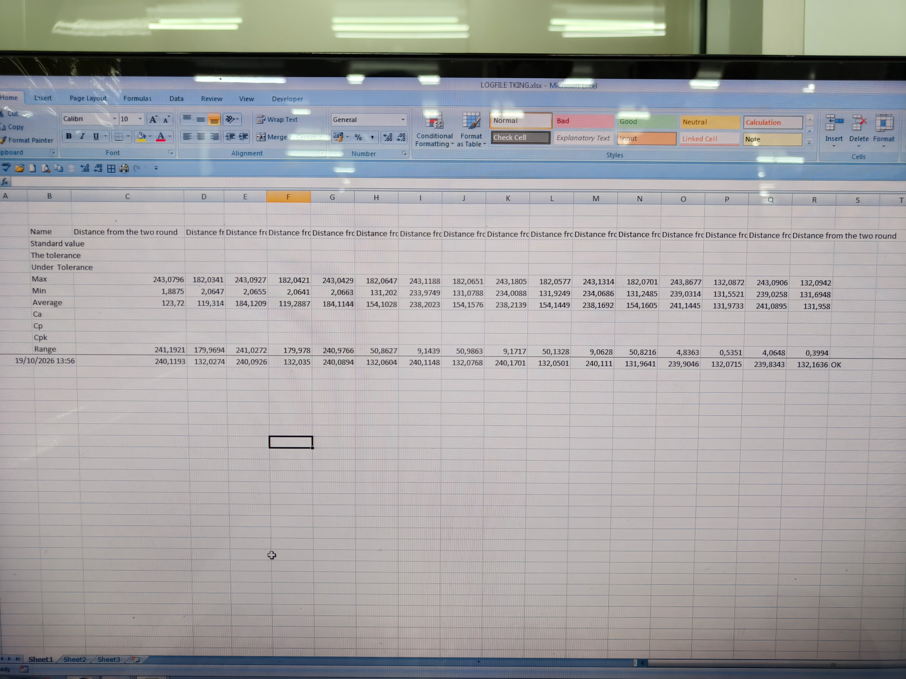
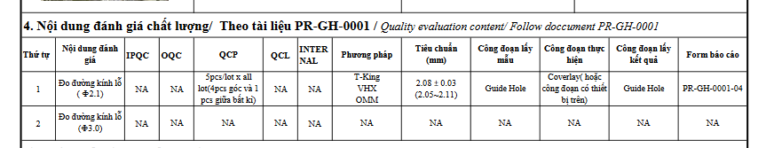
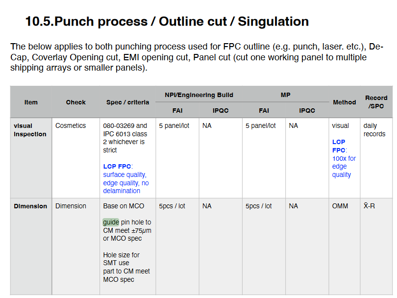
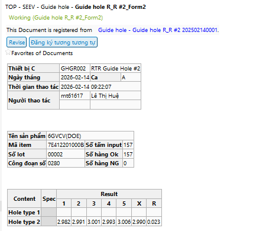

# Ref.06. Guide hole

> Nguồn: sheet `Ref.06. Guide hole` trong `LAB_Test_system_261013.xlsx`. Chuyển đổi tự động, giữ nguyên câu chữ gốc. Cột `Row` và tên cột (A, B, ...) là tọa độ ô trong Excel.

Ref.06. Guide hole <!-- A1 -->

Content <!-- A2 -->

Logic for template processing <!-- A3 -->

IPQC content in WI (Watch | Pismo |Camera) <!-- A4 -->

IPQC contents in WCS <!-- A5 -->

Customer requirement <!-- A6 -->

| Row | A | G |
|---|---|---|
| 10 | Kết Quả Đo Đường Kính Lỗ Đục Của Máy Guide Hole |  |
| 11 |  | Trưởng ca GH:………………………….. |
| 12 | Ngày: ……24/8/2026……….... |  |
| 13 | Máy GH no: ……STS NO 7… ….. | Item:………7D0830……6CRRV…………… |
| 14 | Ca:………1……….…… | Lot:…....00005……………… |
| 15 | Công nhân GH:……73123………….. |  |
| 16 | Máy T-King no…...:………… | Đường kính cần đo: ………2.1………. (mm) |
| 17 | Công nhân đo:……………………. | Tần suất: 32 lỗ/đường kính. |

| Row | A | D | G | J |
|---|---|---|---|---|
| 19 | Loaị đường kính (mm) | Đinh đục (mm) | Dải quản lý ( Đinh đục ± 0.030 mm) |  |
| 20 | Loaị đường kính (mm) | Đinh đục (mm) | Min | Max |
| 21 | 3 | 2.98 | 2.95 | 3.01 |
| 22 | 2.1 | 2.08 | 2.05 | 2.11 |
| 23 | 2 | 1.98 | 1.95 | 2.01 |
| 24 | 4 | 3.98 | 3.95 | 4.01 |
| 25 | 1.5 | 1.48 | 1.45 | 1.51 |
| 26 | 1 | 0.98 | 0.95 | 1.01 |
| 27 | 0.5 | 0.48 | 0.45 | 0.51 |

<!-- ảnh neo tại ô M19 -->

| Row | A | B | C | D | E | F | G | H | I | J | K | L |
|---|---|---|---|---|---|---|---|---|---|---|---|---|
| 29 | Loại đường kính: ……2.1……head 1….(mm) |  |  |  |  |  | Loại đường kính: ……2.1…head 2….(mm) |  |  |  |  |  |
| 30 | STT | Kết quả đo (mm) | OK/NG | STT | Kết quả đo (mm) | OK/NG | STT | Kết quả đo (mm) | OK/NG | STT | Kết quả đo (mm) | OK/NG |
| 31 | 1 |  |  | 21 |  |  | 1 |  |  | 21 |  |  |
| 32 | 2 |  |  | 22 |  |  | 2 |  |  | 22 |  |  |
| 33 | 3 |  |  | 23 |  |  | 3 |  |  | 23 |  |  |
| 34 | 4 |  |  | 24 |  |  | 4 |  |  | 24 |  |  |
| 35 | 5 |  |  | 25 |  |  | 5 |  |  | 25 |  |  |
| 36 | 6 |  |  | 26 |  |  | 6 |  |  | 26 |  |  |
| 37 | 7 |  |  | 27 |  |  | 7 |  |  | 27 |  |  |
| 38 | 8 |  |  | 28 |  |  | 8 |  |  | 28 |  |  |
| 39 | 9 |  |  | 29 |  |  | 9 |  |  | 29 |  |  |
| 40 | 10 |  |  | 30 |  |  | 10 |  |  | 30 |  |  |
| 41 | 11 |  |  | 31 |  |  | 11 |  |  | 31 |  |  |
| 42 | 12 |  |  | 32 |  |  | 12 |  |  | 32 |  |  |
| 43 | 13 |  |  | 33 |  |  | 13 |  |  | 33 |  |  |
| 44 | 14 |  |  | 34 |  |  | 14 |  |  | 34 |  |  |
| 45 | 15 |  |  | 35 |  |  | 15 |  |  | 35 |  |  |
| 46 | 16 |  |  | 36 |  |  | 16 |  |  | 36 |  |  |
| 47 | 17 |  |  | 37 |  |  | 17 |  |  | 37 |  |  |
| 48 | 18 |  |  | 38 |  |  | 18 |  |  | 38 |  |  |
| 49 | 19 |  |  | 39 |  |  | 19 |  |  | 39 |  |  |
| 50 | 20 |  |  | 40 |  |  | 20 |  |  | 40 |  |  |
| 51 | Ghi chú:…………………………………………………………………………… |  |  |  |  |  |  |  |  |  |  |  |

| Row | A | B |
|---|---|---|
| 53 | Note: | Công nhân đo phải phủ màu khi kết quả đo ngoài chuẩn. |
| 54 |  | Trưởng ca guide hole xác nhận kết quả đo sau khi trả kết quả đo |
| 55 |  | Ghim kết quả vào báo cáo của máy guide hole |

PR-GH-0001-04-Rev02 <!-- J57 -->

<!-- ảnh neo tại ô A60 -->

<!-- ảnh neo tại ô K60 -->

<!-- ảnh neo tại ô X60 -->

## Chú thích vẽ trên sheet (shape)

Các hộp chú thích vẽ đè lên ảnh/bảng, chép nguyên văn:

- Công nhân copy thủ công chuyển dữ liệu từ hàng ngang sang cột dọc
