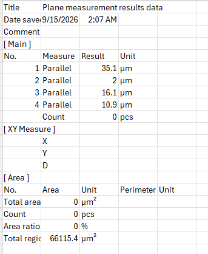
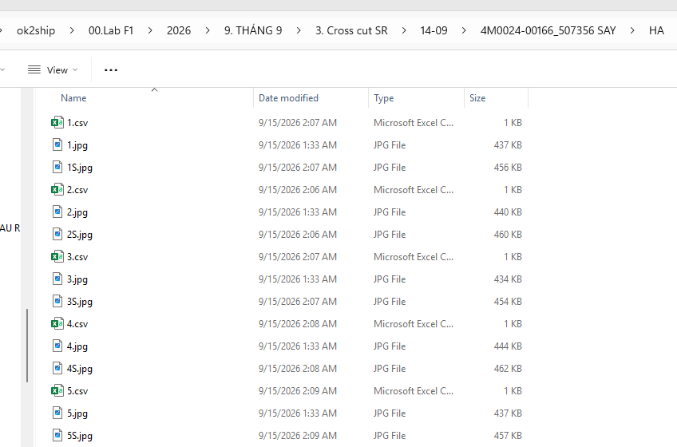
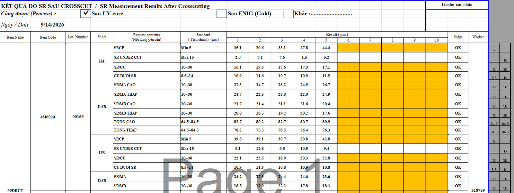
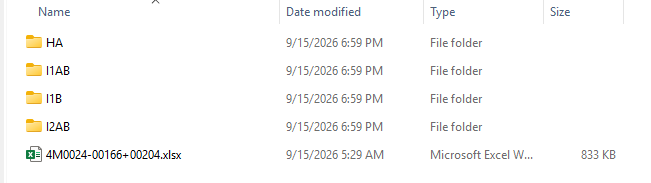
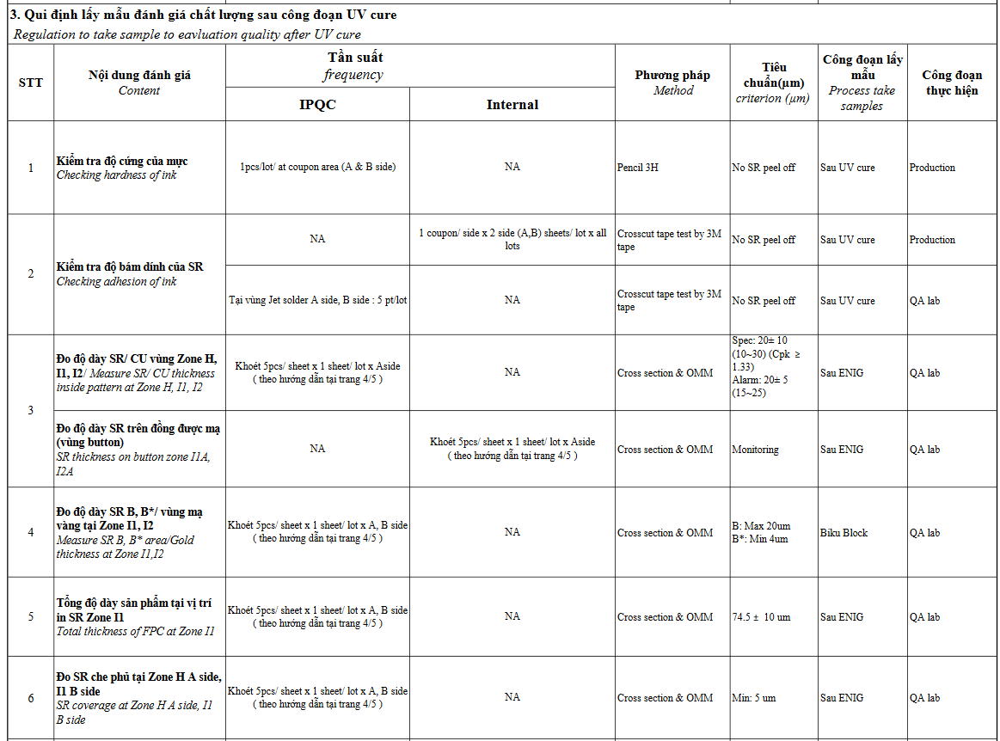
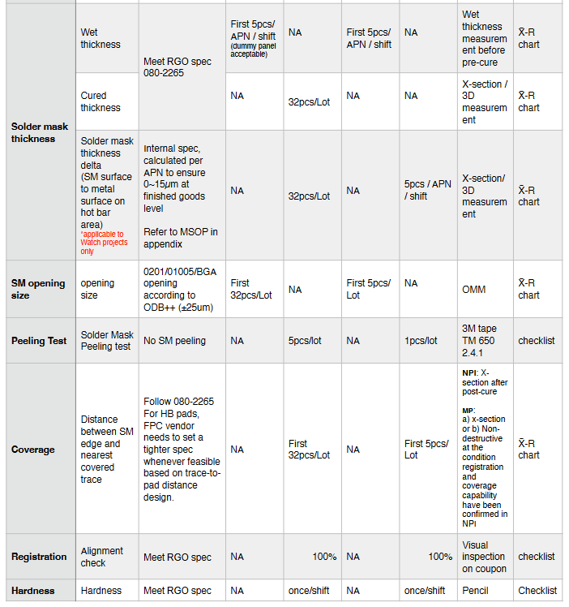
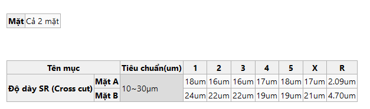

# Ref.07. Printing

> Nguồn: sheet `Ref.07. Printing` trong `LAB_Test_system_261013.xlsx`. Chuyển đổi tự động, giữ nguyên câu chữ gốc. Cột `Row` và tên cột (A, B, ...) là tọa độ ô trong Excel.

Ref.07. Printing <!-- A1 -->

Content <!-- A2 -->

Logic for template processing <!-- A3 -->

IPQC content in WI (Watch | Pismo |Camera) <!-- A4 -->

IPQC contents in WCS <!-- A5 -->

Customer requirement <!-- A6 -->

<!-- ảnh neo tại ô Q1 -->

<!-- ảnh neo tại ô J6 -->

<!-- ảnh neo tại ô V6 -->

<!-- ảnh neo tại ô A9 -->

<!-- ảnh neo tại ô A23 -->

<!-- ảnh neo tại ô E23 -->

<!-- ảnh neo tại ô Q23 -->

## Chú thích vẽ trên sheet (shape)

Các hộp chú thích vẽ đè lên ảnh/bảng, chép nguyên văn:

- Tạo folder với các điểm đo
