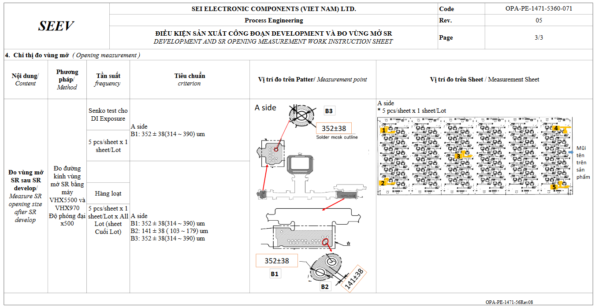
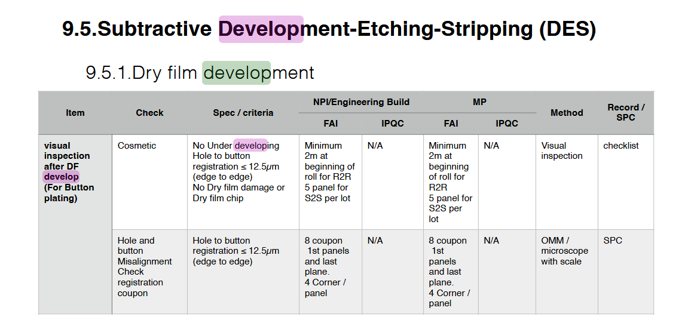
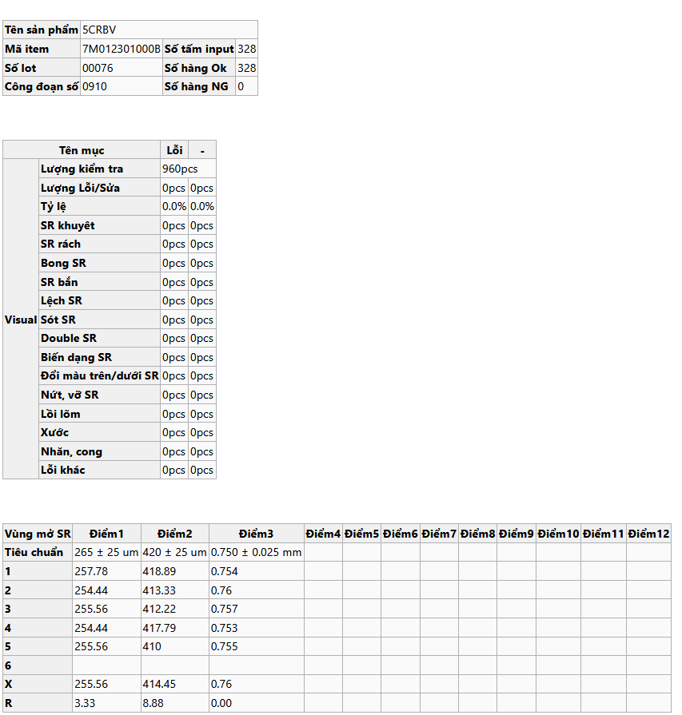

# Ref.08. SR Development

> Nguồn: sheet `Ref.08. SR Development` trong `LAB_Test_system_261013.xlsx`. Chuyển đổi tự động, giữ nguyên câu chữ gốc. Cột `Row` và tên cột (A, B, ...) là tọa độ ô trong Excel.

Ref.08. SR Development <!-- A1 -->

Content <!-- A2 -->

Logic for template processing <!-- A3 -->

IPQC content in WI (Watch | Pismo |Camera) <!-- A4 -->

IPQC contents in WCS <!-- A5 -->

Customer requirement <!-- A6 -->

Bảng dữ liệu rộng (9 dòng × 88 cột có dữ liệu, cột A..CJ, dòng 8–16) được xuất nguyên vẹn ra [`data/ref-08-sr-development-rows8-16.csv`](data/ref-08-sr-development-rows8-16.csv). Trích 6 dòng đầu, cột A..L:

| Row | A | B | C | D | E | F | G | H | I | J | K | L |
|---|---|---|---|---|---|---|---|---|---|---|---|---|
| 8 | Measure Opening SR |  |  | Aside |  |  |  |  |  |  |  |  |
| 9 | Date | Item code | Lot No | B1 |  |  |  |  |  |  |  |  |
| 10 | Date | Item code | Lot No |  |  |  |  |  |  |  |  |  |
| 11 | Date | Item code | Lot No | Center | Min | Max | Max | Min | Ave | R | cpk |  |
| 12 | Date | Item code | Lot No |  |  |  |  |  |  |  |  | 1 |
| 13 | 2026-09-29 | 4M002401000B | 390 | 352 | 314 | 390 | 356.92 | 354.09 | 355.26 | 2.83000000000004 | 4.09187279151938 | 355.21 |

<!-- ảnh neo tại ô A19 -->

<!-- ảnh neo tại ô D19 -->

<!-- ảnh neo tại ô I19 -->

## Chú thích vẽ trên sheet (shape)

Các hộp chú thích vẽ đè lên ảnh/bảng, chép nguyên văn:

- Đo bằng máy VHX và nhập thủ công vào file
