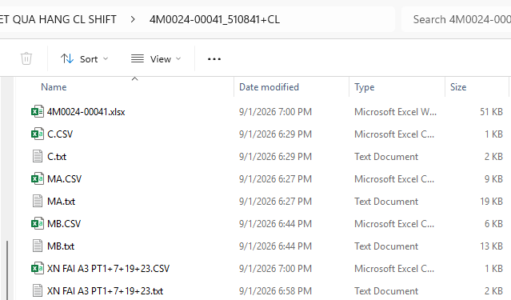
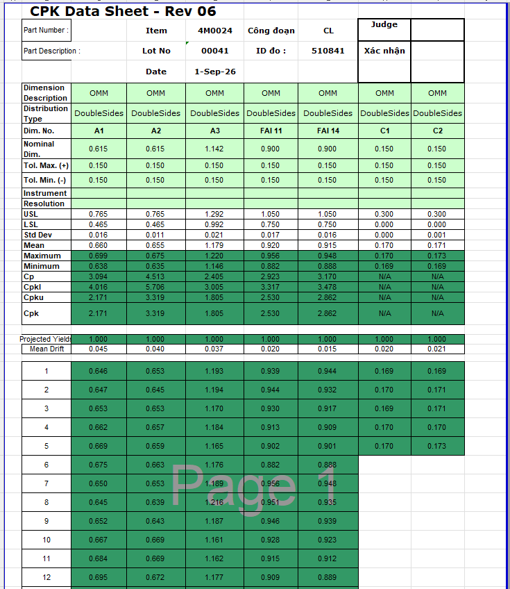
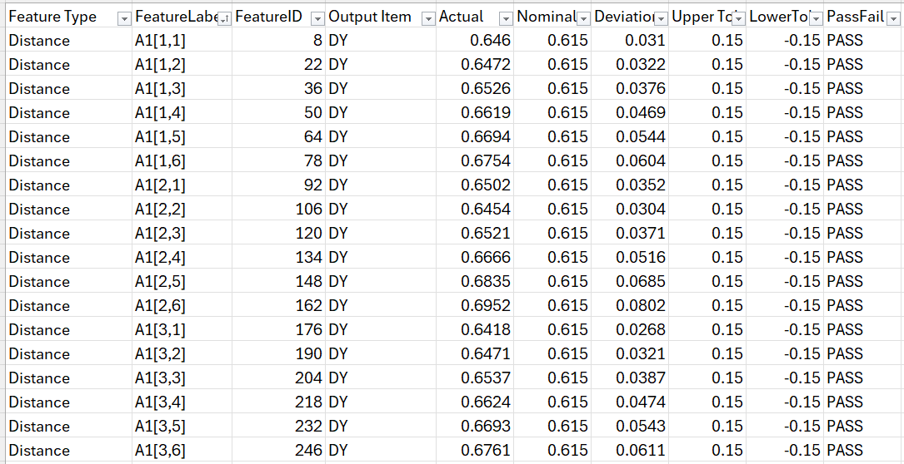
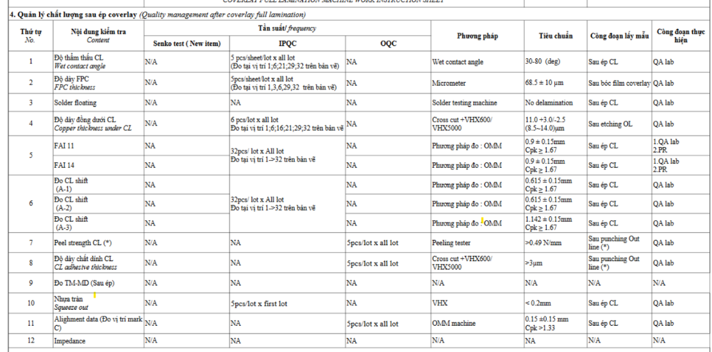
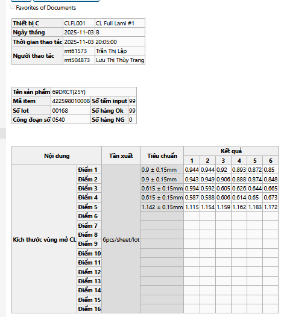
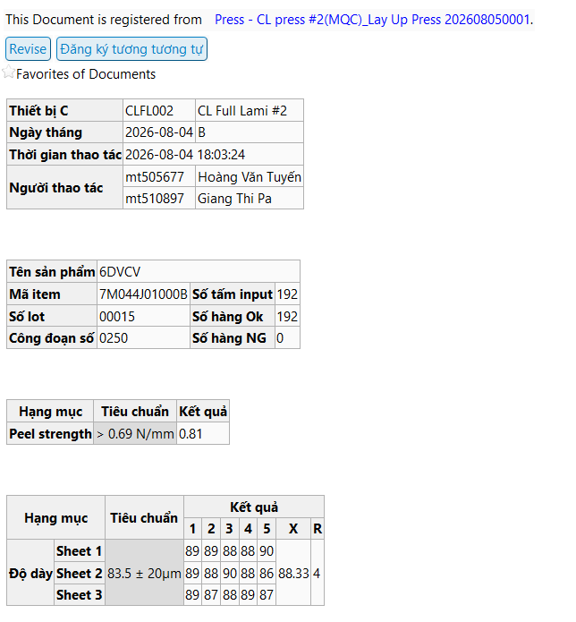
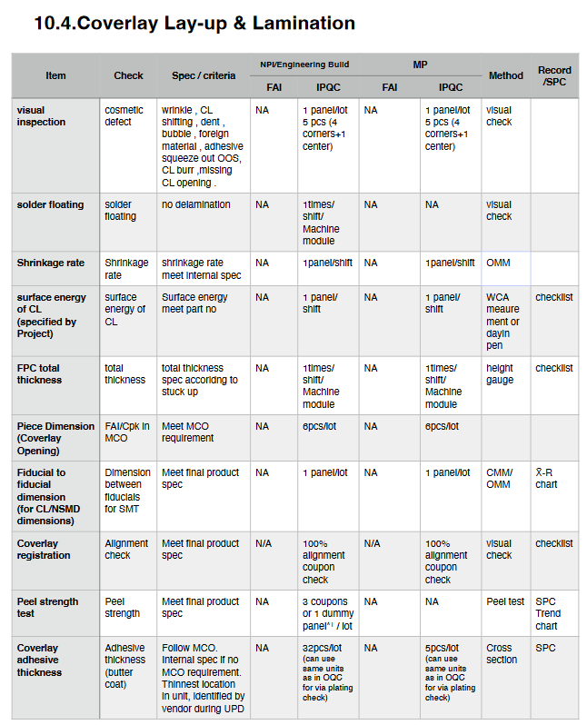

# Ref.09. CVL full lamination

> Nguồn: sheet `Ref.09. CVL full lamination` trong `LAB_Test_system_261013.xlsx`. Chuyển đổi tự động, giữ nguyên câu chữ gốc. Cột `Row` và tên cột (A, B, ...) là tọa độ ô trong Excel.

Ref.09. CVL full lamination <!-- A1 -->

Content <!-- A2 -->

Logic for template processing <!-- A3 -->

IPQC content in WI (Watch | Pismo |Camera) <!-- A4 -->

IPQC contents in WCS <!-- A5 -->

Customer requirement <!-- A6 -->

<!-- ảnh neo tại ô A7 -->

<!-- ảnh neo tại ô E7 -->

<!-- ảnh neo tại ô K7 -->

<!-- ảnh neo tại ô A29 -->

<!-- ảnh neo tại ô J29 -->

<!-- ảnh neo tại ô P29 -->

<!-- ảnh neo tại ô V29 -->
