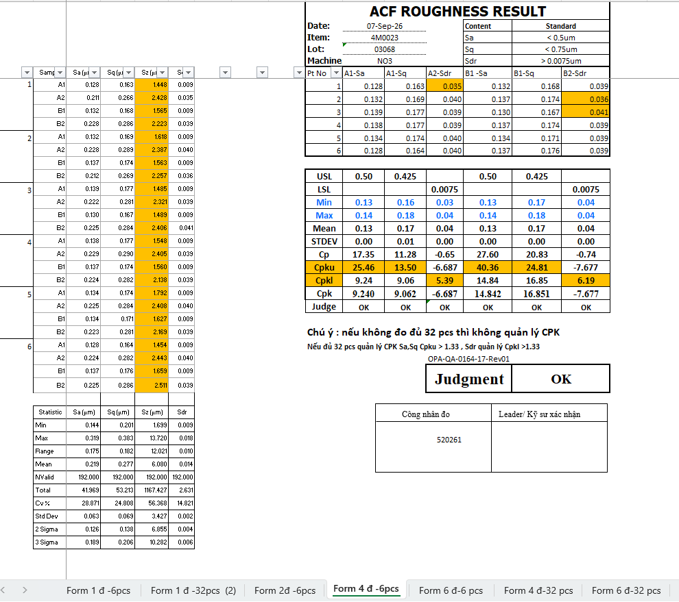
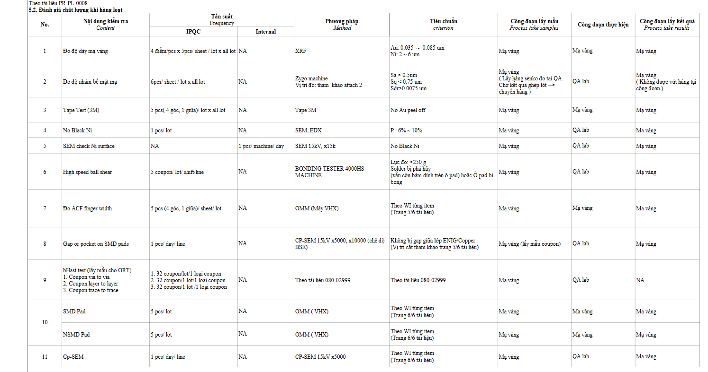
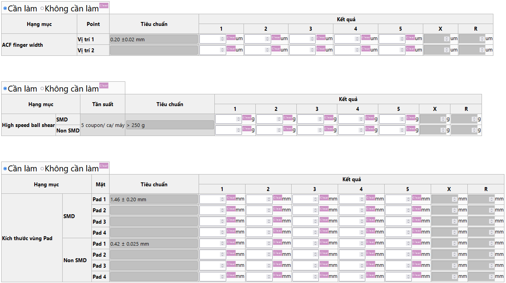
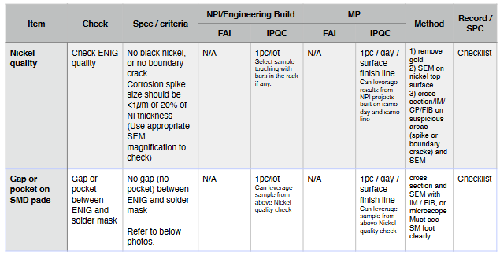

# Ref.10. ENIG

> Nguồn: sheet `Ref.10. ENIG` trong `LAB_Test_system_261013.xlsx`. Chuyển đổi tự động, giữ nguyên câu chữ gốc. Cột `Row` và tên cột (A, B, ...) là tọa độ ô trong Excel.

Ref.10. ENIG <!-- A1 -->

Content <!-- A2 -->

Logic for template processing <!-- A3 -->

IPQC content in WI (Watch | Pismo |Camera) <!-- A4 -->

IPQC contents in WCS <!-- A5 -->

Customer requirement <!-- A6 -->

I. Logic for template processing <!-- A10 -->

<!-- ảnh neo tại ô A11 -->

<!-- ảnh neo tại ô A44 -->

<!-- ảnh neo tại ô K44 -->

<!-- ảnh neo tại ô U44 -->
