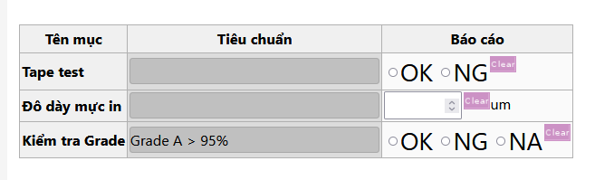
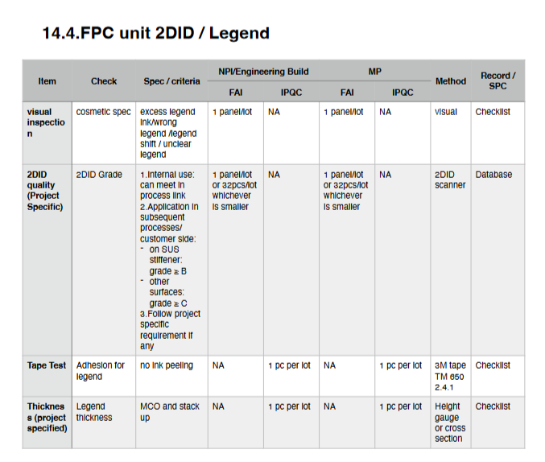
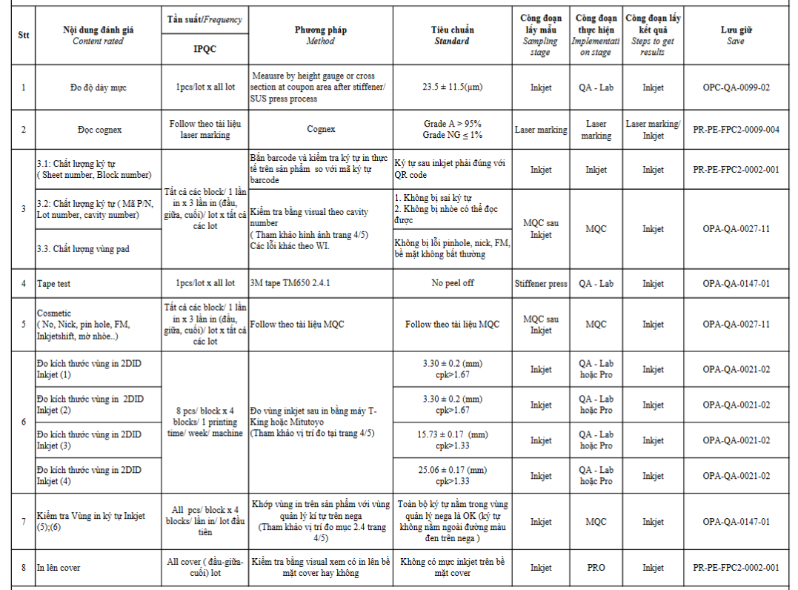

# Ref.12. InkJet

> Nguồn: sheet `Ref.12. InkJet` trong `LAB_Test_system_261013.xlsx`. Chuyển đổi tự động, giữ nguyên câu chữ gốc. Cột `Row` và tên cột (A, B, ...) là tọa độ ô trong Excel.

Ref.11. SUS Pre-tack <!-- A1 -->

Content <!-- A2 -->

Logic for template processing <!-- A3 -->

IPQC content in WI (Watch | Pismo |Camera) <!-- A4 -->

IPQC contents in WCS <!-- A5 -->

Customer requirement <!-- A6 -->

<!-- ảnh neo tại ô Y16 -->

<!-- ảnh neo tại ô A18 -->

<!-- ảnh neo tại ô H18 -->
