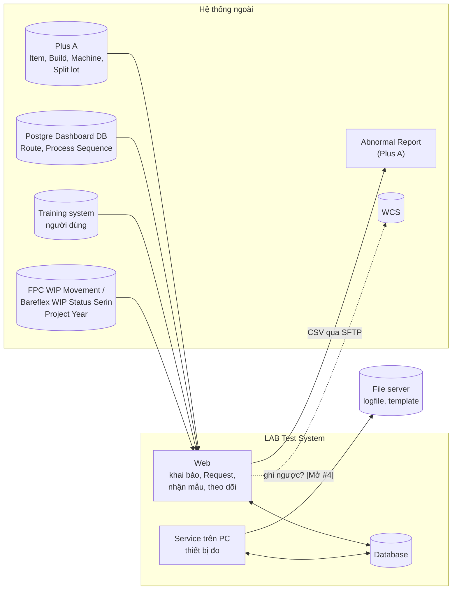
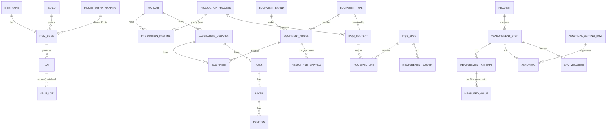
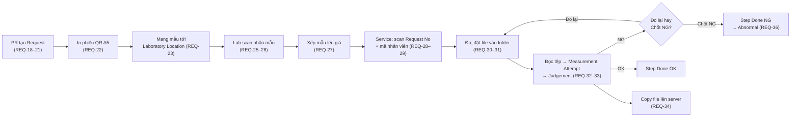

# LAB Test System: Spec tạm thời

**Version:** 20261031 Rev.01 · **Trạng thái:** DRAFT, bản tạm thời để rà soát nội bộ. Chưa phải hồ sơ bàn giao cho maker, chưa dùng để chạy `/to-spec` hay `/to-tickets`.
**Map:** [Wayfinder: Bộ hồ sơ bàn giao LAB Test system cho maker](https://github.com/trungkien87/LabTestSystem/issues/1)

## 0. Cách đọc tài liệu

### 0.1 Nguồn tổng hợp

| Nguồn | Vị trí | Vai trò trong spec |
|---|---|---|
| System concept | [`docs/source/01-concept.md`](../source/01-concept.md) | Bối cảnh, output mong muốn theo vai trò, workflow ①–㉟ |
| System requirement (37 mục) | [`docs/source/02-requirements.md`](../source/02-requirements.md) | Mã truy vết `REQ-01` … `REQ-37` |
| IPQC master data | [`docs/source/03-ipqc-contents.md`](../source/03-ipqc-contents.md), [`docs/source/ref/`](../source/ref/) | Dữ liệu đầu vào cho khai báo, không phải tính năng |
| Glossary | [`GLOSSARY.md`](../../GLOSSARY.md) | Thuật ngữ chuẩn; spec dùng đúng các từ này |
| Resolution của ticket đã đóng | #2, #3, #5, #6, #7, #11 (link ở từng mục) | Business rule đã chốt |
| Design system | [`DESIGN_EN_20261027_Rev01.md`](../source/design-system/DESIGN_EN_20261027_Rev01.md) | Quy tắc UI cho Web và Service |
| Quality checklist Rev04 | [`docs/source/quality-checklist/`](../source/quality-checklist/README.md) | Điều kiện go-live, mã `A1` … `K2` |
| Demo của maker | [`MakerDemoReview_VI_20261028_Rev01.md`](../research/MakerDemoReview_VI_20261028_Rev01.md) | Chỉ để tham chiếu. Quyết định đã chốt thắng demo |

### 0.2 Nhãn trạng thái

| Nhãn | Nghĩa |
|---|---|
| **[Chốt #n]** | Đã chốt trong resolution của ticket #n, ticket đã đóng |
| **[Đề xuất #n]** | Khuyến nghị đang chờ chủ dự án trả lời ở ticket #n. Có thể đổi |
| **[Mở #n]** | Chưa quyết định; ticket #n đang mở |
| **[Fog]** | Đã biết là cần làm nhưng chưa thành ticket (mục Not yet specified của map) |
| **[Nguồn]** | Lấy nguyên từ `docs/source`, chưa qua grilling |
| **[khác requirement]** / **[khác demo]** | Quyết định khác `docs/source` hoặc khác demo của maker |

Con số nào không có nguồn thì ghi rõ **(ước lượng)**.

---

## 1. Bối cảnh và mục tiêu

### 1.1 Vấn đề hiện tại [Nguồn: Concept I]

| Hiện tại | Vấn đề |
|---|---|
| Tiêu chuẩn IPQC khai trên Plus A | Khó thao tác |
| QA Lab tự quản lý tiêu chuẩn theo tài liệu PE | Tiêu chuẩn phân tán, khó kiểm soát |
| Phiếu yêu cầu đo bằng giấy | Ghi tay, dễ sai |
| QA Lab không biết trước Request nào sắp đến | Khó lập kế hoạch nguồn lực |
| PR không theo dõi được tình trạng đo | Mất thời gian liên hệ |
| Kết quả IPQC nhập tay vào WCS từ file kết quả | Dễ sai, tốn thời gian |

### 1.2 Mục tiêu hệ thống

Hệ thống quản lý yêu cầu đo IPQC giữa Production (PR), Process Engineering (PE) và Laboratory. Phạm vi gồm:
1. Khai báo tiêu chuẩn (IPQC Spec).
2. Tạo Request và theo dõi tiến độ.
3. Nhận mẫu và xếp mẫu lên giá.
4. Đọc kết quả từ file của thiết bị đo.
5. Đánh giá Judgement tự động.
6. Phát sinh Abnormal và theo dõi SPC.

---

## 2. Phạm vi

### 2.1 Lát cắt MVP [Mở #16]

Luồng **Request → Receive → Measure → Judge → Result** cho 4 Production Process có checkpoint:

| Production Process | IPQC Content (theo nguồn) | Equipment type / phương pháp | Laboratory Location (theo nguồn) |
|---|---|---|---|
| UV Laser (Laser drilling) | BVH Top, BVH Bottom, PTH Hole size (top) | Cross cut + VHX | In line |
| De-smear (Dry Desmear Plasma) | Etch back; Desmear amount / Etching Rate; Desmear uniformity | Cross cut + VHX; weighting loss | QA Lab; In line |
| DFR Development | Hole and button Misalignment | VHX | Đo mạch F1 |
| RR SS Etching | MD/TD trace width top/bottom, MD/TD space, Copper thickness, Etching factor, Registration MD & TD | Cross cut + VHX & Laser Microscope; Impedance | Đo mạch / QA Lab |

Bảng trên chép từ [`03-ipqc-contents.md`](../source/03-ipqc-contents.md) **[Nguồn]**; tên Laboratory Location trong nguồn chưa theo quy tắc `Factory – Floor – Room`. Ticket [Chốt lát cắt MVP và tiêu chí nghiệm thu](https://github.com/trungkien87/LabTestSystem/issues/16) còn phải chốt:
- MVP có gồm Abnormal, Abnormal Setting không.
- MVP có gồm kết nối Postgre Dashboard DB không.
- MVP có gồm luồng đo trong xưởng không.
- MVP có gồm Ad-hoc Request không.

Phần còn lại của 37 requirement được đặc tả đủ để không phá thiết kế.

### 2.2 Ngoài phạm vi [Chốt map]

- FAI Group 1/2 (dừng input/dừng line). Ràng buộc giữ lại: kết quả IPQC và Judgement phải truy vấn được theo Item code, Lot và Production Machine.
- Theo dõi việc xử lý hàng sau Abnormal (thuộc Abnormal Report của Plus A) [Chốt #11].

### 2.3 Đã biết nhưng chưa đặc tả [Fog]

- Logfile của Equipment type ngoài MVP (Nikon, XRF, Zygo, …).
- SPC control chart và báo cáo đầu ra (REQ-37, Concept "Cần viết Output thật kĩ"), cấu hình loại đồ thị và màu theo IPQC Content / Production Machine / Item name / Item code.
- Xuất dữ liệu đo kết hợp 4M của Lot.
- Thông báo cho PR khi Request hoàn thành, Overdue hoặc NG.
- Dashboard và KPI theo cấp và Department; xuất dữ liệu; xuất ảnh đồ thị.
- Scan mã jig, nhập tên chương trình đo trên Service.

---

## 3. Người dùng

### 3.1 Department và Job Level [Chốt #2]

- **Department:** PE, PR, QA, SF.
- **Job Level:** Manager, Engineer, Leader, Operator.

Cả hai **chỉ là thông tin**, không quyết định quyền. Quyền thao tác chỉ do **Role** quyết định (mục 9). **[khác demo]** Demo dùng Department để giới hạn Vị trí + Công đoạn.

### 3.2 Nhu cầu theo vai trò [Nguồn: Concept II]

| Vai trò | Cần |
|---|---|
| PE Engineer / Operator | Khai IPQC Content, Piece quantity NPI/MP, Measurement points per piece, Equipment type; khai IPQC Spec Common và Individual |
| PE Leader | Đếm Item name / Item code đã khai IPQC Spec theo Production Process (Common/Individual); lọc, tìm |
| PR Engineer / Leader | Biết lúc đo xong để nhận hàng; đếm Lot/máy gặp sự cố; xuất dữ liệu kèm 4M; đếm Request theo Status; biểu đồ SPC theo Machine → Item name → Item code |
| PR Operator | Biết Lot/máy đã lấy mẫu chưa; thấy nội dung cần đo và số mẫu khi tạo Request; scan Machine ID và Indication number |
| LAB engineer | Khai Result File Mapping |
| LAB leader | Đếm Request theo Status; người nhận và thời điểm nhận; tổng số lỗ (hole) của mọi Request |

---

## 4. Kiến trúc mức thành phần [Mở #13]

Tech stack chưa chốt. Spec chỉ quy định thành phần và luồng dữ liệu, không chọn framework.

| Thành phần | Trách nhiệm | Trạng thái |
|---|---|---|
| Web | Master data, IPQC Spec, tạo Request, in phiếu, nhận mẫu, giá, theo dõi, Abnormal, báo cáo | [Nguồn] |
| Service trên PC thiết bị đo | Danh sách Request chờ theo Equipment type; scan Request No + mã nhân viên; tạo folder; đọc file; Judgement; copy file lên server; lịch sử tại máy | [Nguồn REQ-28–35] |
| File server | Lưu logfile, template theo cấu trúc REQ-34 | [Nguồn]; giữ nguyên cấu trúc hay không: [Mở #13] |
| Tích hợp | Plus A, Postgre Dashboard DB, Training system, Project Year, SFTP Abnormal Report, WCS, Calibration | [Mở #4] |

Câu hỏi kiến trúc đang mở [Mở #13]:
- Service nối thẳng DB hay qua API.
- Hành vi khi mất mạng (checklist I2).
- Judgement tính ở Service hay ở server.
- Một PC phục vụ một hay nhiều Equipment.

**Ràng buộc từ checklist** (chi tiết ở mục 11):
- **I1, I2:** log của Service đồng bộ lên hệ thống trung tâm; khi mất mạng thì lưu tạm và gửi lại.
- **C6:** chịu lỗi.
- **D3:** mã hoá khi lưu và khi truyền (demo đang chạy HTTP).
- **H8:** tách môi trường Dev / UAT / Production.

---

## 5. Data model (mức khái niệm)

Đủ để maker tự thiết kế DB schema. Tên entity theo `GLOSSARY.md`.

### 5.1 Sơ đồ quan hệ

### 5.2 Master data

| Entity | Khoá / định danh | Thuộc tính và ràng buộc chính | Nguồn dữ liệu | Trạng thái |
|---|---|---|---|---|
| Factory | F1 … F5 | Tên đầy đủ Factory 1 … 5 | Khai báo | [Chốt #2] |
| Production Process | Mã tự sinh | Tên; đúng một **Sample Form** (Worksheet / block / panel / piece) | Khai báo (REQ-04) | [Chốt #2] |
| Production Machine | Machine ID (vd `CPRR009`) | Tên; đúng một Factory; chạy 1..n Production Process | Plus A (REQ-05) | [Chốt #2]; kênh [Mở #4] |
| Item name | Chuỗi `[A-Z0-9]+` (vd `69DRCT`) | Project Year (từ hệ thống WIP) | Plus A | [Chốt #2, #11] |
| Build | Build Code + Build Phase | Build Type NPI/MP, do người dùng gán | Plus A + gán tay (REQ-06) | [Chốt #2] |
| Item code | 12 ký tự (sản xuất) hoặc 7 ký tự (test) | Đúng một Item name, đúng một Build (không đổi theo thời gian) | Plus A (REQ-07) | [Chốt #2] |
| Route suffix mapping | Đuôi 6 ký tự | `01000B` Front, `02000B` Back, `00000B` MI, `03000B` SECT; chỉ Role Admin sửa; sửa chỉ áp dụng cho Request sau | Khai báo | [Chốt #2] |
| Route / Process Sequence | Item code (+ Route) × Process Sequence `0000`–`9999` | Process Sequence ↔ Production Process | Postgre Dashboard DB, không tự tạo | [Chốt #2]; kênh [Mở #4] |
| Split lot relation | Split lot con → cha | Nhiều cấp; mã không cho biết cha | Plus A | [Chốt #2]; kênh [Mở #4] |
| Laboratory Location | Tên `Factory – Floor – Room` | Cờ **bật nhận mẫu**; không có tầng quản lý phía trên | Khai báo (REQ-08) | [Chốt #2, #6] **[khác requirement]** REQ-08 sinh tên = Factory + Department |
| Equipment type | Mã | Tên (vd OMM) | Khai báo (REQ-09) | [Chốt #2] |
| Equipment brand | Tên | Keyence, Nikon, Mitutoyo… | Khai báo | [Chốt #2] |
| Equipment model | Tên | Đúng một brand, một Equipment type; **LogFile type** (Template / VHX / Laser / Manual Input); **Max attempts** (mặc định hệ thống = 3) | Khai báo | [Chốt #2, #6] **[khác demo]** demo cài Max attempts theo máy |
| Equipment | Equipment ID | Đúng một Equipment model, đúng một Laboratory Location | Khai báo (REQ-10) | [Chốt #2] |
| Rack / Layer / Position | `F1-RCK-0001`, `-01`, `-01.01` | Quy tắc chọn, sức chứa, FIFO, layout giá theo loại hàng | Khai báo (REQ-11–13) | [Mở #9] |
| IPQC Content | Mã | Tên (không dịch); đúng một Equipment type; tuỳ chọn danh sách Equipment model được phép | Khai báo (REQ-14) | [Chốt #2] |
| Result File Mapping | Equipment model × IPQC Content | Vị trí ô, hàng, cột, chiều lấy dữ liệu; dùng chung mọi Laboratory Location | Khai báo (REQ-15) | [Chốt #2] **[khác demo]** |
| IPQC Spec | Common: Item name × Route × Process Sequence; Individual: Item code × Process Sequence | Unit, Lead time (phút), danh sách IPQC Spec Line, trạng thái hiệu lực / Deactivated | Khai báo (REQ-16) | [Chốt #2, #7] |
| IPQC Spec Line | IPQC Spec × IPQC Content | Side A/B bật/tắt; Piece quantity NPI và MP; Measurement points per piece; Specification Limit (LL/UL, một hoặc hai phía) theo Side; Control Limit X và/hoặc R (LCL/CL/UCL) theo Side | Khai báo | [Chốt #2, #7] |
| Measurement Order | Thuộc một IPQC Spec | Danh sách IPQC Content có Step No 1..n; mỗi IPQC Content thuộc tối đa một Measurement Order | Khai báo bởi Lab | [Chốt #7] |
| Abnormal Setting row | ID | Reason, Action, phạm vi Item name / Item code / IPQC Content / Production Machine, hiệu lực từ–đến, lý do, người đề xuất, người phê duyệt, trạng thái | Khai báo | [Chốt #11] |
| Abnormal CSV template | Version | Cột, dấu phân cách, encoding, mẫu tên file | Khai báo | [Chốt #11] |

### 5.3 Dữ liệu giao dịch

| Entity | Định danh | Thuộc tính chính | Trạng thái |
|---|---|---|---|
| Request | Request No `RYYMMDD_NNNN` | Indication number (tách Item code, Revision, Part No, Lot/Split lot); Process Sequence; Route lúc tạo; Production Machine; người tạo; thời điểm tạo; Deadline; Comment; Status; Judgement; cờ Overdue; liên kết Request NG trước đó; lý do lấy mẫu lại; bản chụp IPQC Spec lúc tạo (mục 7.2.4) | [Chốt #2, #6, #7]; phần còn lại [Đề xuất #8] |
| Measurement Step | Request × IPQC Content | Step No (nếu trong Measurement Order); Status; Judgement; Laboratory Location nhận; Position | [Chốt #6, #7] |
| Measurement Attempt | Measurement Step × số 1, 2, 3… | Thời điểm, Operator ID, Equipment, file nguồn, Judgement, **bản chụp Specification Limit / Control Limit đã dùng** theo Side | [Chốt #6, #7] |
| Measured value | Attempt × Side × piece × point | Giá trị, đơn vị, Judgement từng giá trị | [Chốt #2, #11] |
| File read error | Measurement Step × thời điểm | Nguyên nhân; không tạo Attempt | [Chốt #6] |
| SPC Violation | Measurement Step × Side × SPC rule | Luôn ghi khi có Control Limit | [Chốt #11] |
| Abnormal | Measurement Step (tối đa 1) | Abnormal reason, Side NG, trạng thái, người Verify, file CSV và version template đã gửi | [Chốt #11] |
| Lịch sử theo trường | Entity × trường × thời điểm | Ai sửa, giá trị cũ → mới, Lý do bắt buộc | [Chốt #7]; phạm vi B4 [Mở #18] |

### 5.4 Nhận dạng Indication number [Chốt #2]

| Loại hàng | Regex | Ví dụ |
|---|---|---|
| Sản xuất | `^[A-Z0-9]{12}[0-9]{5}(-[0-9]{2})?$` | `4M002401000B00094`, `4M002401000B00094-02` |
| Test / prototype | `^[A-Z0-9]{7}[0-9][A-Z0-9]{2}-[0-9]{3}(-[0-9]{2})?$` | `26B07400V2-001-02` |

- Chữ thường tự đổi thành chữ hoa.
- Chuỗi không khớp mẫu nào → từ chối, cho nhập tay.
- Hàng sản xuất có đuôi Item code không có trong Route suffix mapping → từ chối.
- Revision và Part No không thuộc khoá IPQC Spec.

---

## 6. Quy tắc master data

### 6.1 IPQC Spec Common / Individual [Chốt #7]

1. **Individual là bản sao đầy đủ** của Common hiện hành tại lúc chuyển, gồm cả Measurement Order. Từ lúc đó, sửa Common không ảnh hưởng Item code này. Không có override từng trường **[khác demo]**.
2. **Sửa Common** chỉ áp dụng cho Item code còn Common. Trước khi lưu, hệ thống hiện số Item code bị ảnh hưởng và danh sách Item code Individual không bị ảnh hưởng.
3. **Chuyển Individual về Common** được phép, cần phê duyệt, có lịch sử.
4. **Item code mới** đồng bộ về tự động là Common nếu đã có Common cho khoá Item name × Route × Process Sequence.
5. **Hàng test/prototype** luôn dùng Individual.
6. **Không version, không xoá.** Lịch sử ghi theo trường, Lý do bắt buộc. Chỉ Deactivate:
   - Deactivate Common → Item code còn Common về Not set.
   - Deactivate Individual → Item code về Not set, không tự về Common.
7. **Phê duyệt hai người** cho mọi thao tác: tạo, sửa, chuyển Common↔Individual, Deactivate. Người tạo không tự duyệt.
8. **Nạp dữ liệu ban đầu:** maker nạp từ template; lịch sử ghi nguồn `Initial import` kèm tên file và thời điểm. Chủ dự án hoặc PE Leader ký xác nhận cả file. Sau go-live, mọi thay đổi chỉ qua web form.
9. **Số giá trị đo** của một IPQC Content cho mỗi Side = Piece quantity × Measurement points per piece.

### 6.2 Measurement Order [Chốt #7]

- **Tuỳ chọn.** Một IPQC Spec có 0..n Measurement Order. IPQC Content không thuộc Measurement Order nào là Measurement Step độc lập, không có Step No.
- **Người khai:** Role của Lab. Không cần phê duyệt; có lịch sử và Lý do; chỉ áp dụng cho Request tạo sau.
- IPQC Content mới được duyệt là bước độc lập, không tự vào Measurement Order.
- IPQC Content bị Deactivate tự rời Measurement Order; các Step No sau dồn lên.

### 6.3 Nhập Process Sequence [Chốt #2]

- **Cài đặt toàn hệ thống:** chỉ scan, hoặc scan + nhập tay. Chỉ Role Admin chỉnh. **[khác demo]** Demo chọn Process Sequence từ danh sách.
- **Từ chối khi:**
  - sai format (không đủ 4 chữ số); hoặc
  - Process Sequence không có trong Route của Item code (hàng sản xuất) hay trong Item code (hàng test).

---

## 7. Luồng nghiệp vụ

### 7.1 Tổng quan

### 7.2 Tạo Request (REQ-18–22)

#### 7.2.1 Trình tự nhập [Chốt #2]

1. **Machine ID:** bắt buộc scan hoặc nhập. Hệ thống kiểm tra máy tồn tại và thuộc đúng Factory. Machine ID chỉ dùng để truy vết và lọc báo cáo/SPC. **Không kiểm tra** Process Sequence có khớp với Production Machine không, vì một máy chạy được nhiều Production Process.
2. **Indication number:** scan hoặc nhập (mục 5.4). Hệ thống tự hiển thị Item name, Item code, Lot / Split lot, Build, Build Type.
3. **Process Sequence:** scan mã vạch 4 chữ số trên Traveller ticket (mục 6.3).
4. **Kiểm tra Request trùng** (mục 7.2.2).
5. **Hiển thị nội dung đo:**
   - Unit cần mang lên.
   - Danh sách IPQC Content, gồm Step No, Equipment type, Side A/B, Piece quantity theo Build Type, Specification Limit.
6. **Lưu** → sinh Request No. Request ở Status `Requested`.

#### 7.2.2 Request trùng (cùng Indication number + Process Sequence) [Chốt #2, #6]

| Request trước | Xử lý |
|---|---|
| `Requested` hoặc `Processing` (kể cả khi đã có bước NG) | Từ chối tạo |
| `Completed`, Judgement OK | Cảnh báo, bắt nhập lý do lấy mẫu lại, vẫn cho tạo |
| `Completed`, Judgement NG | Cho tạo, không cảnh báo; liên kết với Request NG trước đó |
| `Cancelled` | Không tính |

- Chỉ so đúng Indication number. Split lot tính riêng: `00094-02` không bị cảnh báo vì `00094` đã OK.
- Màn hình vẫn hiển thị kết quả của Lot và các Split lot cha để tham khảo.

#### 7.2.3 Điều kiện từ chối tạo Request

| Điều kiện | Trạng thái |
|---|---|
| Indication number, Process Sequence hoặc Machine ID không hợp lệ | [Chốt #2] |
| Trùng Request chưa có kết quả | [Chốt #2, #6] |
| Bước đầu tiên không có Laboratory Location nào bật nhận mẫu và có Equipment đúng Equipment type | [Chốt #6] |
| Build chưa được gán Build Type | [Đề xuất #8 Q7] |
| Request No trong ngày vượt 9999 | [Đề xuất #8 Q6] |

#### 7.2.4 Dữ liệu cố định lúc tạo [Chốt #7]

| Lấy lúc tạo Request (cố định) | Lấy lúc phán định |
|---|---|
| Danh sách IPQC Content, Measurement Order, Unit, Lead time / Deadline, Side, Piece quantity, Measurement points per piece, Route | Specification Limit, Control Limit: bản mới nhất **đã duyệt**, chép vào Measurement Attempt |

#### 7.2.5 IPQC Spec Not set [Chốt #7]

- Vẫn cho tạo Request; cảnh báo PR Operator lúc tạo.
- Lab vẫn nhận mẫu, ghi ở cấp Request (ai, lúc nào, Location nào), cảnh báo lúc nhận; được đưa mẫu lên giá.
- Service **không nhận** Request để đo cho tới khi IPQC Spec được duyệt.
- Khi Spec được duyệt, Measurement Step được sinh: bước cùng Location với nơi đã nhận bắt đầu ở `Received`, khác Location thì `Awaiting receipt`.
- Notify PE: mỗi khoá IPQC Spec Not set chỉ có **một** thông báo đang mở, kèm bộ đếm "N Request đang chờ"; tự đóng khi Spec được duyệt.

#### 7.2.6 Đang chờ chốt ở ticket Quy tắc tạo Request [Đề xuất #8]

| # | Chủ đề | Khuyến nghị hiện tại |
|---|---|---|
| Q2 | Người tạo | Lấy từ tài khoản đăng nhập; không có tài khoản dùng chung; không nhập tay mã nhân viên. Demo ghi `00000` |
| Q3 | Deadline | Deadline = thời điểm **lưu** Request + Lead time. Lead time là số nguyên phút > 0, bắt buộc trong IPQC Spec, tính theo lịch 24/7. **[khác demo]** Demo lấy mốc lúc chọn Sequence |
| Q4 | Cấp Deadline / Overdue | Chỉ cấp Request; Measurement Step không có Deadline |
| Q5 | Deadline khi Spec Not set | Để trống; khi Spec được duyệt thì Deadline = thời điểm duyệt + Lead time |
| Q6 | Bộ đếm Request No | Một bộ đếm toàn hệ thống; ngày theo giờ Việt Nam (UTC+7); reset 00:00 |
| Q7 | Build Type thiếu | Từ chối tạo |
| Q8 | Sửa Request | Không sửa được; sai thì Huỷ rồi tạo lại. Comment tuỳ chọn, ≤ 500 ký tự, chỉ nhập lúc tạo |
| Q9 | Phiếu A5 | Một phiếu cho mỗi Request; QR chỉ mã hoá Request No. Phiếu ghi Request No, Production Process, Machine ID, Indication number, Item code, Process Sequence, Unit, Created date, người tạo, Deadline, Comment. Nhãn trường in song ngữ VI/EN; in lại không giới hạn, có ghi lịch sử. **[khác requirement]** REQ-22 thiếu Indication number, Process Sequence, Deadline |
| Q10 | Tạo liên tiếp | Mỗi lần lưu tạo một Request; form giữ Machine ID |
| Q11–Q13 | **Ad-hoc Request** (đo bổ sung, tiêu chuẩn đặc biệt) | Một loại Request riêng: • Không áp IPQC Spec; người tạo tự chọn IPQC Content, Piece quantity, Side, Specification Limit (tuỳ chọn), điều kiện đo. • Machine ID và Indication number tuỳ chọn. • Dùng chung bộ đếm và state machine. • Quyền cấp qua Role; bắt buộc lý do; không áp rule Request trùng. • Không vào SPC, không tính Control Limit, không sinh Abnormal. • Chỉ có Judgement khi đã nhập Specification Limit |
| — | Factory của Request | Câu từ ticket thuật ngữ #2, chưa hỏi. Khả năng: lấy Factory của Production Machine |

### 7.3 State machine [Chốt #6]

Có **ba trục độc lập**:
- **Status:** tiến độ, có ở Request và Measurement Step.
- **Judgement:** OK / NG.
- **Overdue:** cờ, không phải Status. **[khác demo]** Demo có trạng thái "Quá hạn".

#### 7.3.1 Status của Measurement Step

| Status | Vào khi |
|---|---|
| `Not started` | Tạo Request, trừ bước đầu |
| `Awaiting receipt` | Tạo Request (bước đầu); hoặc bước trước `Done` và bước này ở Location khác |
| `Received` | Scan Request No tại Location (REQ-26) |
| `On rack` | Scan Position khi đặt mẫu lên giá; hoặc bước trước `Done` ở cùng Location (giữ Position) |
| `Measuring` | Scan Request No + mã nhân viên trên Service (REQ-29) |
| `Done` | Attempt OK; hoặc Chốt NG |

- Status chỉ đi tiến.
- Trong một Measurement Order, bước n+1 chỉ bắt đầu khi bước n `Done`.
- Service chỉ hiện Request có bước hiện tại dùng đúng Equipment type của máy.
- **Làm mới** trên Service: chỉ khi bước chưa có Attempt nào; phải xác nhận; đưa `Measuring` → `On rack`.

> **[Mở #20]** Quy tắc cho Measurement Step **độc lập** (ngoài Measurement Order) và việc chia mẫu song song nhiều Equipment theo Sample ID chưa chốt. Cách hiểu "bước đầu tiên" ở bảng trên áp dụng cho chuỗi trong Measurement Order.

#### 7.3.2 Status của Request

| Status | Điều kiện |
|---|---|
| `Requested` | Chưa bước nào được nhận |
| `Processing` | Từ lúc bước đầu được nhận tới trước khi bước cuối `Done` |
| `Completed` | Mọi bước `Done`, hệ thống tự chuyển |
| `Cancelled` | Bị huỷ |

- Request không đi lùi.
- **[khác requirement]** Bỏ `Delayed` khỏi danh sách Status (REQ-17); Overdue là cờ.
- Màn LAB (REQ-24) hiện Status + bước hiện tại, ví dụ `Processing · Step 2/3 · On rack @ F5 – 1st Floor – Etching`.

**Huỷ Request:**
- Chỉ khi chưa bước nào tới `Measuring`.
- Quyền huỷ cấp qua Role; bắt buộc lý do.
- **[khác demo]** Demo cho huỷ khi đã quá hạn.

#### 7.3.3 Ví dụ

Request có S1, S2 (VHX, QA Lab) và S3 (Laser Microscope, Etching), cùng một Measurement Order:

| # | Sự kiện | S1 | S2 | S3 | Request | Judgement Request |
|---|---|---|---|---|---|---|
| 1 | Tạo | Awaiting receipt | Not started | Not started | Requested | – |
| 2 | QA Lab nhận, đặt giá | On rack | Not started | Not started | Processing | – |
| 3 | S1 Attempt 1 OK | Done (OK) | On rack | Not started | Processing | – |
| 4 | S2 Attempt 1 NG | Done (OK) | Measuring | Not started | Processing | – |
| 5 | S2 Attempt 2 NG, Chốt NG | Done (OK) | Done (NG) | Awaiting receipt | Processing | NG |
| 6 | Etching nhận, S3 Attempt 1 OK | Done (OK) | Done (NG) | Done (OK) | Completed | NG |

### 7.4 Nhận mẫu và giá (REQ-24–27)

- **Laboratory Location của bước không cố định lúc tạo Request.** Location nào bật nhận mẫu và có Equipment đúng Equipment type của bước hiện tại thì nhận được. Location tắt nhận mẫu thì không scan nhận được. [Chốt #6]
- Quyền nhận mẫu tại Location cấp qua Role. [Chốt #2]
- Đổi Laboratory Location giữa hai bước thì phải nhận mẫu lại. [Chốt #6]
- **Phân bổ Rack/Layer/Position [Mở #9]**, gồm:
  - tiêu chí chọn giá;
  - "max Qty = 10" là số mẫu hay số Request;
  - một Request chiếm mấy Position;
  - lúc giải phóng Position;
  - xử lý khi hết chỗ;
  - chọn tay;
  - các bổ sung ngày 2026-10-31: tên giá, xếp FIFO, sắp xếp lại giá, layout theo loại hàng / kích cỡ.

### 7.5 Đo trên Service (REQ-28–35)

| Chủ đề | Quy tắc | Trạng thái |
|---|---|---|
| Header | Trạng thái kết nối DB và đường dẫn file; xanh = Connected, đỏ = Disconnected; cảnh báo khi mất kết nối | [Nguồn REQ-28] |
| Danh sách chờ | Request có bước hiện tại đúng Equipment type của máy; tự cập nhật; cột Request No, Machine ID, Production Process, Indication number, Item name, Deadline, số Attempt, Status | [Nguồn REQ-28], [Chốt #6] |
| Bắt đầu đo | Scan Request No rồi scan mã nhân viên → bước `Measuring` | [Nguồn REQ-29], [Chốt #6] |
| Spec Not set | Từ chối nhận đo, hiển thị lý do theo ngôn ngữ đã chọn | [Chốt #7] |
| Folder local | Tự tạo folder tạm theo Request; tải template nếu có; báo lỗi nếu không có quyền | [Nguồn REQ-30] |
| Đọc tệp | Nút sáng khi đủ file; đọc theo Result File Mapping của Equipment model × IPQC Content | [Nguồn REQ-32], [Chốt #2] |
| Đọc hợp lệ | Tạo **Measurement Attempt** n; lưu thời gian, Operator ID, Equipment, dữ liệu, Judgement và bản chụp limit | [Chốt #6, #7] |
| Đọc lỗi | Ghi lỗi + nguyên nhân; **không** tạo Attempt, **không** có Judgement; bước vẫn `Measuring`. **[khác requirement]** REQ-33 coi Error là một kết quả đánh giá | [Chốt #6] |
| Model không được phép | IPQC Content có danh sách Equipment model được phép thì từ chối kết quả từ model ngoài danh sách | [Chốt #2] |
| Attempt NG | Operator chọn **Đo lại** (Attempt mới) hoặc **Chốt NG** (bước `Done`, NG). Màn hình hiện "Attempt n: NG" | [Chốt #6] |
| Max attempts | Theo Equipment model, mặc định 3. Nếu các Attempt dùng Equipment khác model thì áp giới hạn của model ở Attempt mới nhất. Đạt giới hạn mà vẫn NG → bắt buộc Chốt NG | [Chốt #6] |
| Một file, nhiều bước | Một lần Đọc tệp hoàn tất được nhiều bước **liên tiếp** nếu cùng Equipment type và cùng Equipment; mỗi bước có Attempt và Judgement riêng | [Chốt #6] |
| NG không dừng chuỗi | Các bước còn lại vẫn đo | [Chốt #6] |
| Copy lên server | Sau Đọc tệp, chuyển file sang Local `...\YYYY\YYYY-MM\YYYY-MM-DD\Request No` và Server `...\YYYY\YYYY-MM\<Production Process>\<Item name>\<Item code>\<Item code>_<Lot>_<Machine ID>_<OP tạo>\<Equipment type>\<Datetime>_<OP đo>` | [Nguồn REQ-34]; giữ nguyên hay không [Mở #13] |
| Lịch sử tại máy | Mọi Attempt tại Equipment, lọc from/to, có đường dẫn file và event log | [Nguồn REQ-35] |
| Calibration gate | Chặn đo khi thiết bị chưa calibration OK? Nguồn trạng thái? | [Mở #12] |
| Định dạng logfile | VHX: CSV 1 pcs/file, template CPK, nhập tay; Laser microscope; Mitutoyo; T-King có mẫu thô. Thiếu mẫu cho Nikon, XRF, Impedance, Zygo | [Chốt #3]; mẫu thiếu cho MVP [Mở #17] |
| Jig, chương trình đo | Scan mã jig, tên chương trình đo | [Fog] |

### 7.6 Judgement và SPC

#### 7.6.1 Judgement [Chốt #6, #11]

| Cấp | Quy tắc |
|---|---|
| Measured value | NG khi nằm ngoài Specification Limit của Side đó |
| Measurement Attempt | NG khi có ít nhất một giá trị NG, ở bất kỳ Side nào |
| Measurement Step | Có Judgement khi `Done`; lấy Judgement của Attempt cuối |
| Request | **NG** ngay khi có một bước `Done` NG và không đổi lại. **OK** chỉ khi `Completed` và mọi bước OK |

- Không có Judgement riêng theo Side; Abnormal ghi rõ Side NG.
- Bước đã `Done` giữ nguyên Judgement khi IPQC Spec đổi. Không có chức năng phán định lại.

#### 7.6.2 SPC

- X̄ = trung bình mọi giá trị đo của một Request cho một IPQC Content, theo từng Side. R = max − min. Biểu đồ R cho phép bỏ trống LCL. Center line là giá trị trung tâm thống kê, không phải mục tiêu. [Chốt #2]
- Khi bước `Done` và IPQC Content có Control Limit, hệ thống đánh giá **mọi** SPC rule trên Attempt cuối, riêng từng Side. Mỗi rule vi phạm tạo một **SPC Violation**, luôn được ghi. [Chốt #11]
- Rule đã chốt: **X̄ hoặc R vượt UCL/LCL**.
- Danh sách rule đầy đủ và khoá gom chuỗi điểm: [Mở #19].
- Tự tính Control Limit (thời điểm tính, công thức, số mẫu tối thiểu, gộp dữ liệu): [Mở #21].
- Biểu đồ SPC (REQ-37): [Fog].

### 7.7 Abnormal (REQ-36) [Chốt #11]

#### 7.7.1 Phát sinh

- **Mốc:** Measurement Step `Done` với NG (Chốt NG, hoặc bị buộc Chốt NG khi đạt Max attempts). Không phát sinh ở từng Attempt NG. Cách này gộp phương án 2 và 3 của REQ-36.
- **Tối đa một Abnormal** cho mỗi Measurement Step; gửi ngay khi bước `Done`, không chờ Request `Completed`.
- **Abnormal reason:** `Spec NG`, `SPC: <rule>`, hoặc cả hai.
- SPC Violation chỉ sinh Abnormal khi khớp dòng `Bật` trong Abnormal Setting. **[khác requirement]** REQ-36 chỉ nói NG.

#### 7.7.2 Abnormal Setting

- **Đánh giá:** điều kiện trong một dòng kết hợp AND; giữa các dòng là OR; **`Tắt` thắng `Bật`**.
- **Mặc định:**
  - `Spec NG` luôn sinh Abnormal, trừ khi khớp dòng `Tắt` còn hiệu lực.
  - `SPC: Rule n` và `Attempt NG notify`: không có dòng `Bật` thì không sinh gì.
- **Ràng buộc:**
  - Dòng `Spec NG / Tắt` bắt buộc có "đến ngày".
  - Thay đổi không hồi tố.
  - Phê duyệt hai người, người phê duyệt ≠ người đề xuất.
  - Vòng đời dòng: `Chờ phê duyệt` → `Hiệu lực` / `Bị từ chối` → `Hết hạn`. Không xoá dòng.
- **Rủi ro chủ dự án đã chấp nhận:** hai người có thể tắt toàn bộ Abnormal do NG trong nhiều năm bằng một dòng.

#### 7.7.3 Vòng đời Abnormal

| Trạng thái | Vào khi |
|---|---|
| `Awaiting verification` | Tạo và không bị dòng `Tắt` chặn; hoặc được Release |
| `Suppressed` | Khớp dòng `Tắt` còn hiệu lực; không notify, không gửi |
| `Sent` | Leader Verify, CSV gửi thành công |
| `Send failed` | Gửi lỗi sau 3 lần tự gửi lại, cách nhau 5 phút **(ước lượng)** |
| `Rejected` | Leader Reject, bắt buộc lý do; không đổi Judgement NG |

#### 7.7.4 Notify, escalation, CSV

- **Notify:** danh sách trên hệ thống có số đếm trên menu, kèm email tới người có quyền Verify.
- **Escalation:** nhiều cấp; mỗi cấp gồm số giờ X tính từ lúc tạo Abnormal (giờ lịch 24/7) và người nhận theo Role. Dừng khi Verify hoặc Reject.
- **Gửi:** mỗi Abnormal là một file CSV, gửi qua **SFTP** tới Abnormal Report của Plus A. **[khác requirement]** REQ-03 ghi "FTP".
- **CSV template** cấu hình được: cột, dấu phân cách, encoding (mặc định UTF-8), mẫu tên file. Danh mục biến do hồ sơ bàn giao quy định cố định. Template có version; thay đổi template qua phê duyệt hai người.
- **Báo cáo:** đếm số Lot riêng biệt vi phạm Spec NG / SPC theo rule × IPQC Content × Production Machine × Item name × Item code; xuất CSV.

### 7.8 Theo dõi Request (REQ-17, REQ-24)

| Màn | Nội dung | Ghi chú |
|---|---|---|
| PR (REQ-17) | Thanh trạng thái `Requested` / `Processing` / `Completed` / `Cancelled` + bộ đếm Overdue; lọc Request No, Production Process, Machine ID, Indication number, Item name, Item code, Status, khoảng thời gian (1 ngày / 1 tuần / 1 tháng); Detail theo Measurement Step và Attempt | [Chốt #6] **[khác requirement]** bỏ `Delayed` |
| LAB (REQ-24) | Bộ đếm Received / Measuring / NG tính theo bước hiện tại và Judgement; lọc Uncompleted / Completed; cột Rack, Position, Deadline; Detail gồm IPQC Content, LL, LCL, AVG, UCL, UL, Judgement, Qty, giá trị từng pcs | [Chốt #6] |
| Hiển thị giới hạn | Mọi màn hình, báo cáo, Abnormal đọc limit từ bản chụp trong Measurement Attempt, không đọc IPQC Spec hiện tại | [Chốt #7] |
| Phạm vi dữ liệu theo người dùng | Giới hạn theo Production Process / Laboratory Location? | [Mở #10] |

---

## 8. Phân quyền [Mở #10]

**Đã chốt** [Chốt #2]:
- Quyền chỉ do Role quyết định. Admin tạo và tuỳ biến Role. Có Role Admin.
- Department và Job Level không quyết định quyền.

**Danh sách quyền đã phát sinh**, gom từ các ticket. Mỗi quyền cấp qua Role:

| Nhóm | Quyền |
|---|---|
| Hệ thống | Sửa Route suffix mapping; chế độ nhập Process Sequence; cấu hình SFTP; cấu hình escalation |
| IPQC Spec | Khai IPQC Spec; Phê duyệt IPQC Spec; Khai Measurement Order; cấu hình cờ scan Sample ID |
| Request | Tạo Request; Tạo Ad-hoc Request (đề xuất); Huỷ Request |
| Lab | Nhận mẫu tại Laboratory Location; Chốt NG; Sửa Max attempts của Equipment model |
| Abnormal | Verify / Reject / Release; Đề xuất / Phê duyệt Abnormal Setting và CSV template; Nhận escalation cấp n |

**Còn mở:**
- Một người dùng có được nhiều Role không.
- Phạm vi Role theo Laboratory Location / Factory / Production Process.
- Role Admin có phải Role mặc định, không xoá được không.
- Danh sách Role mặc định.
- Giới hạn người nhận notify Abnormal theo Location.

**Ràng buộc checklist:** D1, D2, D6, D7, D8, D9 đều Bắt buộc. Tài khoản riêng hay SSO, MFA, chính sách mật khẩu theo OPC-SF-0024 (REQ-02 ghi 6 tháng/lần; demo dùng 180 ngày): [Mở #18].

---

## 9. Giao diện

### 9.1 Design system [Chốt map]

Mọi màn hình **Web và Service** theo [`DESIGN_EN_20261027_Rev01.md`](../source/design-system/DESIGN_EN_20261027_Rev01.md) (đã phê duyệt toàn bộ, kể cả phần [Derived]) và nhóm E của checklist.

| Hạng mục | Quy tắc chính |
|---|---|
| Màu | Neutral chiếm đa số; Primary Blue `#0067E6` chỉ cho tương tác; màu ấm (`#FCBF1D`, `#F57000`, `#F53C3C`) chỉ cho cảnh báo/lỗi và ≤ 5% bố cục; không gradient |
| Chữ trạng thái | Dùng bậc đậm: Success `#0D826F`, Warning `#754A00`, Caution `#A84100`, Error `#CF272D`. Không dùng Green-6/Red-6/Orange-6/Yellow-6/Gray-5 làm chữ nhỏ trên nền trắng |
| Tương phản | WCAG AA, 4.5:1 cho chữ < 18 pt |
| Font | Inter (có tiếng Việt); số trong bảng dùng tabular figures |
| Bảng dữ liệu | Header `#F5F5F5` 14px/600; hàng 48px (compact 40px); số căn phải; cuộn ngang trong container, không cuộn cả trang |
| Nút | Cao 40px (32px compact), radius 4px; một nút primary cho mỗi vùng; focus ring 2px `#5CB0FF` |
| Status chip | Info / Success / Warning / Caution / Error theo bảng tint của design system. Judgement OK = Success, NG = Error; cờ Overdue = Caution **(đề xuất ánh xạ, chưa chốt)** |
| Icon | Outline, nét 2px, đầu vuông, góc 2px, lưới 20/32/64px |
| Responsive | Breakpoint xs–xl; touch target ≥ 44×44px (màn scan dùng trên thiết bị cầm tay) |

### 9.2 Đa ngôn ngữ [Chốt 2026-10-27]

- **F1 Bắt buộc:** tối thiểu tiếng Việt và tiếng Anh, trên cả Web và Service.
- Áp dụng cho nhãn, menu, thông báo. **Không dịch** dữ liệu master: tên Laboratory Location, Item name, tên IPQC Content. [Chốt #2]
- Mức áp dụng F2–F10: [Mở #18].

### 9.3 Tiêu chí E Bắt buộc liên quan trực tiếp đến màn hình

| Mã | Áp dụng cụ thể trong hệ thống |
|---|---|
| E1 | Điều hướng, liên kết từ Item name sang danh sách Item code (REQ-16) |
| E6 | Kiểm tra đầu vào: regex Indication number, Process Sequence 4 chữ số, giới hạn Specification Limit |
| E7 | Xác nhận: Huỷ Request, Làm mới trên Service, Chốt NG, Deactivate IPQC Spec, Reject Abnormal |
| E8 | Chặn bấm Lưu hai lần khi tạo Request (tránh hai Request No) |
| E9 | Thông báo lỗi nêu lý do cụ thể, theo ngôn ngữ đã chọn |
| E20 | Bảng thống kê hiện số lượng (bộ đếm Status, Overdue, Abnormal) |
| E21 | Một timezone cho toàn hệ thống; lệch NTP ≤ 1 giây (ngưỡng mặc định của checklist); áp cho Deadline và thời gian đo |
| E22 | Hiển thị đơn vị đo cho mọi giá trị và limit |

### 9.4 Màn hình MVP [Mở #15]

Mockup chưa làm. Danh sách màn hình dự kiến:
- Tạo Request và in phiếu.
- Theo dõi Request (PR).
- Nhận mẫu và giá (LAB).
- Màn chính, danh sách chờ và lịch sử của Service.
- Khai IPQC Spec, màn phê duyệt và lịch sử theo trường.
- Measurement Order.
- Quản lý Abnormal và Abnormal Setting.

---

## 10. Truy vết requirement

| REQ | Chức năng | Mục spec | Trạng thái |
|---|---|---|---|
| 01 | Cài đặt vai trò | 8 | [Mở #10] |
| 02 | Thông tin người dùng (từ Training system, mật khẩu OPC-SF-0024) | 8 | [Mở #4, #10, #18] |
| 03 | Máy chủ FTP | 7.7.4 | [Chốt #11] **[khác requirement]** SFTP |
| 04 | Production Process | 5.2 | [Chốt #2] |
| 05 | Production Machine (Plus A) | 5.2 | [Chốt #2], kênh [Mở #4] |
| 06 | Build name, Build Type | 5.2 | [Chốt #2] |
| 07 | Build + Item (Plus A) | 5.2 | [Chốt #2], kênh [Mở #4] |
| 08 | Laboratory Location | 5.2 | [Chốt #2] **[khác requirement]** |
| 09 | Equipment type, LogFile type | 5.2 | [Chốt #2]; LogFile type nằm ở Equipment model |
| 10 | Equipment | 5.2 | [Chốt #2] |
| 11–13 | Rack, Layer, Position | 5.2, 7.4 | [Mở #9] |
| 14 | IPQC Content | 5.2 | [Chốt #2]; SPC rule [Mở #19] |
| 15 | Layout → Result File Mapping | 5.2 | [Chốt #2] |
| 16 | IPQC Spec | 6.1 | [Chốt #7] |
| 17 | Theo dõi trạng thái (PR) | 7.8 | [Chốt #6] **[khác requirement]** |
| 18–21 | Tạo Request | 7.2 | Phần lớn [Chốt]; Deadline, người tạo, Request No [Đề xuất #8] |
| 22 | In mã yêu cầu | 7.2.6 | [Đề xuất #8] |
| 23 | Mang mẫu tới Lab | 7.1 | Thao tác tay |
| 24 | Theo dõi tại LAB | 7.8 | [Chốt #6] **[khác requirement]** |
| 25–26 | Location nhận, scan nhận mẫu | 7.4 | [Chốt #6] |
| 27 | Phân bổ Rack | 7.4 | [Mở #9] |
| 28–32 | Service: kết nối, scan, folder, đo, đọc tệp | 7.5 | [Nguồn] + [Chốt #6]; kiến trúc [Mở #13] |
| 33 | Đánh giá, đo lại | 7.5, 7.6 | [Chốt #6] **[khác requirement]** Error không phải Judgement |
| 34 | Copy lên server | 7.5 | [Nguồn]; [Mở #13] |
| 35 | Lịch sử tại máy | 7.5 | [Nguồn] |
| 36 | Abnormal | 7.7 | [Chốt #11] |
| 37 | SPC Control chart | 7.6.2 | [Fog]; rule [Mở #19]; Control Limit tự tính [Mở #21] |
| — | Calibration gate (Concept III, biên bản 2026-10-09) | 7.5 | [Mở #12] |
| — | Ad-hoc Request (chủ dự án nêu 2026-10-31) | 7.2.6 | [Đề xuất #8] |

Quy ước mã requirement để maker lập RTM (A1, A5): [Mở #18]. Spec này tạm dùng `REQ-01` … `REQ-37`.

---

## 11. Yêu cầu chất lượng và điều kiện go-live

**Điều kiện go-live** [Nguồn checklist Rev04]:
- 100% tiêu chí **Bắt buộc** Đạt.
- Tiêu chí Khuyến nghị nên đạt ≥ 80%; phần chưa đạt cần kế hoạch khắc phục và phê duyệt ngoại lệ của Trưởng dự án.
- Checklist có 98 tiêu chí: 58 Bắt buộc, 40 Khuyến nghị.

| Nhóm | Bắt buộc | Khuyến nghị |
|---|---|---|
| A. Chức năng | A1–A5 | — |
| B. Toàn vẹn dữ liệu | B1–B5 | — |
| C. Hiệu năng, tin cậy | C1, C2, C5, C6, C7 | C3, C4, C8 |
| D. Bảo mật | D1–D9 | — |
| E. Giao diện | E1, E6–E9, E20–E22 | E2–E5, E10–E19 |
| F. Đa ngôn ngữ, trợ giúp | F1, F5 | F2–F4, F6–F10 |
| G. Tương thích | G1, G2, G4 | G3, G5–G7 |
| H. Bảo trì, tuân thủ | H1, H3, H6–H8, H10, H11, H13–H16 | H2, H4, H5, H9, H12 |
| I. Log, giám sát | I1–I4, I7, I8 | I5, I6, I9–I12 |
| J. Đào tạo, bàn giao | J1, J2 | — |
| K. Di chuyển dữ liệu, báo cáo | K1, K2 | — |

### 11.1 Ngưỡng dự án cần chốt [Mở #18]

| Mã | Chỉ số | Mặc định trong checklist | Giá trị dự án |
|---|---|---|---|
| C1 | Response time trang/chức năng chính | ≤ 3 s (hoặc theo SLA) | Chưa chốt |
| C2 | Số người dùng / trạm đo đồng thời, tỷ lệ lỗi | Tỷ lệ lỗi < 1% ở tải thiết kế | Chưa có số người dùng |
| C5 | Uptime | Ví dụ 99.5% | Chưa chốt |
| B5, C7 | RPO / RTO; diễn tập DR | DR 1–2 lần/năm | Chưa chốt |
| D6 | Thời gian hết phiên khi không hoạt động | Theo quy định | Chưa chốt |
| D7 | Độ dài và độ phức tạp mật khẩu, chu kỳ đổi | 8–12 ký tự, đủ 4 loại ký tự | OPC-SF-0024: đổi 6 tháng/lần [Nguồn REQ-02] |
| E21 | Lệch thời gian so với NTP | ≤ 1 s | Chưa chốt |
| I6 | Thời gian giữ log | Ví dụ 6–12 tháng | Chưa chốt |
| B4 | Dữ liệu trọng yếu phải có audit trail | — | Đã có: IPQC Spec (lịch sử theo trường), Abnormal Setting, Measurement Order, Route suffix mapping. Còn lại chưa chốt |
| K1 | Di chuyển dữ liệu (demo đang chạy dữ liệu thật) | — | N/A hay áp dụng: chưa chốt |
| H14, H15 | Chuẩn ngành / PII | — | N/A hay áp dụng: chưa chốt |
| G1 | Trình duyệt, hệ điều hành của PC thiết bị đo | — | Chưa chốt |

### 11.2 Lỗi đã thấy ở demo cần tránh [Chốt #5, tham chiếu]

- Web chạy HTTP, không mã hoá (D3).
- Dữ liệu test lẫn trong môi trường thật (H8).
- Đổi mật khẩu chọn được tài khoản khác, không hỏi mật khẩu hiện tại (D1, D2).
- Màn FTP hiện thông tin kết nối cho mọi người xem được màn (D9).
- Limit lệch đơn vị, ví dụ `R261022_0007`: LL = 81 so với 0.81 (A2, E22). Đã chặn bằng cách chép limit vào Measurement Attempt.

---

## 12. Việc còn mở

| Ticket | Nội dung chính | Bị chặn bởi |
|---|---|---|
| [#8 Quy tắc tạo Request](https://github.com/trungkien87/LabTestSystem/issues/8) | Q2–Q13 ở mục 7.2.6; Factory của Request | — (đang grill) |
| [#4 Tích hợp Plus A, Training, WCS, file server](https://github.com/trungkien87/LabTestSystem/issues/4) | Kênh, tần suất, chủ dữ liệu, hành vi khi nguồn ngừng; Postgre Dashboard DB; SFTP Abnormal Report; Project Year; Calibration | — |
| [#9 Rack/Layer/Position](https://github.com/trungkien87/LabTestSystem/issues/9) | Thuật toán phân bổ, FIFO, layout giá | 1 ticket |
| [#10 Phân quyền](https://github.com/trungkien87/LabTestSystem/issues/10) | Mô hình Role, phạm vi, Role mặc định | — |
| [#12 Calibration gate](https://github.com/trungkien87/LabTestSystem/issues/12) | Chặn đo khi chưa calibration | 1 ticket |
| [#13 Kiến trúc](https://github.com/trungkien87/LabTestSystem/issues/13) | Service ↔ DB/API, offline, nơi tính Judgement | 3 ticket |
| [#14 Prototype state machine](https://github.com/trungkien87/LabTestSystem/issues/14) | Chạy thử mục 7.3 và 7.7.3 | 1 ticket |
| [#15 Mockup UI MVP](https://github.com/trungkien87/LabTestSystem/issues/15) | Mục 9.4 | 3 ticket |
| [#16 Lát cắt MVP và nghiệm thu](https://github.com/trungkien87/LabTestSystem/issues/16) | Acceptance criteria tham chiếu mã checklist | 10 ticket |
| [#17 Mẫu logfile thô còn thiếu](https://github.com/trungkien87/LabTestSystem/issues/17) | Mẫu cho 4 Production Process MVP | — |
| [#18 Ngưỡng non-functional](https://github.com/trungkien87/LabTestSystem/issues/18) | Mục 11.1 | 1 ticket |
| [#19 SPC rule](https://github.com/trungkien87/LabTestSystem/issues/19) | Danh sách rule, khoá gom chuỗi điểm | — |
| [#20 Chia mẫu song song, Sample ID](https://github.com/trungkien87/LabTestSystem/issues/20) | Measurement Run, Measurement Step độc lập | 1 ticket |
| [#21 Tự tính Control Limit](https://github.com/trungkien87/LabTestSystem/issues/21) | Thời điểm, công thức, số mẫu tối thiểu, gộp dữ liệu | #19 |

**Việc mở nhỏ** [Chốt #2, chờ chủ dự án bổ sung]:
- Nghĩa của ký tự `B` cuối Item code hàng sản xuất.
- Tên chính thức của MI route và SECT route.

---

## Lịch sử phiên bản

| Version | Ngày | Thay đổi |
|---|---|---|
| 20261031 Rev.01 | 2026-10-31 | Bản tạm thời đầu tiên, tổng hợp từ nguồn và resolution các ticket #2, #3, #5, #6, #7, #11 |
